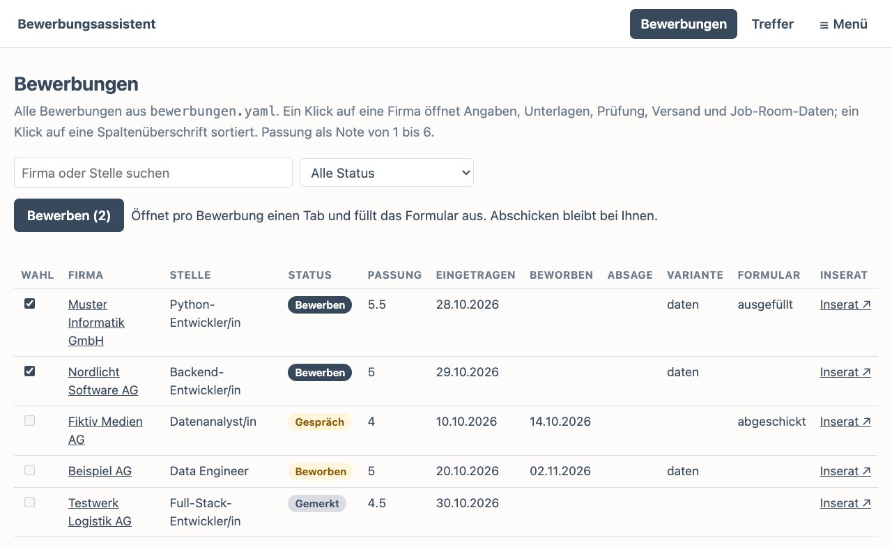
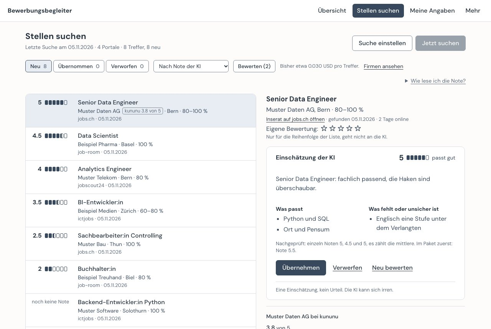
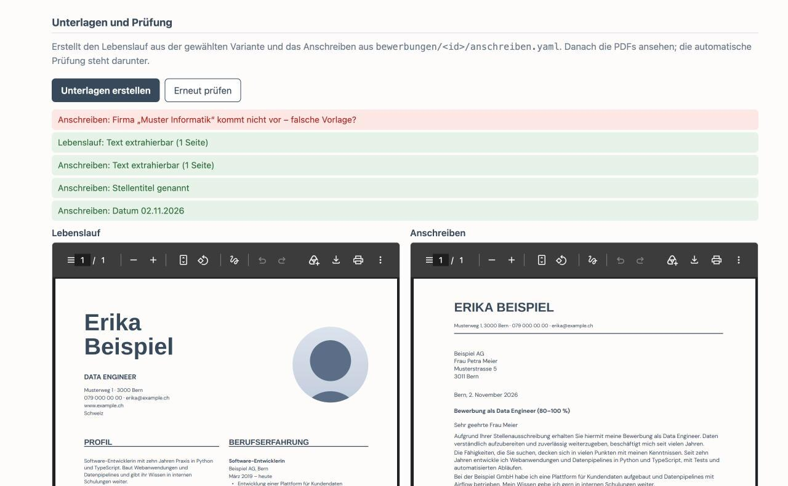
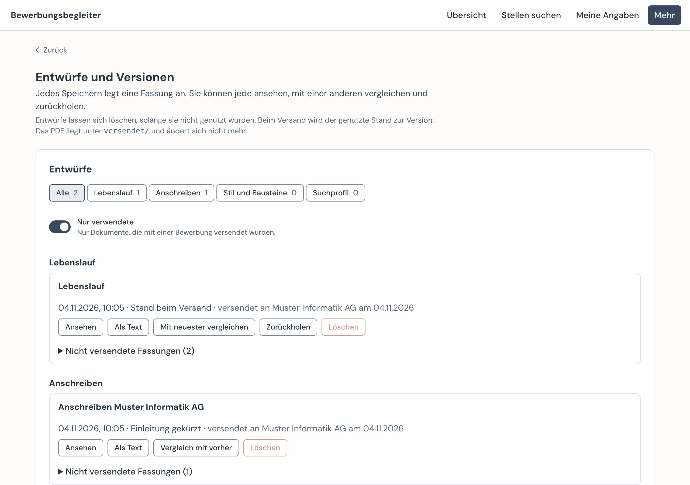
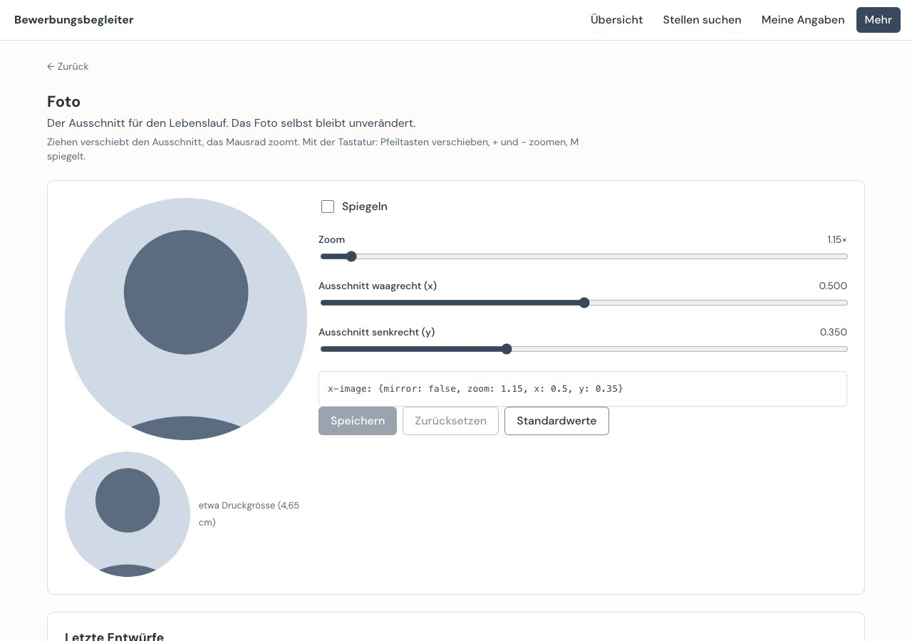
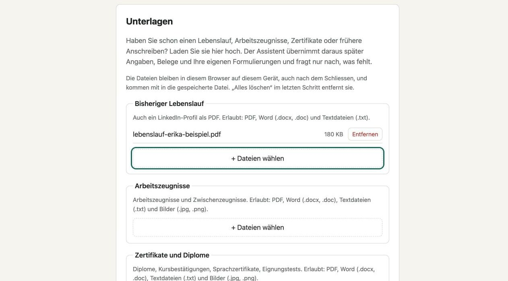

# Bewerbungsassistent

Werkzeuge und Claude-Skills für den ganzen Bewerbungsablauf: passende Stellen finden, Lebenslauf und Anschreiben pro Stelle zuschneiden, vor dem Absenden prüfen und den Versand vorbereiten. Ausgelegt auf den Schweizer Stellenmarkt (job-room.ch, jobs.ch, LinkedIn).

## Wozu: weniger, dafür passende Bewerbungen

Der Assistent nimmt Routinearbeit ab, damit mehr Zeit für das bleibt, was eine gute Bewerbung ausmacht: die richtige Stelle wählen, sich mit der Firma befassen und zeigen, was man mitbringt. Er arbeitet nach diesen Grundsätzen:

- **Passung vor Menge.** Die Suche filtert nach einem persönlichen Suchprofil (Richtung, Region, Pensum, Ausschlüsse) und gleicht gegen bisherige Bewerbungen ab. So landen nur Stellen auf der Liste, die wirklich passen, und keine Firma bekommt dieselbe Bewerbung zweimal.
- **Zugeschnitten auf die Stelle.** Jede Anforderung des Inserats wird geprüft: abgedeckt, fehlt oder überdehnt. Der Lebenslauf zeigt die Erfahrung, die für diese Stelle zählt, das Anschreiben bezieht sich auf genau diese Firma und bleibt bei einer Seite.
- **Im eigenen Stil.** Das Anschreiben folgt dem Tonfall der Person, abgeleitet aus ihren bisherigen Anschreiben, und bleibt dabei professionell und passend zu Branche und Firma.
- **Eigenes Design.** Inhalt und Gestaltung sind getrennt. Wer will, gestaltet Lebenslauf und Anschreiben mit einem eigenen Template (Farben, Schriften, Aufbau; [Anleitung](lebenslauf/README.md#eigenes-theme)). So sehen die Unterlagen nicht aus wie die von allen anderen.
- **Die Person entscheidet und schickt selbst.** Der Assistent macht Vorschläge und Entwürfe. Freigabe und Versand liegen immer bei der Person; nichts wird automatisch verschickt.
- **Nachvollziehbar.** Jede versendete Fassung wird mit Datum festgehalten. Vor einem Gespräch ist sofort klar, welche Unterlagen die Firma bekommen hat, und Rückfragen lassen sich zuverlässig beantworten.
- **Daten bleiben bei der Person.** Lebenslauf, Foto und Bewerbungsstände liegen lokal im eigenen Datenordner, nicht in diesem Repo und nicht auf einem fremden Server.

**Für Bewerbende** heisst das: weniger Zeit für die Suche nach passenden Stellen, für Formatierung und Verwaltung, mehr für die Auswahl und die Vorbereitung aufs Gespräch. Dazu Unterlagen in einem eigenen Design und ein sauberer Nachweis der Arbeitsbemühungen für den Job-Room.

**Für Arbeitgeber** heisst das: Ausschreibungen werden von passenden Bewerbenden auch dann gefunden, wenn sie weit hinten in den Suchergebnissen stehen. Der Assistent prüft jede gefundene Ausschreibung auf Passung und wird dabei nicht müde. Er ist auf gezielte Auswahl statt Streuung ausgelegt. Die Unterlagen beziehen sich auf die ausgeschriebene Stelle, auf die Anforderungen des Inserats und auf die Firma, und sie sind übersichtlich gestaltet.

## So sieht es aus

Alle Bilder zeigen frei erfundene Beispieldaten.

**Übersicht der Bewerbungen:** Stand, Passung (Note 1–6) und Lebenslauf-Variante jeder Stelle auf einen Blick.



**Treffer der Stellensuche:** Die Browser-Erweiterung sucht auf job-room, jobs.ch, jobscout24 und ictjobs nach dem Suchprofil, bei einem Suchprofil für Lehrstellen auf LENA und yousty. Neue Stellen landen hier, nicht direkt im Register. Die KI bewertet die Passung in Paketen von zehn, nach der Suche von selbst (höchstens 30 pro Suche, abschaltbar) oder auf Knopfdruck. Bei Lehrstellen zählt der eigene Beruf mit Sternen zuerst. Dieselbe Stelle von einem zweiten Portal ist angehängt (+1), und bei einer Firma mit laufender Bewerbung steht ein Hinweis. Inserate von anderen Seiten, etwa LinkedIn, prüft oder speichert die Erweiterung auf Klick.



**Unterlagen und Prüfung:** Lebenslauf und Anschreiben pro Stelle als PDF. Die automatische Prüfung findet hier, dass im Anschreiben noch die Firma einer anderen Bewerbung steht.



**Entwürfe und Versionen:** Jedes Speichern legt einen Entwurf mit Datum an. Was versendet wurde, bleibt erhalten und lässt sich nicht mehr löschen.



**Fotoausschnitt (freiwillig):** Ausschnitt per Maus oder Tastatur einstellen, mit Vorschau in Druckgrösse.



**Einstieg:** eine HTML-Seite, die Schritt für Schritt alles abfragt, was der Assistent braucht. Bestehende Unterlagen lädt man gleich am Anfang hoch; dann übernimmt der Assistent die Angaben daraus. Die Vorlage läuft im Browser und verschickt nichts; in der App steht sie unter „Meine Angaben“ und speichert direkt in den Datenordner. Dort füllt „Aus Unterlagen vorbefüllen“ das Formular aus PDF, Word und Text vor; der Text geht ohne Name, Adresse und Kontaktangaben an die KI, und jeder Vorschlag bleibt markiert, bis er geprüft ist.



## Module

| Ordner | Inhalt |
|---|---|
| [`lebenslauf/`](lebenslauf/README.md) | Lebenslauf und Anschreiben als PDF aus YAML und Typst-Themes, Zuschnitt pro Stelle über Tags, mehrsprachige Inhalte |
| [`bewerbungen/`](bewerbungen/README.md) | Lokale Oberfläche: Bewerbungsregister, Unterlagen erstellen und prüfen, KI-Unterstützung mit Pseudonymisierung, Versand erfassen, Entwürfe und Versionen, Job-Room-Angaben, Fotoausschnitt |
| [`skills/einstieg/`](skills/einstieg/SKILL.md) | Claude-Skill: Einstieg aus bestehenden Unterlagen (Lebenslauf, Zeugnisse, Zertifikate, frühere Anschreiben) und per Interview – Lebenslauf, Suchprofil, Stilprofil mit eigenen Formulierungen und Bausteine, auch für die Lehrstellensuche |
| [`skills/jobsuche/`](skills/jobsuche/SKILL.md) | Claude-Skill: Stellensuche auf job-room.ch, jobs.ch, LinkedIn und Karriereseiten, Eintrag ins Register, optional Jobliste in Google Sheets |
| [`skills/bewerbung/`](skills/bewerbung/SKILL.md) | Claude-Skill: von der Stelle zur fertigen Bewerbung – Variante wählen, Anschreiben im eigenen Stil, Prüfung, Versand |
| [`desktop/`](desktop/README.md) | Lokale App für Windows und macOS: Installer, Start per Doppelklick, Einladungslink, Updates aus GitHub Releases |
| [`erweiterung/`](erweiterung/README.md) | Browser-Erweiterung für Chrome und Edge: Stellensuche auf job-room, jobs.ch, jobscout24 und ictjobs, Lehrstellensuche auf LENA und yousty nach dem Suchprofil, im Browser der Person; Treffer gehen an die App |
| [`vermittlung/`](vermittlung/README.md) | KI-Vermittlung für den Pilot: Zugang pro Person per Einladung, Budgets, Kosten ohne Inhalte; Container hinter HTTPS |
| [`onboarding/`](onboarding/README.md) | Einstiegsvorlage: eine HTML-Datei zum Ausfüllen ohne Installation (Stellen- und Lehrstellensuche), mit Import in den Datenordner |
| [`vorlagen/`](vorlagen/) | Vorlagen für die persönlichen Dateien (Suchprofil, Stilprofil, Bausteine fürs Anschreiben) |

## Eigene Daten

Dieses Repo enthält nur Code, Themes, Skills und erfundene Beispieldaten. Persönliche Daten – Stammdaten des Lebenslaufs, Foto, Suchprofil, Zuschnitte pro Stelle, erzeugte PDFs – liegen in einem separaten privaten Ordner oder Repo daneben und werden per Pfad übergeben:

```
dev/
  bewerbungsassistent/          ← dieses Repo
  bewerbungsassistent-daten/    ← privat: cv.yaml, foto.jpg, suchprofil.md, jobs/, bewerbungen.yaml, …
```

## Schnellstart

```bash
python3 -m venv .venv && . .venv/bin/activate
pip install -r requirements.txt
cd lebenslauf
python build.py data/beispiel.yaml -o build/beispiel.pdf
```

Eigene Fassung:

```bash
python build.py ../../bewerbungsassistent-daten/cv.yaml \
  --job ../../bewerbungsassistent-daten/jobs/ki.yaml \
  --build-dir ../../bewerbungsassistent-daten/.build \
  -o ../../bewerbungsassistent-daten/out/ki.pdf
```

Lokale Oberfläche:

```bash
cd bewerbungen
python app.py ../../bewerbungsassistent-daten
```

## Skills einrichten

`skills/einstieg/`, `skills/jobsuche/` und `skills/bewerbung/` in Claude Code nach `~/.claude/skills/` kopieren oder verlinken; in claude.ai als Skill hochladen. Die persönlichen Dateien im privaten Datenordner (`cv.yaml`, `suchprofil.md`, `anschreiben/stil.md`, `anschreiben/bausteine.md`) erarbeitet der Skill `einstieg` aus bestehenden Unterlagen und im Interview oder die Person selbst mit der Einstiegsvorlage (`onboarding/`); alternativ die Vorlagen aus `vorlagen/` kopieren und ausfüllen. Der Skill braucht Claude in Chrome (Suche im eingeloggten Browser-Tab) und nur für eine optionale Jobliste in Google Sheets den Google-Sheets-Connector.

## Lizenz

[GNU General Public License v3.0](LICENSE). Ohne Gewährleistung und ohne Haftung (Abschnitte 15 und 16 der Lizenz).

Schriften unter `lebenslauf/fonts/`: SIL Open Font License (siehe dort).
