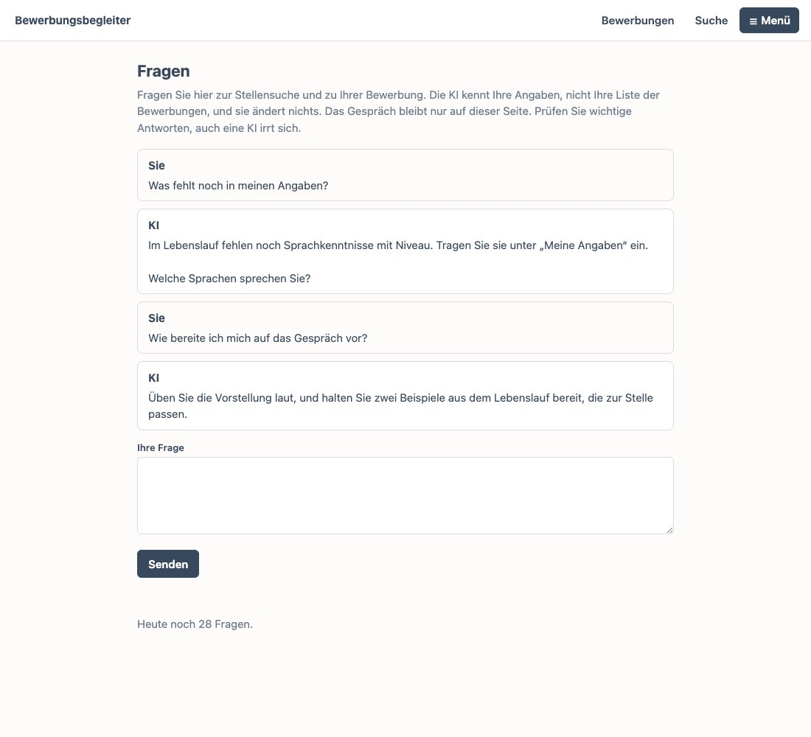

# Bewerbungen

Modul des [Bewerbungsbegleiters](../README.md): Bewerbungen verwalten, Unterlagen erstellen und prüfen, Versand festhalten. Mit lokaler Oberfläche im Browser.

```bash
pip install -r ../requirements.txt
python app.py ../../meine-daten
```

Die Oberfläche läuft nur auf `127.0.0.1` und öffnet sich im Browser:

| Seite | Inhalt |
|---|---|
| Bewerbungen | Alle Bewerbungen mit Status und Daten, Suche, neue Bewerbung anlegen; Spalten per Klick auf die Überschrift sortierbar (Sortierung, Suche, Filter und Scrollposition bleiben beim Seitenwechsel erhalten), mit Passung (Note 1–6), Datum der Erfassung und Link zum Inserat |
| Bewerbung | Angaben ändern (inkl. „beworben am“, „Absage am“), Stellentext, Vorschlag der Lebenslauf-Variante, KI-Unterstützung (Passung bewerten, Anschreiben entwerfen, Inhalt prüfen), Unterlagen erstellen, PDFs ansehen mit automatischer Prüfung, Versand erfassen, Angaben für den Job-Room (Arbeitsbemühungen) zum Kopieren – nur abgeleitet aus den Angaben, eine Absage ergibt immer „Absage“ |
| Inhalte | Lebenslauf, Zuschnitte, Anschreiben, Stilprofil, Bausteine und Suchprofil als PDF ansehen; hinter „Als Text“ bearbeiten (auch Varianten und Register), mit Prüfung und Vorschau; gespeichert wird nur Gültiges (mit Entwurf) |
| Entwürfe & Versionen | Jeder gespeicherte Stand mit Datum: ansehen, vergleichen, wiederherstellen, löschen (solange nicht genutzt); versendete Versionen aus Git |
| Foto | Fotoausschnitt per Maus einstellen (spiegeln, zoomen, verschieben), Vorschau wie im PDF |

## Ablauf

1. **Stelle wählen** – in der Übersicht oder per Skill `jobsuche`; Status „Bewerben“.
2. **Lebenslauf** – bestehende Variante wiederverwenden oder neue erstellen (`varianten.yaml`, Tags zum Wiederfinden).
3. **Anschreiben** – `bewerbungen/<id>/anschreiben.yaml`, Entwurf durch den Skill `bewerbung` aus Bausteinen und Stilprofil. Fehlt es, entwirft „Unterlagen erstellen“ zuerst eines, wenn eine KI eingerichtet ist.
4. **Prüfung** – „Unterlagen erstellen“, PDFs ansehen; formale Prüfung automatisch, inhaltliche durch den Skill.
5. **Versand** – von Hand abschicken, dann „Versand erfassen“: Fassung nach `versendet/` (jede nur einmal), Entwürfe als genutzt markiert, alles in Git eingefroren. Oder in der Übersicht bei „Das steht an“ „Formular öffnen“ (bei mehreren bereiten Bewerbungen „Formulare öffnen“, höchstens 5 pro Durchgang): Die Erweiterung öffnet pro Bewerbung das Formular und füllt es aus, abgeschickt wird durch die Person (siehe `../erweiterung/README.md`); „Abgeschickt? Ja“ im Balken erfasst den Versand.
6. **Bewerbungsdaten** – Status, Gespräch, Absage nachtragen.
7. **RAV** – in der Übersicht bei „Das steht an“ oder beim Hinweis „Bald Monatsende“ auf „Jetzt eintragen“: Die Erweiterung füllt im Job-Room einen Eintrag nach dem anderen aus. Anmelden und „Speichern“ bleiben bei Ihnen, und erst damit geht der Eintrag ans RAV. Danach verschwindet der Schritt „Im Job-Room eintragen“ aus der Liste. Gegen Monatsende erinnert die Übersicht an fehlende Einträge, sobald Sie das einmal genutzt haben. Wer lieber von Hand einträgt, findet die Angaben auf der Seite der Bewerbung und markiert dort „Als eingetragen“. Ausgeblendet ist das, wenn in der Einrichtung „Beim RAV gemeldet: Nein“ gewählt ist (ohne Wahl bei einem Suchprofil für Lehrstellen).

## Datenordner

```
meine-daten/
  cv.yaml, foto.jpg          Stammdaten (Modul lebenslauf)
  jobs/<name>.yaml           Zuschnitte des Lebenslaufs
  varianten.yaml             Lebenslauf-Varianten mit Tags (MIN-307)
  bewerbungen.yaml           Register aller Bewerbungen (MIN-306)
  bewerbungen/<id>/          anschreiben.yaml, stelle.md, erstellte PDFs (nicht in Git)
  bewerbungen/<id>/an-formular/  was das offene Formular bekommen hat (nicht in Git)
  bewerbungen/<id>/zum-hochladen/  Dateien der Bewerbung zum Hochladen von Hand, bis zum Versand (nicht in Git)
  versendet/                 versendete Fassungen, jede nur einmal (in Git)
  anschreiben/               bausteine.md, stil.md (persönlich)
  dokumente/                 Originale: zeugnisse/, zertifikate/, anschreiben-bisher/, lebenslauf-bisher/, lebenslauf.pdf (nicht in Git)
  .entwuerfe/                Entwürfe (nicht in Git)
  .ki/nutzung.jsonl          KI-Nutzung: Aufgabe, Modell, Tokens, Kosten, ersetzte Felder – nie Inhalte (nicht in Git)
```

`app.py` ergänzt die `.gitignore` des Datenordners um `.entwuerfe/`, `.build/`, `bewerbungen/*/*.pdf`, `bewerbungen/*/*.zip`, `bewerbungen/*/an-formular/`, `bewerbungen/*/zum-hochladen/`, `dokumente/` und `.ki/`.

### Eigene Dateien (MIN-346)

Wer fertige Unterlagen hat, legt sie auf der Seite „Meine Dateien“ ab und verwendet sie unverändert:

- **Lebenslauf:** ein PDF, gespeichert als `dokumente/lebenslauf.pdf`. Es gilt für jede Bewerbung ohne gewählte Variante und ersetzt dort den gebauten Lebenslauf, ohne „Unterlagen erstellen“. Eine gewählte Variante geht vor.
- **Zertifikate und Zeugnisse:** PDF, JPG oder PNG, in denselben Ordnern wie die Unterlagen aus „Meine Angaben“. Zertifikate werden pro Bewerbung gewählt. Wird ein gewähltes Zertifikat ersetzt oder entfernt, gilt das für alle noch nicht versendeten Bewerbungen.
- **Anschreiben:** ein PDF pro Bewerbung, hochgeladen auf der Seite der Bewerbung unter „Eigenes Anschreiben“, gespeichert als `bewerbungen/<id>/eigenes-anschreiben.pdf`. Es gilt anstelle eines Entwurfs aus `anschreiben.yaml`; „Unterlagen erstellen“ baut dann kein Anschreiben, und die KI-Knöpfe „Anschreiben entwerfen“ und „Inhalt prüfen“ lehnen ab, bis die Datei entfernt ist. Auch beim Ausfüllen eines Formulars nutzt die KI den Entwurf dann nicht mehr. Nach dem Versand gilt die Kopie unter `versendet/`, und die Datei lässt sich nicht mehr ersetzen oder entfernen.

Höchstens 15 MB pro Datei. Die App prüft den Inhalt, nicht nur die Endung, und nimmt keine anderen Dateitypen an. Ersetzte und entfernte Dateien bleiben unter „Entwürfe“. Die Dateien gehen nicht an die KI; sie gehen nur beim Ausfüllen eines Formulars an die Seite, die die Person selbst geöffnet hat.

**Formular mit nur einem Upload-Feld:** Passen mehrere Dateien auf ein Feld für nur eine Datei, baut die App ohne KI ein gemeinsames PDF: `Unterlagen_…pdf` aus Anschreiben, Lebenslauf, Zeugnissen und gewählten Zertifikaten, `Nachweise_…pdf` nur aus Zeugnissen und Zertifikaten. Bilder werden dafür zu PDF-Seiten. Geht die Bewerbung raus, hält der Nachweis genau dieses PDF fest.

**Upload-Feld ohne klare Bedeutung:** Ist eine KI verbunden, wählt sie anhand dessen, was die Seite zeigt, eine Dateiart oder „unklar“. Der Inhalt der Dateien geht nie an die KI. Die Datei steht dann blau markiert im Feld und wird im Balken genannt; prüfen bleibt bei der Person. Das braucht weder Stilprofil noch Bausteine; nur Textentwürfe verlangen sie.

**Dateien von Hand hochladen:** Der Browser lässt keine Seite und keine Erweiterung den Datei-Dialog in einen Ordner lenken. Darum legt „Dateien im Ordner zeigen“ (im Balken und auf der Seite der Bewerbung) alle Dateien der Bewerbung unter `bewerbungen/<id>/zum-hochladen/` ab, zeigt den Ordner im Finder oder Explorer und nennt den Pfad zum Kopieren. Der Ordner verschwindet beim Versand.

**Datei ersetzt, während ein Formular offen ist:** Das Formular behält, was es bekommen hat. Die App hebt diese Fassung von Lebenslauf, Anschreiben, Zertifikaten und gemeinsamen PDFs unter `bewerbungen/<id>/an-formular/` auf, bis der Versand erfasst ist oder „Bewerben“ für diese Bewerbung ein neues Formular öffnet. „Abgeschickt? Ja“ im Balken hält genau sie fest und nennt, was inzwischen neuer ist. Eine Datei, die das Formular nicht von der App bekommen hat, wird in der aktuellen Fassung festgehalten, denn die App sieht nicht, was die Person selbst hochlädt. „Versand erfassen“ auf der Seite der Bewerbung hält die aktuelle Fassung fest, etwa für einen Versand per E-Mail, und bietet bei einem Unterschied ein Häkchen für die Fassung des Formulars an. Lädt die Person das Formular neu, bekommt es die aktuelle Fassung. Tauscht sie die Datei im Formular von Hand, sieht die App das nicht; dann hält „Abgeschickt? Ja“ die frühere Fassung fest.

Die automatische Prüfung meldet bei eigenen Dateien einen Scan ohne Text oder einen Platzhalter nur als Hinweis, denn die Person will die Datei so verwenden. Beim eigenen Anschreiben gilt das auch für zu viele Seiten und eine Firma, die im Text nicht vorkommt. Für eine versendete Bewerbung baut „Unterlagen erstellen“ nichts mehr. Ein PDF, das sich nicht lesen lässt, bleibt ein Fehler und sperrt „Bewerben“. Name, Adresse und Kontakt fürs Formular kommen aus `cv.yaml`; ohne diese Datei bleiben die Felder leer.

### Sicherung (MIN-359)

Im Menü steht **„Sicherung erstellen“**. Der Browser fragt, wo die Datei `bewerbungsassistent-sicherung-<Datum>.zip` hin soll, zum Beispiel auf einen USB-Stick. Die App lädt nichts irgendwohin hoch. Browser ohne diese Frage (Firefox, Safari) laden die Datei herunter; dann bestätigt die Person, dass sie gespeichert ist.

- **Inhalt:** alle Daten mit `.entwuerfe/`, `versendet/`, `dokumente/` und `.ki/`, ohne `.build/` (lässt sich neu erstellen), ohne frühere Sicherungen im Datenordner und ohne `.git/`. Symlinks kommen nicht mit.
- **Erinnerung:** In der Übersicht erscheint ein ruhiger Hinweis nach 5 versendeten Bewerbungen oder nach 30 Tagen ohne Sicherung. Das Datum der letzten Sicherung steht in `.sicherung.yaml`. Als Sicherung zählt erst, was der Browser fertig gespeichert hat oder was die Person nach dem Download bestätigt.
- **Wiederherstellen:** Die ZIP-Datei entpacken und den Ordner in der App unter „Einrichtung“ wählen. Register, Entwürfe und Versionen sind wieder da. Die Git-Geschichte kommt nicht mit; wer sie braucht, sichert `.git/` selbst.

### Entwürfe und Versionen

- **Entwurf**: Jedes Speichern über die Oberfläche legt einen Entwurf mit Datum an (Inhalte nach SHA-256, jeder nur einmal). Änderungen ausserhalb der Oberfläche, etwa durch Claude im Chat, sichert `python entwurf.py <datenordner> <datei> -m "<was>"` (vorher und nachher aufrufen). Entwürfe sind löschbar, solange sie nicht genutzt wurden. Die Editoren (Inhalte, Foto) zeigen unter „Letzte Entwürfe“ die drei neuesten Entwürfe der gerade bearbeiteten Datei, mit Link auf alle.
- **Version**: Genutzt heisst versendet. Das PDF kommt einmal nach `versendet/`, die Daten, aus denen es entstand, bleiben als genutzte Entwürfe erhalten und sind nicht mehr löschbar. Das Register sagt, was wann an wen ging. Die Seite „Entwürfe & Versionen“ listet die Versionen daraus.
- **Git ist freiwillig**: Ohne Git fehlt nichts. Ist Git installiert, kommt jeder Versand zusätzlich als Commit ins lokale Git des Datenordners (nie automatisch gepusht); Fassungen aus der Zeit ohne Git werden beim nächsten Versand mitgenommen. Ein privates GitHub-Repo braucht es nicht.

### Varianten (`varianten.yaml`)

```yaml
- id: ki
  quelle: jobs/ki.yaml            # Zuschnitt, wird gebaut – oder datei: fertig.pdf – oder extern: "Canva, Google Drive"
  beschreibung: Software-Entwickler – KI-Anwendungen und Qualitätssicherung
  tags: [ki, test]                # Profil
  stichworte: [Python, LLM, RAG]  # Begriffe für den Abgleich mit dem Stellentext
```

Bei externen Varianten das PDF selbst als `bewerbungen/<id>/lebenslauf.pdf` ablegen.

### KI-Unterstützung (MIN-334, MIN-338)

Auf der Seite einer Bewerbung: **Passung bewerten** (Note 1–6 mit Begründung, übernehmbar), **Anschreiben entwerfen** (schreibt `anschreiben.yaml`, alter Stand bleibt als Entwurf) und **Inhalt prüfen** (Anforderungen abgedeckt / fehlt / überdehnt, unbelegte Aussagen). Grundlage sind `cv.yaml`, `suchprofil.md`, `anschreiben/stil.md`, `anschreiben/bausteine.md` und der gespeicherte Stellentext.

Auf der Seite **Suche** bewertet die KI in Paketen von zehn Inseraten pro Anfrage (MIN-372):

- **Knöpfe nach Anzahl:** bis 10 offene „Bewerten (N)“, darüber „Nächste 10 bewerten“ und „Alle bewerten (N)“, über 30 „Nächste 30 bewerten“. Ein Lauf lässt sich anhalten, Bewertetes bleibt.
- **Portale:** Auf der Seite „Suche“ wählt die Person unter „Wo suchen Sie?“, wo gesucht wird (`portale_aus` in `suche/einstellungen.yaml`). Mindestens eines bleibt an. Bis zur ersten Wahl gilt das Suchprofil, und ictjobs bleibt aus, wenn kein Begriff zur Informatik passt.
- **Automatik:** Nach einer Suche bei offener Seite werden höchstens 30 neue Treffer von selbst bewertet, die nahen zuerst; abschaltbar auf der Seite (`suche/einstellungen.yaml`).
- **Nachprüfung (MIN-389):** Im Paket schwankt eine Note stärker als einzeln. Hat ein Treffer Note 4 oder besser, bewertet die KI ihn darum dreimal einzeln, und die mittlere Note zählt; die Details nennen alle drei. Das kostet pro gutem Treffer etwa 0.08 USD und dauert etwa zehn Sekunden: Die drei Durchgänge eines Treffers laufen gleichzeitig, die Treffer nacheinander. Geht es nicht, bleibt die Note aus dem Paket, mit Hinweis in den Details. „Passung bewerten“ auf der Seite einer Bewerbung ist ein einzelner Durchgang und kann darum leicht abweichen.
- **Sprachen:** Fehlt eine Muss-Sprache oder liegt sie mehr als eine Stufe unter dem Verlangten, ist die Note höchstens 2. Genau eine Stufe darunter ist ein Haken wie andere auch.
- **Unsichere Noten:** Eine Antwort, die ein Inserat auslässt oder unbrauchbar ist, trifft nur dieses Inserat: Es wird einzeln nochmals versucht. Ist ein Inserat so knapp, dass die Note wenig sagt, steht ein „?“ daneben und in den Details der Grund.
- **Lehrstellen:** Die Note hat einen eigenen Massstab, in den Details stehen Beruf- und Lehrstellennote. Die Person gibt ihren Berufen 1 bis 5 Sterne; sie sortieren zuerst, ändern die Note nicht und gehen nicht an die KI.
- **Ohne Region (MIN-380):** Ohne Kantone, Orte und PLZ im Suchprofil sucht jedes Portal in der ganzen Schweiz, nach den Abfragen am Wohnort. Unbewertete Treffer am Wohnort oder im selben Postleitzahlgebiet (erste zwei Ziffern) stehen zuerst; Entfernungen kennt die App nicht. Hinweise auf der Seite „Suche“ führen direkt zum Feld in „Meine Angaben“.
- **Was suchen? (MIN-375):** Wer noch nicht weiss, wonach suchen, lässt das Feld im Einstieg leer und schreibt auf der Seite „Suche“ ein paar Stichworte zu Interessen und Fähigkeiten; beides ist nötig. Das Sprachmodell schlägt bei der Lehrstellensuche Berufe mit EFZ oder EBA vor, bei der Stellensuche Suchbegriffe wie „Sachbearbeitung Administration“, mit Begründung, Alltag und dem, worauf man in der Schnupperlehre oder im Inserat achten kann. Was die Person ausschliesst, schlägt die App nicht vor. Die Angaben werden nicht gespeichert. „In die Suche aufnehmen“ schreibt den Eintrag ins Suchprofil. Darüber steht, wonach gesucht wird; „Entfernen“ nimmt einen Eintrag wieder heraus. Wer später unter „Meine Angaben“ die Dateien ersetzt, behält diese Einträge; die Seite nennt sie.
- **Schnupperlehren (MIN-373):** Auf der Seite „Suche“ wählt die Person Lehrstellen, Schnupperlehren oder beides; die Wahl steht im Suchprofil unter „Gesucht“. Eine Schnupperlehre ist ein eigener Treffer, auch beim selben Betrieb wie eine Lehrstelle, und lässt sich in der Liste filtern. Ins Register kommt sie als „Schnupperlehre <Beruf>“ mit `art: Schnupperlehre`; der KI-Entwurf schreibt dann eine kurze Anfrage statt eines Motivationsschreibens.

- **Pseudonymisierung**: Jede Anfrage läuft durch `ai/gateway.py`. Name, Kontaktdaten, Adresse, Geburtsdatum, Profile, Referenzen und Ansprechpersonen werden durch Platzhalter wie `{{NAME}}` ersetzt (auch in anderen Schreibweisen: Telefon mit +41, Links ohne https, Daten als 1. Mai 2011) und in der Antwort zurückgesetzt. E-Mail-Adressen, Telefonnummern und Personen nach „Frau“/„Herr“ im Inserat werden ebenfalls ersetzt; andere Namen im Inserat bitte unter „Kontaktperson“ eintragen. Bleibt danach eine E-Mail-Adresse, Telefonnummer oder ein bekannter Wert übrig, wird nichts gesendet. Bilder und Scans gehen nie an die KI.
- **Inserate sind Daten**: Zeilen, die sich an eine KI richten, befolgt sie nicht; die Oberfläche zeigt sie als „verdächtige Zeile“.
- **Verbindung**: im Pilot über die [Vermittlung](../vermittlung/README.md) (`BEWERBUNGSASSISTENT_KI_URL`). Die Person gibt einmal ihren Einladungscode ein; die App löst ihn ein und legt den Zugang im Schlüsselbund des Systems ab (oder `BEWERBUNGSASSISTENT_KI_ZUGANG`). Die Seite zeigt dann Verbrauch und Budget des Monats. Zum Entwickeln direkt mit `ANTHROPIC_API_KEY`. Ohne Verbindung bleiben die Knöpfe aus und die Seite sagt, was fehlt.
- **Eigener Schlüssel** (Seite „Erweiterte Einstellungen“): Wer einen eigenen Schlüssel für die Claude API hat, trägt ihn dort ein. Er liegt nur im Schlüsselbund des Systems und geht vor der Vermittlung; die Kosten trägt die Person selbst. Schritt für Schritt in der [Anleitung](../docs/installation.md#eigener-api-schlüssel-freiwillig).
- **Eigenes Claude-Abo** (gleiche Seite, nur in der App): Claude arbeitet mit den Skills und schreibt über eine lokale Verbindung in die App. Die KI-Knöpfe laufen damit nicht. Siehe [`docs/eigenes-abo.md`](../docs/eigenes-abo.md).
- **Weitere Seiten durchsuchen** (nur mit eigenem Schlüssel): bis zu fünf Adressen, so wie sie im Browser stehen. Die Erweiterung öffnet sie bei jeder Suche im Tab und nutzt das Suchfeld der Seite, wenn sie eines findet (nur Formulare mit GET auf derselben Seite; die Platzhalter `{begriff}` und `{ort}` funktionieren weiterhin). Die KI liest Seitentext und Linktexte und nennt die Stellen. Sie bekommt weder Adressen noch Lebenslauf. Pro Seite gelten die erste Ergebnisseite, höchstens 10 Suchen und 30 Inserate. Anmeldungen und Prüfungen wie CAPTCHAs bleiben bei der Person: Die Seite wird dann übersprungen und in der Zusammenfassung genannt.
- **Kosten**: `.ki/nutzung.jsonl` hält pro Anfrage Modell, Tokens und Kosten fest; die Seite zeigt die Summe des Monats.

### Fragen an die KI (MIN-376)

**Vorerst ausgeschaltet.** Einschalten: in der App-Datei `einstellungen.json` im Ordner der App `"fragen_seite": true` setzen und die App neu starten; beim Start aus dem Repo `app.py --fragen`. Ohne das gibt es weder Seite noch Schnittstelle noch Menüeintrag.

Dann steht im Menü **„Fragen“**: ein Gespräch mit der KI zu Stellensuche, Lehrstellensuche, Berufswahl, Bewerbung, Lebenslauf, Anschreiben, Vorstellungsgespräch und zur Bedienung der App. Fehlt in den Angaben etwas für eine gute Antwort, fragt sie danach und sagt, wo es eingetragen wird.



- **Was die KI sieht:** Lebenslauf, Suchprofil, Stilprofil und Bausteine, wie bei den anderen Aufgaben, und das laufende Gespräch. Namen und Adressen sind ersetzt. Das Register und alles zum RAV gehen nicht mit.
- **Was sie kann:** nur antworten. Sie ändert nichts und schickt nichts ab.
- **Thema:** Die Eingrenzung steht in den Anweisungen an die KI. Sie ist keine harte Sperre, begrenzt aber, wofür die Fragen taugen.
- **Kosten:** günstiges Modell, kurze Antworten, 30 Fragen pro Tag; mit der Vermittlung zählt zusätzlich ihr Monatsbudget. Das Protokoll `.ki/nutzung.jsonl` hält Tokens und Kosten fest, nie den Text.
- **Verlauf:** Das Gespräch bleibt nur auf der Seite. Beim Verlassen ist es weg.

## Kommandozeile

```bash
python register.py importiere jobliste.csv ../../meine-daten     # CSV-Export der Google-Sheet-Jobliste übernehmen
python register.py exportiere ../../meine-daten > jobliste.csv   # zurück ins Format der Jobliste
python varianten.py vorschlag ../../meine-daten --stelle ../../meine-daten/bewerbungen/<id>/stelle.md
python varianten.py liste ../../meine-daten --tag ki
```

## Tests

```bash
pip install -r ../requirements-dev.txt
python -m pytest
```
