# Bewerbungsassistent: Beschreibung für das Design

Grundlage für die Neugestaltung in Claude Design (MIN-369). Alle Namen, Firmen und Dokumente in den Bildern sind erfunden. Der Code liegt öffentlich unter `minigraphx/bewerbungsassistent`, die Seiten unter `bewerbungen/seiten/`.

## 1. Der Auftrag

Gestalte die ganze Oberfläche neu: Abläufe, Navigation, Seitenaufbau, Gestaltung, Texte und die kleinen Fenster. Der heutige Stand ist funktional gewachsen, Seite um Seite. Er soll sich anfühlen wie ein ruhiger, verlässlicher Begleiter durch eine belastende Lebensphase, nicht wie ein Verwaltungswerkzeug.

Die wichtigste Frage auf jeder Seite: **Was ist mein nächster Schritt?** Heute muss man das selbst herausfinden.

Liefere bitte:

1. **Abläufe und Navigation:** neue Struktur der App, was wo liegt, wie man von Schritt zu Schritt kommt.
2. **Gestaltungssystem:** Farben, Schrift, Abstände, Bausteine (Knöpfe, Felder, Tabellen, Hinweise, Fortschritt, Dialoge), hell und dunkel.
3. **Alle Seiten aus Abschnitt 7** mit ihren Zuständen, bei 1280 und 760 Pixel Breite.
4. **Die Oberflächen der Browser-Erweiterung** aus Abschnitt 8.
5. **Texte:** alle sichtbaren Texte in beiden Anredeformen, wo sie abweichen.

Die Umsetzung übernimmt danach Claude im bestehenden Code. Darum zählt Abschnitt 4.

## 2. Wer es benutzt

| Gruppe | Situation | Was es für die Gestaltung heisst |
|---|---|---|
| **Stellensuchende**, oft beim RAV gemeldet | Unter Druck, teils lange auf Suche, Rückschläge. Unterschiedlich geübt am Computer. | Ruhig, ermutigend, ohne Fachwörter. Nachweise fürs RAV dürfen nicht vergessen gehen. |
| **Lehrstellensuchende**, etwa 14 bis 16 Jahre, oft mit Eltern | Erste Bewerbungen. Vergleichen Berufe, nicht nur Stellen, und machen Schnupperlehren. | Du-Form, einfache Sprache, ein Elternteil schaut mit. |

Der Pilot läuft mit 5 bis 10 Stellensuchenden und 2 Lehrstellensuchenden auf macOS und Windows, in Chrome oder Edge. Eine Bewerbung nebenbei auf dem Handy gibt es nicht; die App läuft auf dem Computer.

## 3. Was nicht verhandelbar ist

- **Das Tool füllt aus, die Person entscheidet und schickt ab.** Abschicken, Einwilligungen, Anmeldungen und CAPTCHAs bleiben immer bei der Person. Das muss sichtbar bleiben.
- **Die Daten bleiben auf dem Computer.** An die KI gehen nur Texte, in denen Name, Adresse und Kontakte ersetzt sind. Bilder, Scans, eigene PDFs und alles zum RAV gehen nie an die KI. Das soll Vertrauen schaffen, ohne Angst zu machen.
- **Die KI schätzt ein und kann sich irren.** Eine Note ist eine Einschätzung, ein Entwurf ist ein Entwurf. Aussagen im Anschreiben müssen belegt sein, Lücken werden offen benannt.
- **Nichts geht verloren.** Jedes Speichern legt einen Entwurf an, der sich zurückholen lässt. Das macht mutiges Ausprobieren möglich und darf spürbar sein.
- **Kosten bleiben sichtbar**, ohne im Vordergrund zu stehen. Im Pilot trägt sie die Begleitperson; mit eigenem Schlüssel die Person selbst.
- **Schweizer Schreibweise:** ss statt ß, Noten wie 4.5, Daten wie 05.11.2026. Bei Stellen Sie-Form, bei Lehrstellen Du-Form.
- **Schweizer Notenskala:** 6 ist die beste, 1 die schlechteste Note. Halbe Noten sind möglich. Ausländische Lesende verstehen das nicht von selbst, darum braucht es eine knappe Erklärung.

## 4. Technische Grenzen

- Die App läuft als lokaler Server (nur 127.0.0.1) und erscheint als **normaler Tab im Browser**. Sie hat keine eigene Fensterleiste.
- Seiten sind **einfaches HTML, CSS und JavaScript ohne Framework und ohne Build**. Wiederverwendbare Bausteine müssen sich so umsetzen lassen.
- **Strenge CSP:** keine Inline-Skripte, keine Inhalte von fremden Servern, also auch keine Schriften oder Icons von einem CDN. Schriften und Icons liegen als Dateien in der App. Heute nennt die CSS „DM Sans“, liefert sie aber nicht mit; auf den meisten Rechnern erscheint darum die Systemschrift.
- **PDFs zeigt der Browser selbst** im eingebetteten Betrachter. Dessen Leiste lässt sich nicht gestalten.
- **Datei-Dialoge gehören dem Browser.** Die App kann sie nicht öffnen und nicht in einen Ordner lenken.
- **Erweiterung:** Die Formularleiste liegt auf fremden Webseiten, isoliert in einem Shadow DOM. Sie darf die Seite nicht verdecken und nichts absenden. Das Popup ist 320 Pixel breit und schliesst sich, sobald man daneben klickt.
- **Lange Wartezeiten:** Eine KI-Antwort dauert 10 bis 60 Sekunden, ein Suchlauf mehrere Minuten. Es gibt Fortschritt in Schritten, aber keine genaue Restzeit.
- **Hell und dunkel** folgen der Systemeinstellung. Zugänglichkeit mindestens WCAG 2.1 AA, alles auch mit Tastatur bedienbar.

## 5. Heutige Gestaltung

Zwei Erscheinungsbilder stehen nebeneinander:

| | App (`seiten/stil.css`) | Meine Angaben und Einstiegsvorlage (`onboarding/src/style.css`) |
|---|---|---|
| Hintergrund | gebrochenes Weiss `#fdfcfa` | warmes Grau |
| Akzent | Schieferblau `#38495d` | Grün |
| Knöpfe | eckig mit kleinem Radius | runde Pillen |
| Links | Text mit Unterstrich | teils Browser-Blau |

Das eine soll es künftig nur noch einmal geben. Die Farben sind nicht gesetzt. Die Marke hat bisher nur ihren Schriftzug, ein Logo gibt es nicht. Vorhanden sind Hinweisfarben: Hinweis `#8a5a00` auf `#fff4dc`, Fehler `#b3261e` auf `#fde7e5`, Erfolg `#2e6b3a` auf `#e6f2e8`.

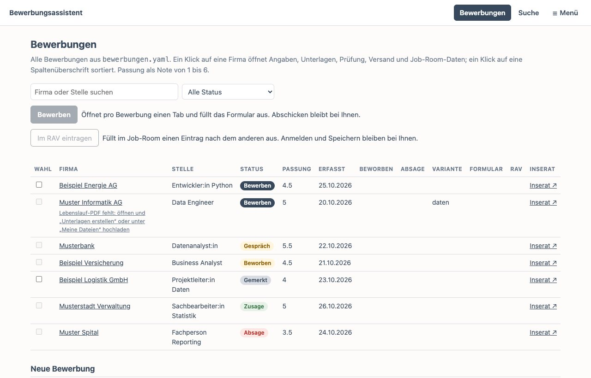

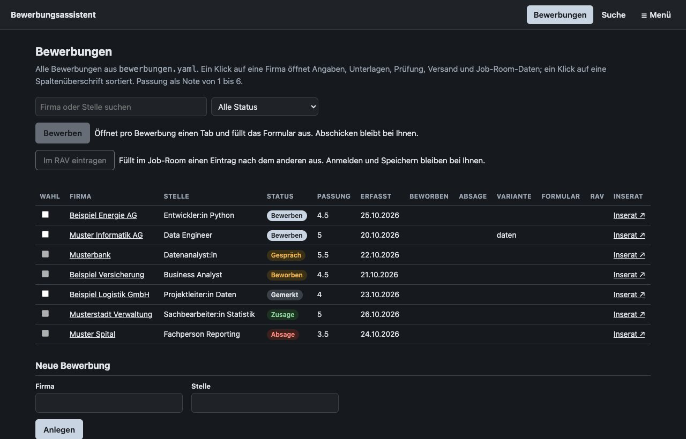

## 6. Der ganze Weg

So geht eine Person heute durch die App. Die Reihenfolge ist nirgends sichtbar; sie steht nur in der Anleitung.

1. **Installieren und einrichten:** Datenordner wählen, Einladungscode einlösen, Browser-Erweiterung laden.
2. **Angaben erfassen:** Lebenslauf, Suche, Stärken, Lücken, Ton, entweder im Assistenten oder aus hochgeladenen Unterlagen. Am Schluss „Übernehmen“. Alternativ eigene PDFs unter „Meine Dateien“.
3. **Suchen:** Die Erweiterung läuft durch die Portale. Treffer erscheinen in der App.
4. **Bewerten:** Die KI gibt jedem Treffer eine Note. Treffer ab Note 4 werden dreimal einzeln nachgeprüft.
5. **Auswählen:** „Übernehmen“ legt eine Bewerbung an, „Verwerfen“ blendet den Treffer aus.
6. **Unterlagen:** Lebenslauf-Variante wählen, Anschreiben entwerfen lassen und lesen, PDFs erstellen, Prüfung ansehen, Zertifikate wählen.
7. **Bewerben:** Die App öffnet das Formular der Firma im Browser, die Erweiterung füllt es aus. Unklares bleibt markiert. Die Person prüft und schickt ab.
8. **Festhalten:** Die Erweiterung fragt „Abgeschickt?“, die App legt die Fassung ab. Bei Bewerbungen per E-Mail: „Versand erfassen“.
9. **RAV:** Stellensuchende tragen den Monat im Job-Room ein. Die App hilft beim Ausfüllen und erinnert gegen Monatsende.
10. **Weiter:** Gespräch oder Absage eintragen, weitersuchen. Der Stand einer Bewerbung ist heute nur ein Statusfeld: Gemerkt, Bewerben, Beworben, Gespräch, Absage, Zusage, Verworfen, Zurückgezogen.

Für Claude mit dem eigenen Abo gibt es einen zweiten Weg: Claude sucht, bewertet und schreibt über eine lokale Verbindung in die App. Abschicken und RAV bleiben auch dort bei der Person.

## 7. Seite für Seite

Navigation heute: oben der Schriftzug, „Bewerbungen“, „Suche“ und ein Menü mit Meine Angaben, Meine Dateien, Fragen, Einrichtung, Inhalte, Entwürfe & Versionen, Foto, Erweiterte Einstellungen, Sicherung erstellen und der Version. In der installierten App kommt „Beenden“ dazu. Der Alltag und das Seltene stehen dort ohne Ordnung beisammen.

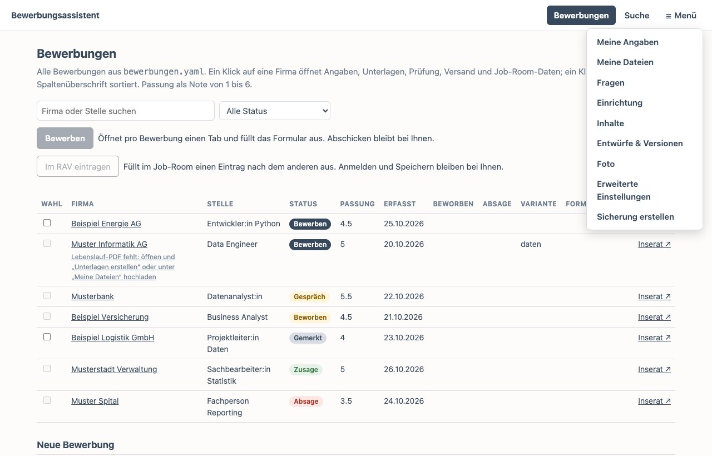

### Bewerbungen (Startseite)

**Zweck:** alle Bewerbungen und ihr Stand.

**Inhalt:** Suche und Statusfilter, Tabelle mit Wahl, Firma, Stelle, Status, Passung, Erfasst, Beworben, Absage, Variante, Formular, RAV und Inserat. Hinweise direkt in der Zeile, etwa „Lebenslauf-PDF fehlt“. Knöpfe „Bewerben“ (öffnet pro gewählter Bewerbung einen Tab) und „Im RAV eintragen“. Unten das Formular „Neue Bewerbung“.

**Zustände:** noch keine Angaben (Hinweis mit Link), keine Bewerbungen, Filter ohne Treffer, Erinnerung ans RAV gegen Monatsende, Rückfrage „Doppelbewerbung?“, wenn bei derselben Firma schon eine Bewerbung läuft, mit „Trotzdem öffnen“ und „Abbrechen“.

**Probleme:** zwölf Spalten, bei schmalem Fenster läuft die Tabelle aus dem Bild. Wahlfelder sind je nach Status inaktiv, ohne dass man den Grund sieht. Die Knöpfe stehen deaktiviert oben, bevor man etwas gewählt hat. Es fehlt jeder Hinweis, was als Nächstes dran ist.

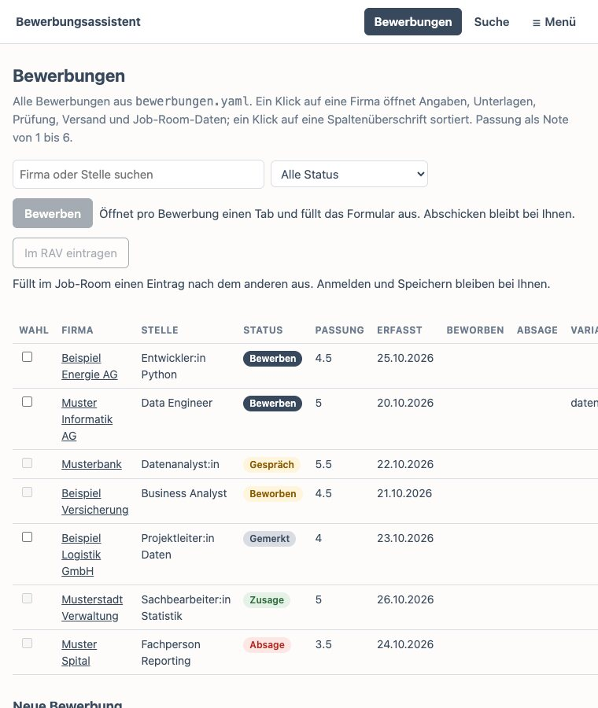

### Suche

**Zweck:** Stellen finden, einschätzen und übernehmen.

**Inhalt:** Knopf „Stellen suchen“, Portale wählen („Wo suchen Sie?“), letzte Suche, Filter, Bewertungsknöpfe mit Kosten, zwei Schalter (im sichtbaren Tab suchen, automatisch bewerten), die eigenen Suchbegriffe, Vorschläge der KI („Welche Stellen passen zu Ihnen?“), Tabelle mit Note, Stelle, Firma, Ort, Pensum, Portal, Gefunden und je drei Knöpfen. Ein Klick auf den Titel klappt die Details auf: Zusammenfassung, Nachprüfung, Passt, Haken, auffällige Zeilen, Inserat.

**Zustände:** Erweiterung fehlt, Suche läuft pro Portal, Bewertung läuft mit „3 von 10“ und „Anhalten“, Note unsicher („?“), keine Treffer, Portal hat einen Fehler gemeldet, Firma ist schon im Register. Filter Neu, Übernommen, Verworfen.

**Probleme:** Die eigentliche Liste beginnt erst weit unten. „Übernehmen“ ist in jeder Zeile der Hauptknopf, auch bei Note 2. Die Note als nackte Zahl sagt wenig, und die Begründung liegt verborgen. Noten erscheinen hier als 4,5 und anderswo als 4.5. Die Zeilen springen bei jedem Aufklappen.

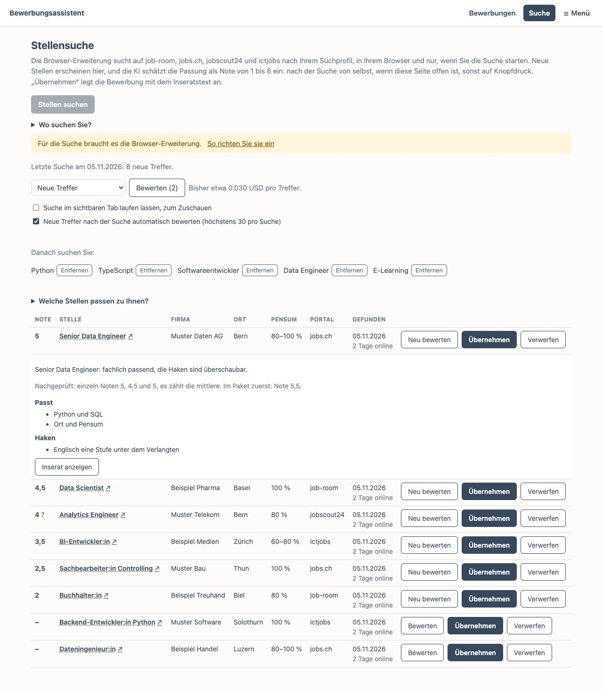

**Lehrstellen:** dieselbe Seite in Du-Form, mit „Was suchst du?“ (Lehrstellen, Schnupperlehren, beides), „Deine Berufe“ mit Sternen, Lehrbeginn statt Pensum, zwei Noten (Beruf und Lehrstelle), Marke „Schnupperlehre“. Die Portale sind LENA und yousty. Die Sterne ordnen die Liste, ändern die Note aber nicht.

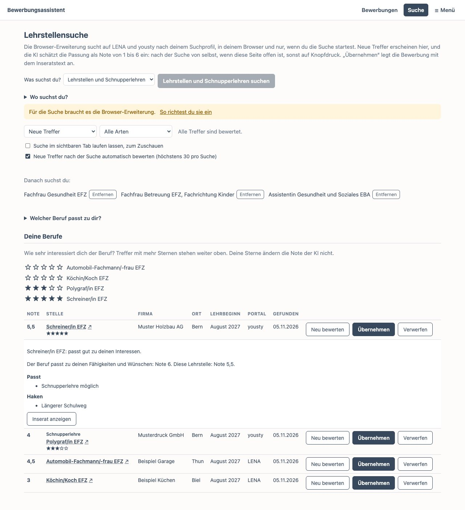

### Bewerbung

**Zweck:** eine Bewerbung vom Inserat bis zum Versand. Die wichtigste und schwierigste Seite.

**Inhalt, von oben nach unten:** 22 Angaben (Firma, Stelle, Firmen-Schlüssel, Ort, Pensum, Vermittler, Portal, zwei Links, Status, Variante, Passung, fünf Daten, Adresse, Kontaktperson, Kontakt, RAV-Zuweisung, Notiz), Stellentext, KI-Unterstützung (Passung bewerten, Anschreiben entwerfen, Inhalt prüfen), Unterlagen und Prüfung mit zwei PDF-Betrachtern, Eigenes Anschreiben, Zertifikate, Versand, Dateien von Hand hochladen, Job-Room mit Kopierknöpfen.

**Zustände:**

- **KI-Ergebnis:** Note mit „Note übernehmen“, Passt, Haken, neue Lücken, Modell und Kosten. Beim Entwurf Aussagen mit Belegen. Bei der Prüfung Anforderungen als abgedeckt, fehlt oder überdehnt.
- **Keine KI:** Knöpfe aus, Hinweis oder Einladungscode.
- **Eigenes Anschreiben oder eigener Lebenslauf gilt:** Entwurf und Teile der KI gelten dann nicht.
- **Lebenslauf:** keine Variante, Varianten vorhanden (Wahl nötig), Vorschlag der KI.
- **Prüfung:** Fehler rot, Hinweis gelb, in Ordnung grün.
- **Nach dem Versand:** Fassung ist fest, Seite zeigt die Versandangaben.
- **Formular:** geöffnet, ausgefüllt, abgeschickt.

**Probleme:** fast 4000 Pixel lang, acht gleichrangige Abschnitte, und der nächste Schritt ist nicht erkennbar. Die Angaben stehen ganz oben, obwohl man sie selten ändert, die Arbeit beginnt erst darunter. Meldungen erscheinen oft ausserhalb des sichtbaren Bereichs. Texte nennen Technik wie `bewerbungen/<id>/anschreiben.yaml`, `versendet/` und Git. Der „Firmen-Schlüssel“ sagt niemandem etwas.

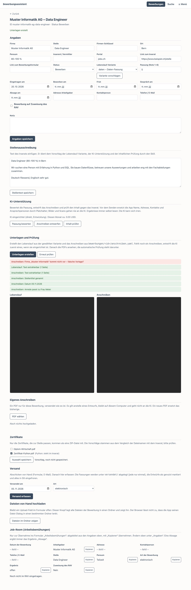

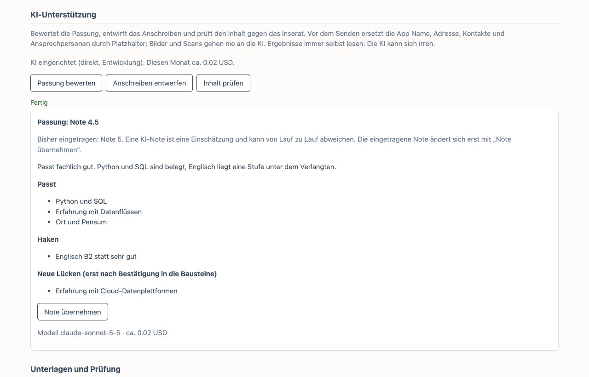

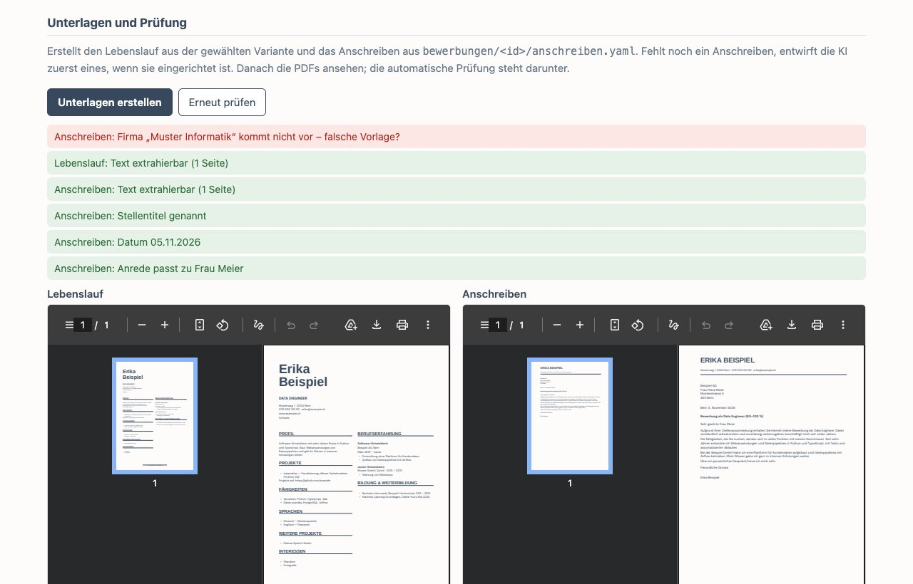

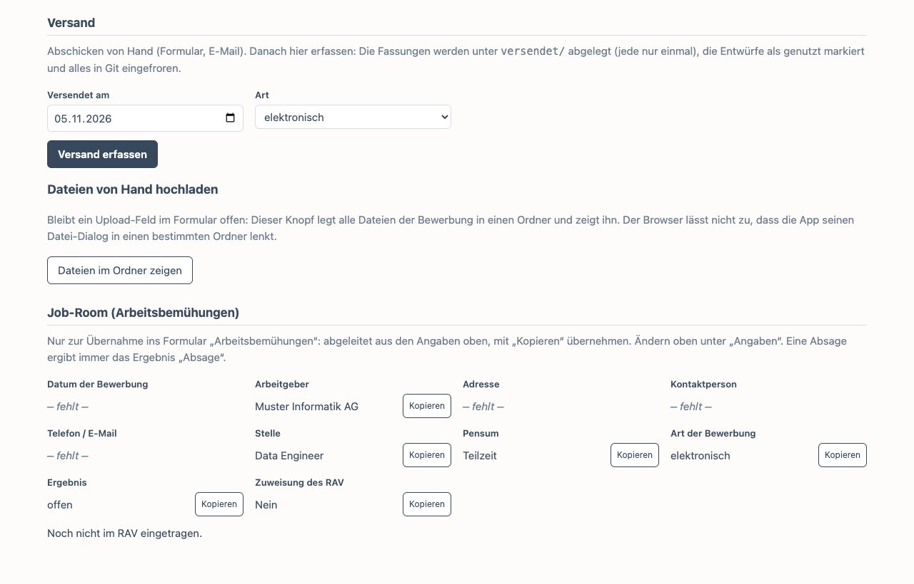

### Meine Angaben

**Zweck:** alles erfassen, was der Assistent braucht. Zwei Zweige, Stelle oder Lehrstelle.

**Inhalt:** Schritte als Reiter: Start, Unterlagen, Person und Kontakt, Kurzprofil, Berufliche Stationen, Ausbildung, Kurse und Zertifikate, Sprachen, Kenntnisse, Hobbys, Suche, Stärken mit Beispiel, Lücken, Ton und Stil, Rahmen, Übernehmen. Mit „Aus Unterlagen vorbefüllen“ liest die KI hochgeladene Dokumente, die Person prüft das Ergebnis.

**Probleme:** eigenes Erscheinungsbild, 16 Reiter wirken erdrückend, wiederholt besuchte Teile sind schwer zu finden. Dieselbe Oberfläche gibt es als einzelne Datei, die man ohne App ausfüllen kann (`onboarding/dist/einstieg.html`); sie muss auch künftig ohne Server laufen.

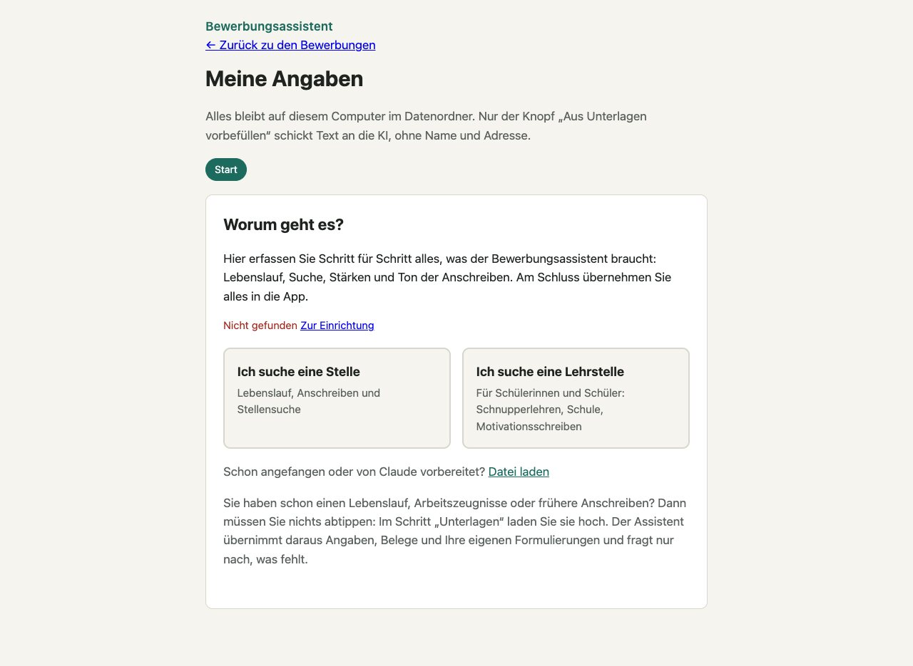

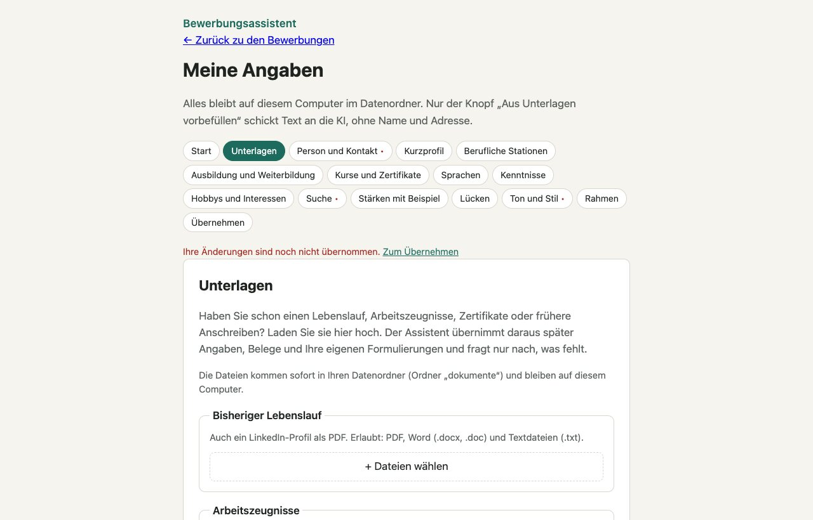

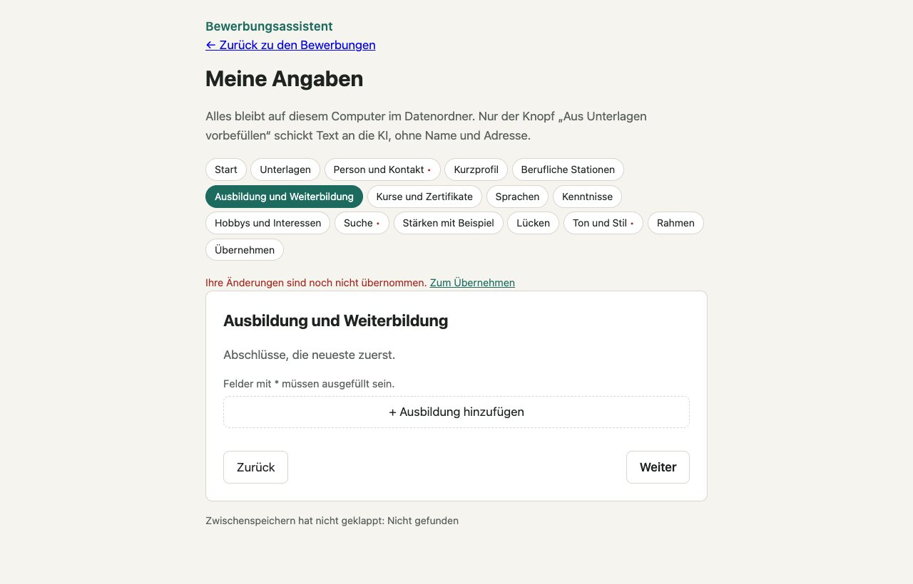

### Meine Dateien

**Zweck:** fertige Unterlagen hochladen und so verwenden, wie sie sind: Lebenslauf, Zertifikate und Diplome, Zeugnisse.

**Probleme:** Es ist unklar, wie das mit den Angaben und den erstellten Unterlagen zusammenhängt. Es gilt: gewählte Variante vor eigenem PDF vor gebautem Lebenslauf. Die Person sieht diese Regel nur als Satz.

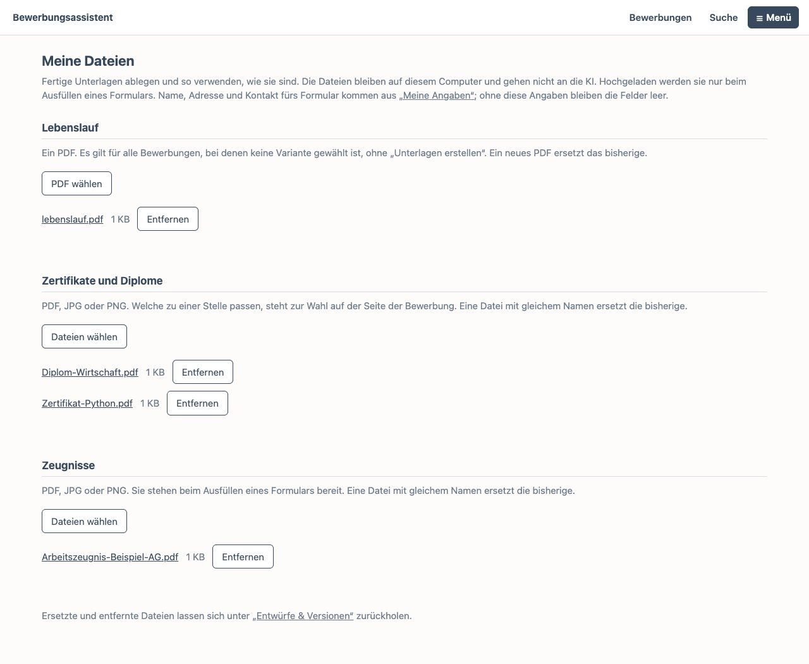

### Einrichtung

**Zweck:** vier Schritte beim ersten Start: Datenordner, Einstiegsvorlage importieren, KI mit Einladungscode, Browser-Erweiterung von Hand laden.

**Zustände:** Ordner fehlt, Import mit Ergebnis, Einladung eingelöst, Erweiterung erkannt („Sobald die Erweiterung geladen ist, steht das hier von selbst“), danach „Fertig“.

**Probleme:** Es ist eine lange Seite statt geführter Schritte. Das Laden im Entwicklermodus wirkt abschreckend; später kommt die Erweiterung aus dem Store. Offene Fragen stehen in MIN-378: Reihenfolge von Einladungscode und Schlüssel, Überspringen ohne KI, Hinweis auf die Erweiterung, abgebrochenes Update.

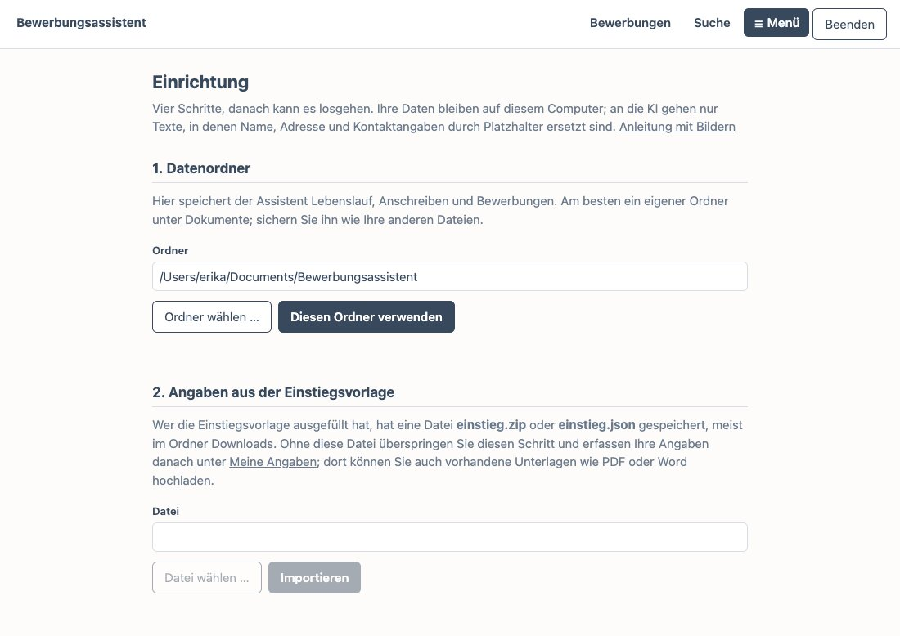

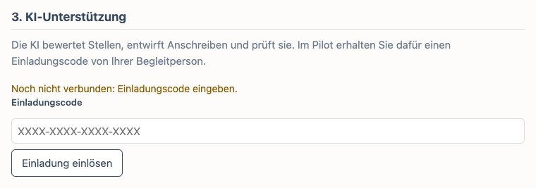

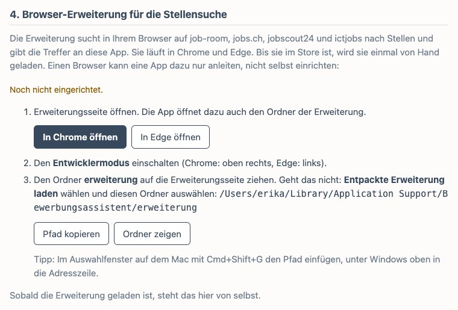

### Inhalte

**Zweck:** Lebenslauf, Zuschnitte, Anschreiben, Stilprofil, Bausteine und Suchprofil als PDF ansehen, mit „Als Text“ direkt bearbeiten.

**Probleme:** Das ist ein Werkzeug für Geübte; der Text ist teils YAML. Dateinamen statt Begriffe. Vielleicht gehört es unter „Meine Angaben“ oder hinter eine Stufe „für Geübte“.

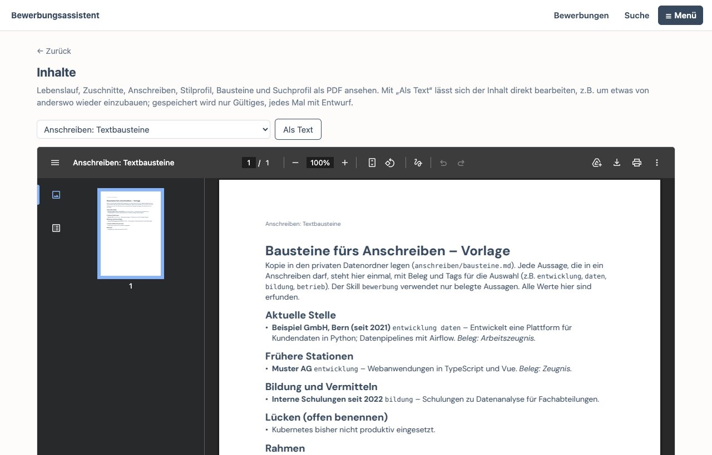

### Entwürfe und Versionen

**Zweck:** alles Gespeicherte ansehen, vergleichen, wiederherstellen, löschen; versendete Fassungen ansehen.

**Probleme:** eine Tabelle aus Dateinamen und Zeiten. Hier sollte die Frage „Wie sah mein Anschreiben gestern aus?“ leicht zu beantworten sein.

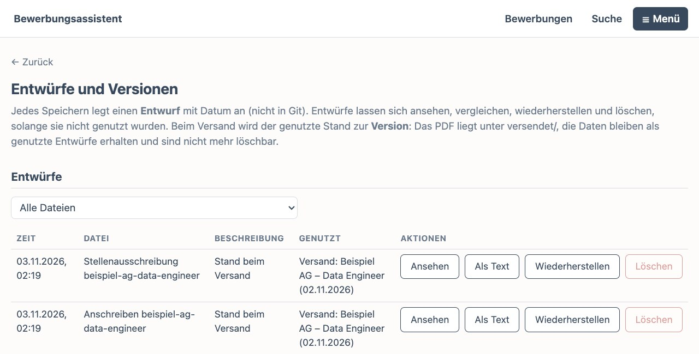

### Foto

**Zweck:** Ausschnitt des Fotos für den Lebenslauf: ziehen, zoomen, spiegeln, Vorschau in Druckgrösse. Foto ist freiwillig.

**Probleme:** eine eigene Hauptseite für etwas Seltenes. Schieberegler heissen „x“ und „y“, und rohe YAML-Werte sind sichtbar.

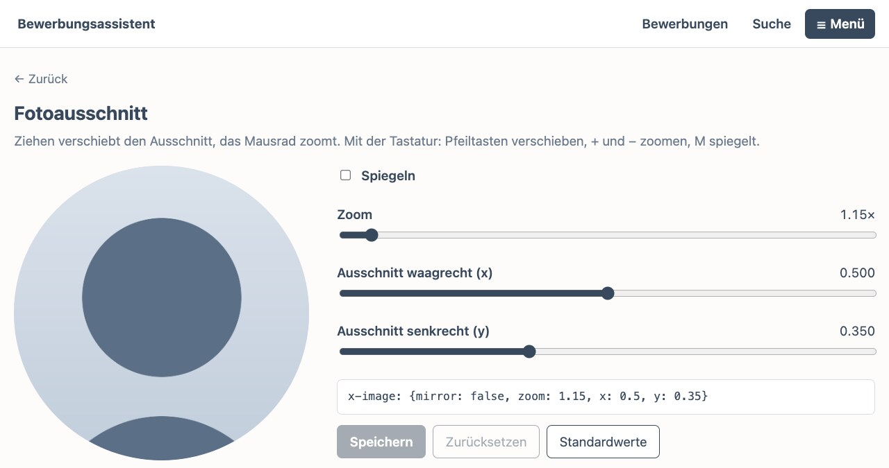

### Fragen

**Zweck:** Gespräch mit der KI zur Stellensuche, mit Beispielfragen und Tageslimit. Ist standardmässig ausgeschaltet; ob und wie es bleibt, ist offen. Bitte als möglichen Baustein mitdenken, nicht als gesetzt.

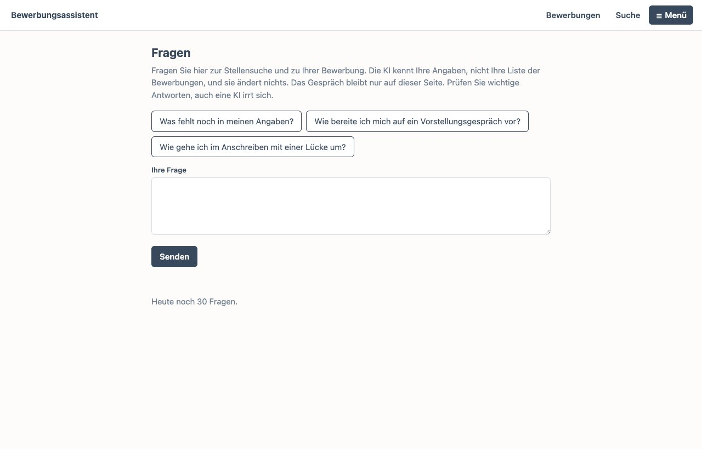

### Erweiterte Einstellungen

**Zweck:** eigener API-Schlüssel mit Warnhinweisen, weitere Seiten durchsuchen, Claude mit dem eigenen Abo verbinden, Kosten der KI.

**Probleme:** Drei unterschiedlich heikle Themen auf einer langen Seite. Viele werden sie nie brauchen, aber die Warnhinweise müssen gelesen werden.

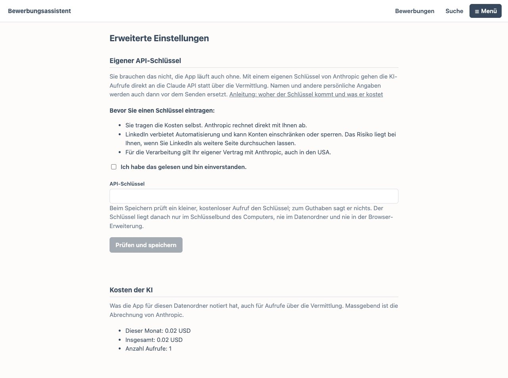

## 8. Browser-Erweiterung

- **Popup:** Verbindung zur App, „Suche starten“, Fortschritt pro Portal, und für die offene Seite „Stelle prüfen“ und „Stelle speichern“ mit Note. Mit „Treffer in der App ansehen“ geht es zurück.
- **Formularleiste:** am unteren Rand des fremden Formulars. Zeigt „10 Felder ausgefüllt, 3 offen, 1 Einwilligung bitte selbst prüfen. Abschicken bleibt bei Ihnen.“, eine Legende, „Abgeschickt? Ja“, „Nicht mehr ausfüllen“ und einen Knopf, der den Balken nach oben oder unten setzt. Je nach Lage auch „Hier ausfüllen“ und „Dateien im Ordner zeigen“; während der Suche „Suche abbrechen“.
- **Markierte Felder im Formular:** grün ausgefüllt, orange offen, rot selbst bestätigen, blau Entwurf der KI. Die Farben dürfen nicht das einzige Merkmal sein.
- **Job-Room:** dieselbe Leiste beim Eintragen der Arbeitsbemühungen, ein Eintrag nach dem anderen, mit „Zum Formular“ und „Eingetragen? Ja“. Speichern und Anmelden macht die Person.
- **Erlaubnis-Seite:** bittet um Zugriff auf eine weitere Seite (`erlauben.html`).

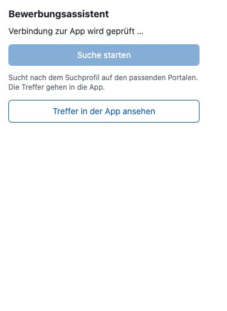

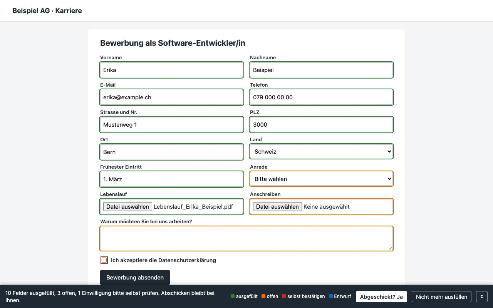

## 9. Kleine Fenster und Muster

Heute gibt es keine Dialoge. Das sind die Muster, die neu gedacht werden sollen:

- **Bestätigung im Knopf:** Der Knopf wechselt beim ersten Klick seinen Text, ein zweiter Klick führt aus. Heute bei „Wirklich beenden?“, „Wirklich erfassen? Nochmals klicken“, „Wirklich entfernen?“, „Wirklich löschen?“, „Datei überschreiben?“ und „Vorhandenes Anschreiben ersetzen? Nochmals klicken“.
- **Statuszeile:** Eine Zeile Text unter einem Knopf, je nach Stufe grün, gelb oder rot. Liegt oft ausserhalb des sichtbaren Bereichs.
- **Banner:** Für fehlende Angaben, fehlende Erweiterung, neue Version mit „Jetzt aktualisieren“, Erinnerung an die Sicherung.
- **Warten:** Text wie „KI bewertet: 3 von 10 …“, mit „Anhalten“ nur bei Läufen. Einzelne KI-Aufrufe sperren ihre Knöpfe.
- **Kopieren:** Pfade und Job-Room-Angaben mit eigenem Knopf.
- **Details:** klappen in der Tabelle auf; eine Seitenleiste gibt es nicht.

## 10. Was am meisten stört

1. Der nächste Schritt ist nirgends sichtbar, weder in der App noch auf der Bewerbung.
2. Die Seite „Bewerbung“ ist zu lang und ohne Gewichtung.
3. Technik in Texten: Dateinamen, YAML, Git, „Skill“, ID.
4. Zwei Erscheinungsbilder.
5. Das Menü mischt Tägliches mit Seltenem.
6. Lange Hilfetexte oben auf jeder Seite, die niemand zweimal liest.
7. Meldungen erscheinen weit weg vom Geschehen.
8. Noten sind unerklärt und uneinheitlich geschrieben, die Begründung ist versteckt.
9. Zu viele gleich laute Knöpfe, vor allem in der Trefferliste.
10. Schmale Fenster: Tabellen laufen aus dem Bild.
11. Warten fühlt sich unbestimmt an.

## 11. Ton der Texte

- Kurz, konkret, in ganzen Sätzen. Sagen, was geschieht und was die Person tun kann.
- Keine Fachwörter ohne Not: Datenordner ja, YAML und Pseudonymisierung nein.
- Fehler nennen den Ausweg. Beispiel heute: „Die KI ist gerade ausgelastet. Bitte in 30 Sekunden nochmals versuchen.“
- Ermutigen ohne zu beschönigen, besonders bei Absagen und schlechten Noten.
- Knöpfe nennen die Handlung: „Unterlagen erstellen“, nicht „OK“.
- Du-Form bei Lehrstellen, Sie-Form bei Stellen. Neutrale Wörter vermeiden doppelte Texte.

## 12. Fragen, zu denen ich Vorschläge möchte

- Soll die Startseite eine Tabelle bleiben, oder wird sie zu einer Übersicht „Das steht an“?
- Soll die Bewerbung in Schritte oder Reiter zerfallen, und wie zeigt sie ihren Stand?
- Wie lässt sich die Trefferliste schnell durchgehen, zum Beispiel mit einer Detailspalte?
- Wie unterscheiden sich Stelle und Lehrstelle sichtbar, ohne zwei Apps zu werden?
- Wie wird eine Note verständlich, ohne mehr Platz zu brauchen?
- Welche Bereiche gehören hinter eine Stufe „für Geübte“?

## 13. Bilder

Die Bilder zeigen den Stand vom 5.11.2026 mit erfundenen Daten. Die meisten entstanden in einer Testumgebung: Dort erscheinen Hinweise wie „KI eingerichtet (direkt, Entwicklung)“ oder „Für die Suche braucht es die Browser-Erweiterung“, und in „Meine Angaben“ steht „Nicht gefunden“. Das gehört nicht zur normalen Ansicht. Im Bild „Bewerbung, ganze Seite“ bleiben die PDF-Betrachter leer; das Bild „Unterlagen und Prüfung“ zeigt sie gefüllt. Die neue Gestaltung darf frei von alldem abweichen.
