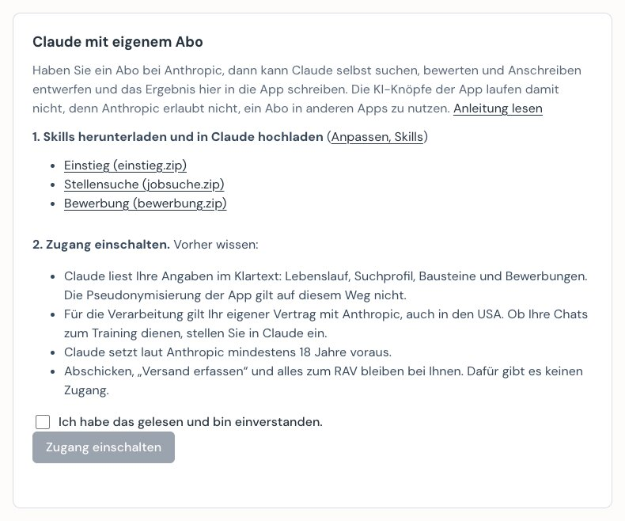

# Mit dem eigenen Claude-Abo arbeiten

Wer ein Abo bei Anthropic hat, kann den Bewerbungsbegleiter mit Claude nutzen, ohne Einladung und ohne API-Schlüssel. Claude sucht, bewertet und entwirft; die App hält Register, Unterlagen und Entwürfe.

## So funktioniert es

Sie arbeiten in Claude, angemeldet mit Ihrem eigenen Konto. Claude schreibt über eine lokale Verbindung in die App auf Ihrem Computer.

Die KI-Knöpfe in der App (zum Beispiel „Bewerten“ oder „Entwurf erstellen“) laufen damit **nicht**. Anthropic [erlaubt nicht](https://code.claude.com/docs/en/legal-and-compliance), dass andere Apps Anfragen über die Zugangsdaten eines Abos schicken. Für diese Knöpfe braucht es eine Einladung oder einen [eigenen API-Schlüssel](installation.md#eigener-api-schlüssel-freiwillig). Die Aufgaben selbst erledigt auf diesem Weg Claude.

## Was Sie wissen sollten

- **Klartext:** Claude liest Lebenslauf, Suchprofil, Bausteine und Bewerbungen im Klartext. Die Pseudonymisierung der App gilt auf diesem Weg nicht. Dateien unter „Meine Dateien“ und ein hochgeladenes Anschreiben erreicht die Verbindung zur App nicht.
- **Ihr Vertrag:** Es gilt Ihr eigener Vertrag mit Anthropic, auch in den USA. Ob Ihre Chats zum Training dienen, stellen Sie in Claude unter den Einstellungen zum Datenschutz ein.
- **Alter:** Claude setzt laut den [Bedingungen von Anthropic](https://www.anthropic.com/legal/consumer-terms) mindestens 18 Jahre voraus. Für jüngere Lehrstellensuchende passt dieser Weg nicht; sie nutzen die App mit Einladung.
- **Kosten und Grenzen:** Die Nutzung zählt auf die Grenzen Ihres Abos. Eine Suche über mehrere Portale braucht viel davon.
- **Portale:** Claude liest die Portale in Ihrem Browser. LinkedIn liest Claude nicht, denn LinkedIn verbietet Automatisierung und kann Konten einschränken. Dort öffnen Sie das Inserat selbst und klicken in der Erweiterung des Bewerbungsbegleiters auf „Stelle speichern“.

Abschicken, „Versand erfassen“, Anmeldungen und alles zum RAV bleiben bei Ihnen. Dafür hat die Verbindung zur App keine Werkzeuge. Ist eine Bewerbung verschickt, ändert Claude dort nur noch die Notiz, denn der Nachweis für das RAV stützt sich auf diese Angaben.

**Links:** „Bewerben“ öffnet den Link einer Bewerbung und füllt dort Ihre Angaben ein. Darum übernimmt die App einen Link von Claude nur für die Portale der Suche, LinkedIn und Seiten, die Sie unter „Weitere Seiten durchsuchen“ eingetragen haben. Bei anderen Seiten steht die Adresse in der Notiz. Stimmt sie, tragen Sie sie bei der Bewerbung selbst unter „Link zum Inserat“ ein. Speichern Sie ein Inserat selbst mit „Stelle speichern“, ist der Link immer dabei.

**App offen lassen:** Die App kann offen bleiben, während Claude arbeitet. Was Claude schreibt, erscheint nach wenigen Sekunden von selbst. Was Sie gerade eintippen, bleibt stehen, und beim Speichern ändert die App nur die Felder, die Sie geändert haben.

**Claude in Chrome:** Die Grenzen oben gelten für die Verbindung zur App. Claude in Chrome bedient den Browser und ist daran nicht gebunden: Es könnte auch in der App klicken, zum Beispiel auf „Versand erfassen“. Die Skills weisen Claude an, die Seiten der App nicht zu bedienen. Das ist eine Anweisung, keine technische Sperre. Ziehen Sie den Tab der App darum nicht in die [Tab-Gruppe von Claude](https://support.claude.com/en/articles/12012173-get-started-with-claude-in-chrome), starten Sie Claude in Chrome nicht in diesem Tab, und lehnen Sie ab, falls Claude dort etwas tun will. Wer jede Aktion selbst freigeben will, stellt das in den [Berechtigungen von Claude in Chrome](https://support.claude.com/en/articles/12902446-claude-in-chrome-permissions-guide) ein.

**Zurück:** Änderungen an Ihren Texten und am Register sichert die App als Entwurf; unter „Entwürfe“ kommen Sie zurück. Nicht dabei sind die Trefferliste auf der Seite „Suche“ und neu gebaute PDFs, die sich aus den Texten wieder bauen lassen.

## Einrichten

Sie brauchen ein bezahltes Abo, weil [Claude in Chrome](https://support.claude.com/en/articles/12012173-get-started-with-claude-in-chrome) nur damit läuft.

1. **App laden und starten**, wie in der [Installation](installation.md) beschrieben. Die Einladung können Sie überspringen. Die [Browser-Erweiterung des Bewerbungsbegleiters](installation.md#schritt-4-browser-erweiterung) brauchen Sie, um Inserate von LinkedIn und anderen Seiten einzulesen.
2. **Skills hochladen:** In der App unter Menü, „Erweiterte Einstellungen“, Abschnitt „Mit dem eigenen Claude-Abo arbeiten“, laden Sie `einstieg.zip`, `jobsuche.zip` und `bewerbung.zip` herunter. In Claude: [Anpassen, Skills, „+“, Skill hochladen](https://support.claude.com/en/articles/12512180-use-skills-in-claude). Einmal pro Datei; entpacken ist nicht nötig.
3. **Zugang einschalten:** Im selben Abschnitt. Hinweise lesen, Häkchen setzen, „Zugang einschalten“.

   

4. **Claude mit der App verbinden:** „In Claude Desktop eintragen“ klicken und Claude Desktop einmal ganz beenden und neu öffnen. Die App ändert nur ihren eigenen Eintrag und legt die alte Datei daneben. Claude Code statt Desktop: Der Befehl steht unter „Claude Code oder von Hand eintragen“. Claude Code liest Skills aus dem Ordner `~/.claude/skills/`; entpacken Sie die drei ZIP-Dateien dort.
5. **Browser verbinden:** In Chrome die Erweiterung [Claude in Chrome](https://claude.com/claude-in-chrome) installieren und anmelden. In Claude Desktop unter Einstellungen, Anpassen, Connectors den Eintrag „Claude in Chrome“ einschalten. In Claude Code: `claude --chrome`.

## Beispiel: von der Suche zur Bewerbung

Beispiel mit erfundenen Angaben: Erika Beispiel sucht eine Stelle als Köchin in der Region Bern.

**Angaben erfassen.** Entweder in der App unter „Meine Angaben“, oder in Claude:

> Richte mich im Bewerbungsbegleiter ein. Ich suche eine Stelle als Köchin in der Region Bern. Hier ist mein alter Lebenslauf.

Claude fragt nach, was fehlt, und speichert Lebenslauf, Suchprofil, Stil und Bausteine in der App. Claude fragt bei jedem Werkzeug um Erlaubnis. Das können Sie pro Werkzeug dauerhaft erlauben.

**Suchen.**

> Suche neue Stellen nach meinem Suchprofil und bewerte sie.

Claude holt in der App den Suchplan, liest die gewählten Portale in Chrome, gibt die Inserate an die App und bewertet sie. Die Treffer stehen danach in der App unter „Suche“, mit Note und Begründung. Kommt ein Portal mit einer Anmeldung oder einem CAPTCHA, ist das Ihre Aufgabe.

**Inserat einlesen.** Für LinkedIn und jede andere Seite: Inserat selbst öffnen, auf das Symbol der Erweiterung klicken, Stelle und Firma prüfen und **Stelle speichern** klicken. Das braucht keine KI. Die Stelle steht danach in der App unter „Bewerbungen“, und Claude findet sie dort:

> Bewerte die Stelle bei der Muster AG, die ich gerade gespeichert habe.

**Bewerben.**

> Bewirb mich auf die Stelle bei der Muster AG: Variante wählen, Anschreiben entwerfen, Unterlagen erstellen und prüfen.

Claude übernimmt die Stelle ins Register, schlägt eine Lebenslauf-Variante vor, schreibt das Anschreiben und baut die PDFs. Sie lesen die PDFs in der App auf der Seite der Bewerbung, schicken selbst ab und klicken danach „Versand erfassen“.

## Häufige Fehler

| Meldung oder Beobachtung | Was hilft |
|---|---|
| „Der Zugang für Claude ist ausgeschaltet.“ | In der App unter „Erweiterte Einstellungen“ einschalten. |
| Claude kennt die Werkzeuge `bewerbungsassistent` nicht | Claude Desktop ganz beenden und neu öffnen. Unter Connectors nachsehen, ob der Eintrag erscheint. |
| „Die Einstellungen von Claude Desktop lassen sich nicht lesen.“ | Die Datei selbst ergänzen. Text und Pfad stehen unter „Claude Code oder von Hand eintragen“. |
| „Die App startet nicht.“ | App von Hand öffnen und nochmals versuchen. |
| Die App wurde verschoben | In den erweiterten Einstellungen „Eintrag in Claude Desktop erneuern“ klicken. |
| `save_job` meldet `link_gespeichert: false` | Die Adresse steht in der Notiz der Bewerbung. Prüfen und selbst unter „Link zum Inserat“ eintragen. |
| „Bewerten“ in der App oder „Stelle prüfen“ in der Erweiterung meldet, die KI sei nicht eingerichtet | Auf diesem Weg bewertet Claude: „Bewerte die neuen Treffer in der App.“ In der Erweiterung nehmen Sie „Stelle speichern“. |

## Wieder ausschalten

„Zugang ausschalten“ sperrt alle Werkzeuge sofort. „Aus Claude Desktop entfernen“ löscht den Eintrag. Die Skills entfernen Sie in Claude unter Anpassen, Skills.
