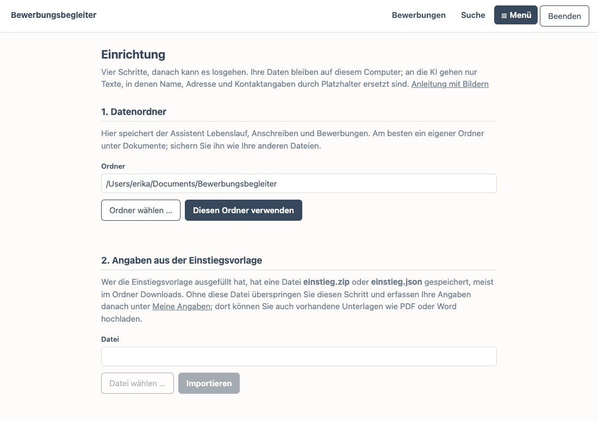
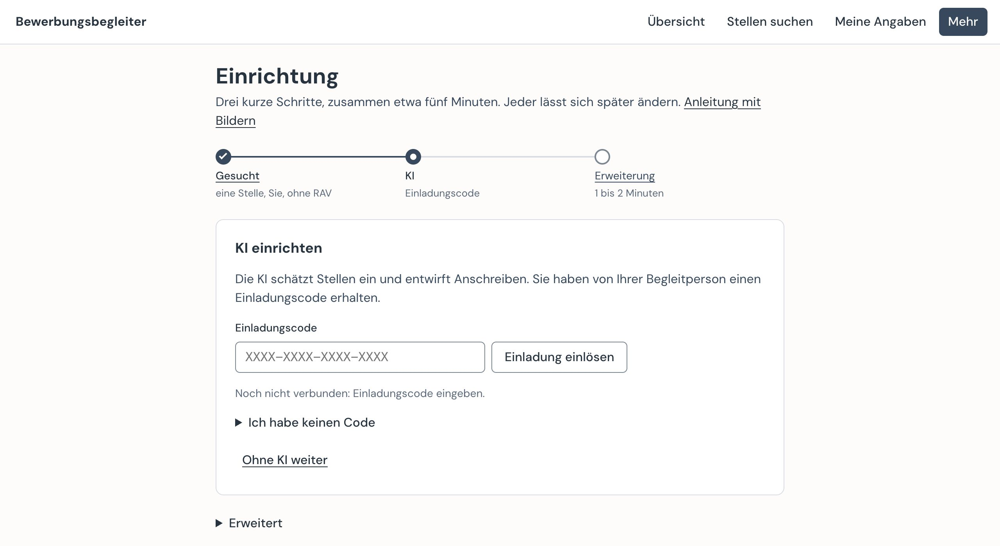
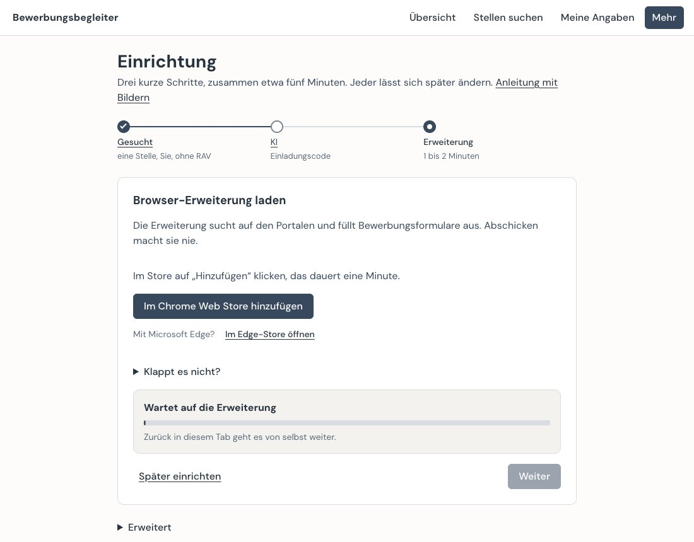
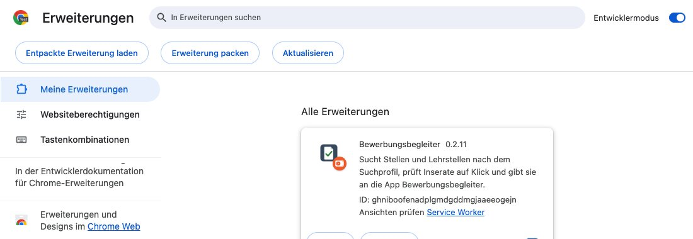
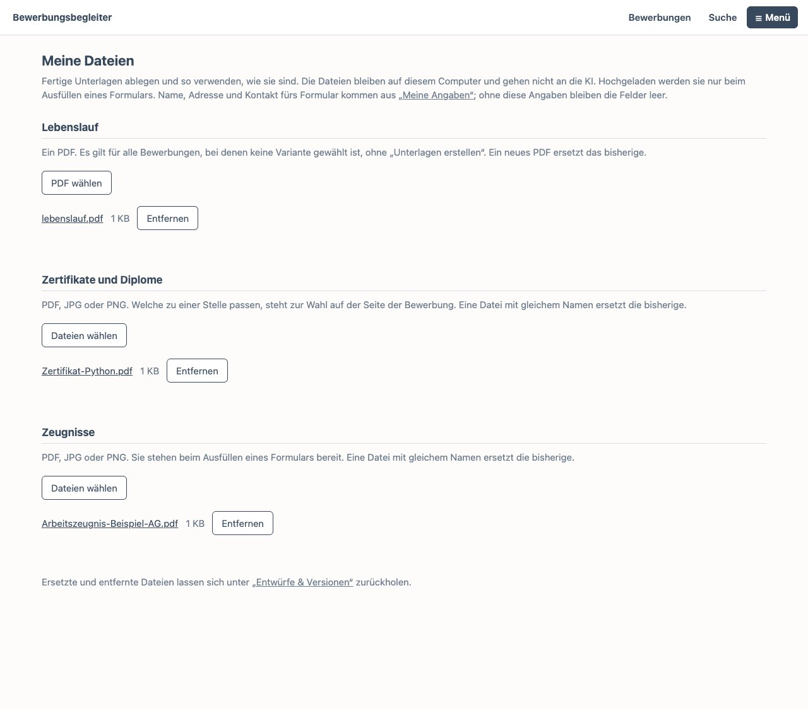
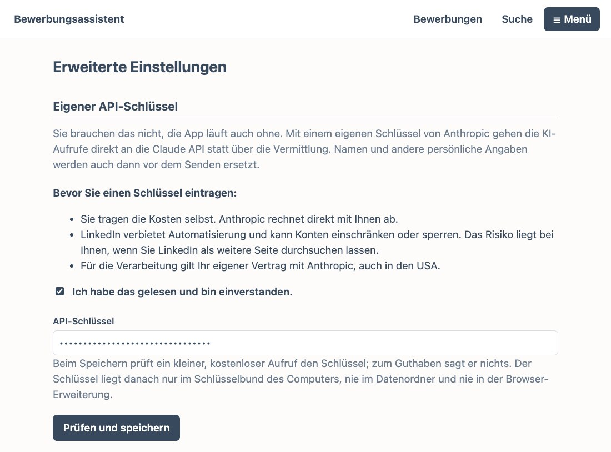
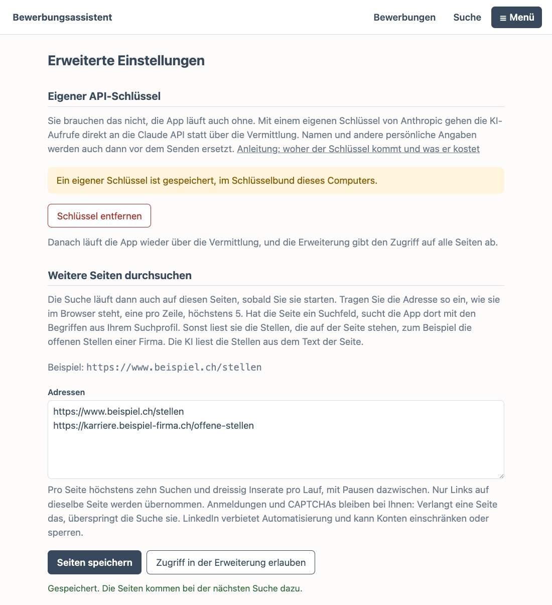

# Anleitung

Der Bewerbungsbegleiter ist eine App für Ihren Computer. Die App sucht auf Schweizer Stellenportalen nach Stellen, die zu Ihnen passen, und schätzt jede ein. Für die Stellen, die Sie wählen, bereitet sie Lebenslauf und Anschreiben als Entwurf vor und füllt das Bewerbungsformular der Firma aus. Bei jeder Bewerbung zeigt sie den nächsten Schritt, und sie hilft beim Nachweis fürs RAV.

Was zählt, bleibt bei Ihnen: Sie wählen die Stellen, passen das Anschreiben an die Firma an, geben es frei und schicken die Bewerbung selbst ab. Die Zeit, die Sie bei Suche und Formatierung sparen, gehört Ihrer Bewerbung.

Ihre Unterlagen liegen auf Ihrem Computer, nicht auf einem fremden Server.

Du suchst eine Lehrstelle? Die App richten deine Eltern oder deine Begleitperson ein. Was bei dir anders ist, steht unter [Für Lehrstellen](#für-lehrstellen).

**Springen zu**

- [Einmal einrichten](#einmal-einrichten)
  - [Was Sie brauchen](#was-sie-brauchen)
  - [App installieren](#app-installieren)
  - [App einrichten](#app-einrichten)
  - [Browser-Erweiterung hinzufügen](#browser-erweiterung-hinzufügen)
- [Mit der App arbeiten](#mit-der-app-arbeiten)
  - [Angaben erfassen](#angaben-erfassen)
  - [Stellen suchen und bewerben](#stellen-suchen-und-bewerben)
  - [Firmen und kununu](#firmen-und-kununu)
  - [Fertige Dateien verwenden](#fertige-dateien-verwenden)
  - [Für Lehrstellen](#für-lehrstellen)
- [Bei Bedarf](#bei-bedarf)
  - [Updates](#updates)
  - [Mehrere Personen](#mehrere-personen)
  - [Was im Datenordner liegt](#was-im-datenordner-liegt)
  - [Für Geübte](#für-geübte)
  - [Häufige Fehler](#häufige-fehler)
  - [Hilfe](#hilfe)

## Einmal einrichten

Diese Kapitel brauchen Sie nur einmal. Sie gelten auch, wenn Sie die App für Ihr Kind einrichten, das eine Lehrstelle sucht.

### Was Sie brauchen

- einen Computer mit Windows, macOS oder Linux,
- den Browser Chrome oder Edge,
- für die KI-Unterstützung einen Einladungscode von Ihrer Begleitperson. Haben Sie ein eigenes Claude-Abo oder einen eigenen API-Schlüssel, geht es auch ohne Code (siehe [Für Geübte](#für-geübte)).

### App installieren

Die App laden Sie auf der [Startseite](./#laden), für Windows, macOS oder Linux.

Im Pilot ist die App noch nicht signiert. Darum warnt Ihr Betriebssystem beim ersten Start. Das ist bei dieser Version zu erwarten, und Sie müssen die Warnung einmal bestätigen. Öffnen Sie unten den Teil für Ihren Computer.

Für Computer mit Windows

1. Die Datei `Bewerbungsbegleiter-Setup-<Version>.exe` herunterladen und öffnen. Warnt der Browser beim Herunterladen, behalten Sie die Datei.
2. Erscheint „Der Computer wurde durch Windows geschützt“: auf **Weitere Informationen** klicken, dann auf **Trotzdem ausführen**. Die App ist nicht signiert, darum diese Warnung.
3. Die Installation durchlaufen. Administratorrechte braucht es nicht. Die App steht danach im Startmenü.

Die App öffnet sich in Ihrem Browser mit der Seite „Einrichtung“.

Für Mac-Computer mit macOS

1. Die Datei `Bewerbungsbegleiter-<Version>-macOS.zip` herunterladen und im Finder öffnen.
2. **Die App in den Ordner „Programme“ ziehen.** Sonst funktionieren spätere Updates nicht.
3. Die App dort öffnen. macOS warnt und öffnet sie nicht.
4. **Systemeinstellungen → Datenschutz & Sicherheit** öffnen, nach unten scrollen und bei der App auf **Dennoch öffnen** klicken.

Die App öffnet sich in Ihrem Browser mit der Seite „Einrichtung“.

Für Computer mit Linux (Ubuntu, Linux Mint)

Zugesagt ist das aktuelle Ubuntu LTS. Linux Mint baut darauf auf und wird mitgeprüft. Auf anderen Systemen wie Fedora, Debian oder Arch läuft die App meist auch, aber ohne Zusage.

1. Die Datei `Bewerbungsbegleiter-<Version>-x86_64.AppImage` herunterladen und in einen festen Ordner legen, zum Beispiel `Programme` in Ihrem Benutzerordner. Dort soll die Datei bleiben: Die App meldet sich beim Start unter diesem Pfad an, für den Einladungslink und die Erweiterung.
2. Die Datei ausführbar machen: im Dateimanager unter **Eigenschaften** „Als Programm ausführen“ erlauben, oder im Terminal mit `chmod +x Bewerbungsbegleiter-*.AppImage`.
3. Die Datei doppelt anklicken. Danach steht der Bewerbungsbegleiter auch im Anwendungsmenü.

Die App öffnet sich in Ihrem Browser mit der Seite „Einrichtung“. Für die Erweiterung braucht es Chrome oder Edge als Paket von der Seite des Herstellers, nicht als Snap oder Flatpak (mehr unter [Häufige Fehler](#häufige-fehler)).

### App einrichten

Die App läuft in Ihrem Browser, aber nur auf Ihrem Computer. Sie beenden sie im Menü **Mehr** mit **Beenden**. Schliessen Sie den letzten Tab der App, beendet sie sich nach einer Minute von selbst. Läuft gerade eine Suche oder eine Aufgabe der KI, wartet sie, bis diese fertig ist.

Die Einrichtung hat fünf Schritte und dauert zusammen etwa zehn Minuten. Die Schritte 1 bis 4 stehen hier, Schritt 5 unter [Browser-Erweiterung hinzufügen](#browser-erweiterung-hinzufügen). Jeden Schritt können Sie später ändern; Sie finden die Seite im Menü **Mehr** unter **Einrichtung**.

#### Schritt 1: Was wird gesucht?

Wählen Sie **Eine Stelle** oder **Eine Lehrstelle**, wie die App Sie ansprechen soll und ob Sie beim RAV gemeldet sind. Mit **Ja** hilft die App beim Eintragen der Arbeitsbemühungen im Job-Room. Klicken Sie dann auf **Weiter**.

Bei Lehrstellen: Wählen Sie **Eine Lehrstelle**, auch wenn Sie die App für Ihr Kind einrichten.

#### Schritt 2: Datenordner

Hier liegen Ihr Lebenslauf, Ihre Anschreiben und Ihre Bewerbungen. Der Vorschlag unter „Dokumente“ passt meistens: Klicken Sie auf **Ordner anlegen und weiter**. Einen anderen Ordner wählen Sie mit **Ordner wählen …**.

#### Schritt 3: Angaben aus einer Datei

Haben Sie schon eine Datei `einstieg.zip` oder `einstieg.json`, zum Beispiel aus Claude, wählen Sie sie mit **Datei wählen …** und klicken auf **Importieren**. Sonst klicken Sie auf **Überspringen** und erfassen Ihre Angaben später unter **Meine Angaben**.

Liegen Suchprofil, Stilprofil oder Bausteine schon im Datenordner, fragt die App pro Datei, ob sie bleibt. Das geht wie unter [Angaben erfassen](#angaben-erfassen) beschrieben, abschliessend mit **Mit dieser Wahl importieren**.

#### Schritt 4: KI

Lesen Sie zuerst die Datenschutzerklärung und willigen Sie ein: Die App ist für Erwachsene, und ohne Einwilligung gehen keine Texte an die KI. Widerrufen können Sie jederzeit unter **Erweiterte Einstellungen**.

Bei Lehrstellen: Ein Elternteil oder die gesetzliche Vertretung richtet die App ein und bestätigt das hier.

Tragen Sie danach den Einladungscode ein und klicken Sie auf **Einladung einlösen**. Haben Sie stattdessen einen Einladungslink erhalten, genügt ein Klick darauf; der Code wird nach der Einwilligung eingelöst. Ohne Code geht es mit **Ohne KI weiter**. Suche, Unterlagen und Versand funktionieren dann trotzdem. Mit einem eigenen Claude-Abo oder einem eigenen API-Schlüssel kommen Sie auch so zur KI (siehe [Für Geübte](#für-geübte)).

### Browser-Erweiterung hinzufügen

Das ist Schritt 5 der Einrichtung. Die Erweiterung sucht in Ihrem Browser nach Stellen und füllt Bewerbungsformulare aus; abschicken macht sie nie. Ausserdem liest sie auf Klick das Inserat ein, das Sie gerade offen haben, zum Beispiel auf LinkedIn oder der Karriereseite einer Firma: Inserat öffnen, auf ihr Symbol klicken, **Stelle speichern**.

In Microsoft Edge und Google Chrome kommt die Erweiterung aus dem Store. Öffnen Sie unten den Teil für Ihren Browser.

Für Microsoft Edge

1. In der App auf **Im Edge-Store öffnen** klicken. Der [Eintrag bei Edge Add-ons](https://microsoftedge.microsoft.com/addons/detail/mcbcijjbklfeffbollnemgkgnabnmfmp) geht auf.
2. Auf **Abrufen** klicken und bestätigen.

Fertig: In der App erscheint von selbst „Die Erweiterung ist bereit“.

Für Google Chrome

1. In der App auf **Im Chrome Web Store öffnen** klicken. Der [Eintrag im Chrome Web Store](https://chromewebstore.google.com/detail/bewerbungsbegleiter/nopiegcdnjpkekgfakgglegkeifpmopo) geht auf.
2. Auf **Hinzufügen** klicken und bestätigen.

Fertig: In der App erscheint von selbst „Die Erweiterung ist bereit“.

Ohne Store laden: wenn es über den Store nicht klappt

In diesem Fall laden Sie die Erweiterung einmal von Hand, in Chrome oder Edge:

1. Auf **In Chrome öffnen** oder **In Edge öffnen** klicken. Die Erweiterungsseite und der Ordner der Erweiterung gehen auf.
2. Den **Entwicklermodus** einschalten: in Chrome oben rechts, in Edge links.
3. Den Ordner `erweiterung` auf die Erweiterungsseite ziehen. Geht das nicht: **Entpackte Erweiterung laden** wählen und den Ordner auswählen. Der Knopf **Kopieren** neben dem Pfad hilft dabei: Auf dem Mac fügen Sie den Pfad im Auswahlfenster mit Cmd+Shift+G ein, unter Windows oben in die Adresszeile, unter Linux mit Ctrl+L.

Die Erweiterung steht dann in der Liste, und in der App erscheint von selbst „Die Erweiterung ist bereit“.

## Mit der App arbeiten

Du suchst eine Lehrstelle? Was bei dir anders ist, steht unter [Für Lehrstellen](#für-lehrstellen).

### Angaben erfassen

Unter **Meine Angaben** erfassen Sie Lebenslauf und Suchprofil, in etwa 20 Minuten. Vorhandene Unterlagen als PDF oder Word können Sie hochladen. Die KI macht daraus Vorschläge, und Sie prüfen jeden davon. Im letzten Schritt, **Übernehmen**, klicken Sie auf **Angaben übernehmen**. Erst danach zählen Ihre Angaben für die Suche.

Ändern können Sie Ihre Angaben jederzeit an derselben Stelle. Die Seite zeigt dann Ihren bisherigen Lebenslauf. Was sie nicht anzeigt, zum Beispiel Ihr Foto, bleibt beim Übernehmen, wie es ist. So geht nichts verloren, was Sie schon verfeinert haben.

**Tags** bestimmen, wo ein Eintrag erscheint: Ohne Tags steht er in jedem Lebenslauf, mit Tags nur in den Varianten für Stellen mit einem dieser Tags. Tags können Sie Stellen, einzelnen Tätigkeiten, Kenntnissen, Projekten, Lehrtätigkeiten und Zertifikaten geben. Die Seite schlägt die Tags vor, die Sie schon verwenden; neue tippen Sie einfach ein. Tags sind freiwillig.

Für die Stellensuche gibt es ausserdem die Abschnitte **Projekte** sowie **Lehre und Training** und ein Feld für Ihre eigene Webseite. Bei Ausbildungen und Zertifikaten können Sie unter **Eigener Text** einen fertigen Satz schreiben; er steht im Lebenslauf anstelle der einzelnen Angaben.

Gibt es Suchprofil, Stilprofil oder Bausteine schon, fragt die App beim Übernehmen pro Datei, ob sie bleibt. Vorgewählt ist **Behalten**. Wählen Sie **Ersetzen**, zeigt die Seite zuerst die Unterschiede: Zeilen mit − fallen weg, Zeilen mit + kommen dazu. Abschliessend klicken Sie auf **Mit dieser Wahl übernehmen**. Der alte Stand bleibt als Entwurf erhalten, und der Lebenslauf nimmt Ihre Angaben in jedem Fall auf.

### Stellen suchen und bewerben

1. **Stellen suchen**: Klicken Sie auf **Jetzt suchen**. Die Erweiterung sucht auf den Portalen, in Ihrem Browser und nur, wenn Sie die Suche starten. Ohne gewählte Kantone sucht sie in der ganzen Schweiz; Stellen nahe Ihrem Wohnort stehen dann zuerst. Unter **Suche einstellen**, **Wo suchen Sie?**, wählen Sie die Portale. Passen Ihre Begriffe nicht zur Informatik, ist ictjobs zu Beginn ausgeschaltet. Pro Portal holt ein Lauf höchstens 150 neue Inserate, der Rest kommt bei der nächsten Suche.
2. **Bewerten** lässt die KI einschätzen, wie gut eine Stelle zu Ihnen passt. **Übernehmen** legt eine Bewerbung an, **Verwerfen** blendet den Treffer aus.
3. **Bewerben**: Die **Übersicht** zeigt unter **Das steht an**, was als Nächstes zu tun ist, und in der Liste den nächsten Schritt jeder Bewerbung. Öffnen Sie eine Bewerbung und klicken Sie auf **Unterlagen erstellen**. Fehlt noch ein Anschreiben, entwirft die KI dabei zuerst eines; das kann bis zu einer Minute dauern. Der Entwurf ist ein Ausgangspunkt: Lesen Sie ihn, passen Sie ihn mit **Ändern** an die Stelle und die Firma an, und klicken Sie dann auf **Freigeben**. Danach öffnet **Formular öffnen** das Formular der Firma, und die Erweiterung füllt es aus. Haben Sie schon einen fertigen Lebenslauf, entfällt das Erstellen (siehe [Fertige Dateien verwenden](#fertige-dateien-verwenden)).

Abgeschickt wird eine Bewerbung immer von Ihnen selbst.

### Firmen und kununu

Unter **Mehr**, **Firmen** steht jede Firma aus Ihren Treffern und Bewerbungen, dazu, was kununu über sie sagt. Auf **Stellen suchen** führt **Firmen ansehen** dorthin. Bei der Lehrstellensuche heisst die Seite **Lehrbetriebe**.

Auf kununu bewerten heutige und frühere Mitarbeitende ihre Firma, bei Lehrbetrieben auch Lernende. 5 ist der beste Wert, 1 der schlechteste. Die Werte stammen von diesen Mitarbeitenden, nicht von der App. Unter 10 Bewertungen sagt ein Wert wenig, die App schreibt dann „wenig aussagekräftig“. Nach 90 Tagen gilt er als veraltet, und die App bietet **Neu prüfen** an. Die Note der App ist etwas anderes: Sie sagt, wie gut eine Stelle zu Ihren Angaben passt.

Die App fragt kununu nur, wenn Sie auf **Prüfen** klicken, nie von selbst. An kununu geht dabei nur der Firmenname; Ihre Angaben bleiben auf diesem Computer. Mit der Erweiterung liest die App Wert und Anzahl Bewertungen in einem Tab und trägt sie ein. Ohne Erweiterung öffnet **Prüfen** die Firma bei kununu in einem neuen Tab, und Sie lesen den Wert dort selbst.

Auf **Stellen suchen** steht der Wert als **kununu 3.8** nach dem Firmennamen, gestrichelt bei wenigen Bewertungen. Neben dem Treffer zeigt eine Zeile Wert, Bewertungen und Datum, dazu **Bei kununu ansehen** oder **Jetzt prüfen**. **Jetzt prüfen** tut dasselbe wie **Prüfen** auf der Seite **Firmen**.

Lässt sich kein Wert lesen, zum Beispiel weil kununu eine Prüfseite zeigt, bleibt der Tab offen. Klicken Sie dann auf der Seite **Firmen** auf **Von Hand eintragen**; den Knopf hat jede Firma ohne Wert und jede, deren Wert älter als 90 Tage ist. Geben Sie den Wert und die Anzahl Bewertungen so ein, wie sie bei kununu stehen, und klicken Sie auf **Eintragen**.

Welche kununu-Seite zu einer Firma gehört, entscheiden Sie selbst:

- Findet kununu mehrere Firmen, klicken Sie auf **Passende wählen**. Ort und Anzahl Bewertungen helfen beim Wählen. Wählen Sie die richtige und klicken Sie auf **Zuordnen**. Passt keine, wählen Sie **Keine davon passt**.
- Findet kununu die Firma nicht, suchen Sie mit **Bei kununu suchen** selbst. Öffnen Sie die Firma bei kununu und kopieren Sie den Link aus der Adresszeile. Klicken Sie in der App auf **Selbst zuordnen**, fügen Sie den Link ein und klicken Sie auf **Zuordnen**. Es gehen Links von kununu.com/ch, kununu.com/de und kununu.de. Danach liest **Prüfen** die Werte von dieser Seite.

Unter **Zu klären** zeigt die Seite die Firmen, bei denen noch eine Wahl offen ist oder die Prüfung nicht ging.

### Fertige Dateien verwenden

Haben Sie Lebenslauf, Zeugnisse oder ein Anschreiben schon als fertige Datei, verwendet die App sie so, wie sie sind. Öffnen Sie unten den Teil, der für Sie passt.

Lebenslauf und Zeugnisse: wenn Sie sie schon als PDF haben

Unter **Meine Dateien** (im Menü **Mehr**) laden Sie Ihren Lebenslauf als PDF sowie Zertifikate und Zeugnisse hoch. Sie werden so verwendet, wie sie sind. Der Lebenslauf gilt für alle Bewerbungen, bei denen keine Variante gewählt ist. Welche Zertifikate mitgehen, wählen Sie pro Bewerbung. Die Dateien gehen nicht an die KI.

Damit das Formular auch Name, Adresse und Kontakt einfüllt, braucht es trotzdem die Angaben unter **Meine Angaben**. Ohne sie bleiben diese Felder leer, und Sie tragen sie selbst ein.

Eigenes Anschreiben: wenn Sie es selbst geschrieben haben

Ein eigenes Anschreiben laden Sie als PDF auf der Seite der Bewerbung hoch, unter **Eigenes Anschreiben**. Es gilt nur für diese Bewerbung und anstelle eines Entwurfs. Solange es gilt, entwirft und prüft die KI dort kein Anschreiben; den Inhalt vergleichen Sie selbst mit dem Inserat. Entfernen Sie die Datei, gilt wieder der Entwurf.

Wenn im Formular ein Upload-Feld offen bleibt

Hat ein Formular nur ein Feld für eine Datei, baut die App daraus ein gemeinsames PDF. Bleibt ein Upload-Feld trotzdem offen, klicken Sie im Balken oder auf der Seite der Bewerbung auf **Dateien im Ordner zeigen**. Die App legt dann alle Dateien der Bewerbung in einen Ordner, öffnet ihn und nennt den Pfad. Von dort ziehen Sie die Datei ins Formular. Oder Sie fügen den Pfad im Datei-Dialog ein: auf dem Mac mit ⇧⌘G, unter Windows im Feld „Dateiname“. Direkt in diesen Ordner kann die App den Datei-Dialog nicht lenken, das lässt der Browser nicht zu.

Ersetzen Sie eine Datei, während ein Formular offen ist, behält das Formular die frühere Fassung. Laden Sie das Formular neu, damit es die aktuelle bekommt. Tauschen Sie die Datei dort nicht von Hand aus: Bei „Abgeschickt? Ja“ hält die App fest, was das Formular von ihr bekommen hat.

### Für Lehrstellen

Du installierst alles genau wie oben beschrieben. Lass dir dabei ruhig von deinen Eltern oder deiner Begleitperson helfen, vor allem bei den Warnungen des Computers.

Danach ist Folgendes anders:

1. Unter **Meine Angaben** wählst du die **Lehrstellensuche**. Die Fragen führen dich durch alles, was es braucht.
2. Weisst du noch nicht, welcher Beruf passt? Auf der Seite **Lehrstellen suchen** kann dir die KI unter **Welcher Beruf passt zu dir?** Berufe vorschlagen. Fehlt noch die Einwilligung, fragt die App gleich dort danach. Was du geschrieben hast, bleibt stehen, und nach **Einwilligen** kommen die Vorschläge. Du entscheidest, welche du in deine Suche aufnimmst.
3. Unter **Suche einstellen** wählst du, ob du Lehrstellen, Schnupperlehren oder beides suchst. Die Erweiterung sucht dann auf LENA (berufsberatung.ch) und yousty. Unter **Wo suchst du?** kannst du eines davon ausschalten.

Deine Bewerbung schickst immer du selbst ab.

## Bei Bedarf

### Updates

**App:** Gibt es eine neue Version, fragt die App beim Start in einem Fenster nach. Klicken Sie auf **Installieren**, oder auf **Später** und arbeiten Sie weiter. Dann steht oben ein Hinweis mit **Jetzt aktualisieren**, und beim nächsten Start fragt die App wieder. Beim **Beenden** installiert sich die neue Version von selbst im Hintergrund, beim nächsten Start läuft sie. Ihre Daten und Einstellungen bleiben erhalten.

**Erweiterung:** Aus dem Store hält der Browser die Erweiterung selbst aktuell. Haben Sie sie von Hand geladen, bringt die App die neue Version mit, und die Erweiterung lädt sich von selbst neu, sobald die App läuft und keine Suche oder kein Formular offen ist. Sie müssen nichts tun. Der Entwicklermodus muss dafür eingeschaltet bleiben. Zeigt die Seite „Einrichtung“ trotzdem eine andere Version, öffnen Sie `chrome://extensions` oder `edge://extensions` und klicken bei der Erweiterung auf **Neu laden**. Das ist auch beim Wechsel auf die erste Version mit dieser Funktion einmal nötig.

Für Linux: die App von Hand aktualisieren

Unter Linux installiert sich die App nicht selbst: Auf **Neue Version herunterladen** klicken, die neue AppImage-Datei an die Stelle der alten legen und ausführbar machen. Ihre Daten und Einstellungen bleiben erhalten.

Wechsel von Version 0.2.10 oder älter: wenn die App bei Ihnen noch Bewerbungsassistent heisst

Bis Version 0.2.10 hiess die App technisch `Bewerbungsassistent`. Von dort aktualisiert sie sich nicht von selbst: Sie zeigt nur den Link zum Herunterladen. Laden Sie die neue Version einmal von Hand und installieren Sie sie wie unter [App installieren](#app-installieren). Danach geht es wieder von selbst.

Beim ersten Start übernimmt die neue Version Ihre Einstellungen, den Datenordner und den Zugang zur KI. Der Mac fragt dabei unter Umständen einmal nach Ihrem Passwort für den Schlüsselbund. Lehnen Sie ab, lösen Sie Ihre Einladung neu ein. Eine noch offene alte App wird dabei beendet.

Von Hand bleibt:

- **Mac:** Die alte `Bewerbungsassistent.app` aus „Programme“ löschen. Windows entfernt die alte Version selbst.
- **Erweiterung:** Die alte Erweiterung auf der Erweiterungsseite des Browsers entfernen und die neue hinzufügen, wie unter [Browser-Erweiterung hinzufügen](#browser-erweiterung-hinzufügen) beschrieben.
- **Eigenes Claude-Abo:** Die drei Skills in der App neu herunterladen und in Claude ersetzen, und Claude Desktop einmal neu starten. Haben Sie die App in Claude Code eingetragen: `claude mcp remove bewerbungsassistent` und den Befehl aus den Einstellungen neu ausführen.

Einladungslinks, die mit `bewerbungsassistent://` beginnen, öffnen die App nicht mehr. Geben Sie den Code in diesem Fall in der App ein.

### Mehrere Personen

Mehrere Personen können die App auf demselben Computer nutzen. Jede Person hat einen eigenen Datenordner mit Lebenslauf, Anschreiben und Bewerbungen.

Am einfachsten hat jede Person ein eigenes Benutzerkonto auf dem Computer und richtet die App dort ein. Dann hat sie auch ihren eigenen Zugang zur KI.

Teilen Sie sich ein Benutzerkonto, wechseln Sie so zwischen den Personen:

1. Oben unter **Mehr** auf **Einrichtung** klicken.
2. In der Liste der Schritte auf **Datenordner** klicken.
3. Mit **Ordner wählen …** den Ordner der anderen Person wählen. Die App meldet dann „Der Ordner enthält schon Bewerbungsdaten; sie werden weiter verwendet.“ Für eine neue Person wählen Sie einen neuen, leeren Ordner.
4. Auf **Ordner anlegen und weiter** klicken. Der Knopf heisst auch bei einem Ordner so, den es schon gibt; die Unterlagen darin bleiben, wie sie sind.

Die App arbeitet jetzt mit den Unterlagen dieser Person. Eine neue Person erfasst danach ihre Angaben unter **Meine Angaben**. Die Einwilligung gehört zum Datenordner: Vor der ersten KI-Nutzung gibt jede Person ihre eigene.

Bringen Sie vor dem Wechsel zu Ende, was noch offen ist: eine laufende Suche, Tabs mit Bewerbungsformularen und angefangene Einträge im Job-Room. Sonst kann, was dabei herauskommt, bei der falschen Person landen.

Der Zugang zur KI gehört zum Benutzerkonto des Computers, nicht zum Datenordner. Auf demselben Konto nutzen beide Personen also denselben Zugang und dasselbe Budget. Das gilt auch für einen eigenen API-Schlüssel.

### Was im Datenordner liegt

Alles, was Sie in der App erfassen, liegt als gewöhnliche Datei in Ihrem Datenordner. Sie können die Dateien mit jedem Texteditor öffnen, die PDFs verschicken oder alles in ein anderes Programm mitnehmen. Welcher Ordner das ist, sehen Sie unter **Mehr**, **Einrichtung**, Schritt **Datenordner**.

**Bevor Sie eine Datei von Hand ändern:** Erstellen Sie zuerst unter **Mehr** mit **Sicherung erstellen** eine Kopie des ganzen Ordners. Eine Datei mit einem Fehler kann die App nicht mehr lesen. Sicherer ist es, Texte in der App unter **Mehr**, **Inhalte als Text** zu ändern: Dort prüft die App jede Änderung, und der alte Stand bleibt als Entwurf erhalten.

Ihre Grundlagen

- `cv.yaml` – Ihr Lebenslauf mit allen Angaben: Person, Stellen, Ausbildungen, Kenntnisse, Sprachen. Die App ändert ihn unter **Meine Angaben**, den Bildausschnitt unter **Mehr**, **Foto**. Ausserhalb der App ist es eine Textdatei im Format YAML nach dem Schema von JSON Resume, das auch andere Programme für Lebensläufe kennen.
- Ihr Foto, zum Beispiel `foto.jpg` – die Datei, die in `cv.yaml` unter `basics.image` steht. Sie bleibt ein gewöhnliches Bild. Haben Sie am Anfang kein Foto gegeben, laden Sie es unter **Mehr**, **Foto** hoch, als JPG oder PNG. Die App speichert es dann als `foto.jpg` oder `foto.png`, ohne die Angaben zu Kamera, Ort und Zeit, die ein Foto sonst mitträgt.
- `suchprofil.md` – was Sie suchen: Berufe und Suchbegriffe, Region, Portale, Ausschlüsse. Die App ändert es unter **Meine Angaben** und **Stellen suchen** (**Suche einstellen**, **Was suchen**). Ein Text im Format Markdown, lesbar in jedem Editor.
- `anschreiben/stil.md` – Ihr Stilprofil: wie Ihre Anschreiben klingen sollen. `anschreiben/bausteine.md` – Ihre Bausteine: Sätze und Beispiele, die die KI in Anschreiben verwenden darf. Beide entstehen unter **Meine Angaben** und lassen sich unter **Inhalte als Text** ändern.
- `jobs/<name>.yaml` und `varianten.yaml` – Varianten des Lebenslaufs für bestimmte Stellen und ihre Tags. Sie entstehen nur mit Claude; ändern lassen sie sich unter **Inhalte als Text**.
- `einrichtung.yaml` – Ihre Wahl aus dem ersten Schritt der Einrichtung: Stelle oder Lehrstelle, Sie oder du, RAV.
- `einwilligung.json` – wann Sie der Nutzung der KI zugestimmt haben und welcher Fassung des Textes.
- `uebersetzungen.yaml` – welche Übersetzungen im Lebenslauf schon geprüft sind, nur als Prüfsummen, ohne Text. Sie schreibt der Skill `bewerbung` von Claude.

Ihre Bewerbungen

- `bewerbungen.yaml` – das Register aller Bewerbungen: Firma, Stelle, Status, Daten, Notizen. Die App ändert es in der **Übersicht**, auf der Seite jeder Bewerbung und beim **Übernehmen** einer Stelle. Ausserhalb der App ist es eine Liste in YAML, die sich in eine Tabelle übertragen lässt.
- `bewerbungen/<id>/` – ein Ordner pro Bewerbung:
  - `bewerbungen/<id>/stelle.md` – der Text des Inserats, gespeichert beim **Übernehmen** oder beim Speichern des Inserats mit der Erweiterung.
  - `bewerbungen/<id>/anschreiben.yaml` – Ihr Anschreiben, entworfen und geändert auf der Seite der Bewerbung.
  - `bewerbungen/<id>/lebenslauf.pdf` und `bewerbungen/<id>/anschreiben.pdf` – die Unterlagen, die **Unterlagen erstellen** baut. Diese PDFs können Sie direkt verschicken, etwa per E-Mail.
  - `bewerbungen/<id>/dossier.pdf` – das Dossier mit Deckblatt, Anschreiben und Lebenslauf, wenn Sie unter **Unterlagen prüfen** **Dossier** gewählt haben. Anschreiben und Lebenslauf liegen dann im selben Design auch einzeln daneben.
  - `bewerbungen/<id>/dossier.yaml` – falls vorhanden, die weiteren Seiten des Dossiers wie Gruss, Dank und Kennzahlen. Ohne diese Datei entfallen diese Seiten.
  - `bewerbungen/<id>/zertifikate.zip` – die für diese Bewerbung gewählten Zertifikate.
  - `bewerbungen/<id>/eigenes-anschreiben.pdf` – ein Anschreiben, das Sie unter **Eigenes Anschreiben** selbst hochgeladen haben.
  - `bewerbungen/<id>/freigabe.yaml` – dass Sie das Anschreiben mit **Freigeben** freigegeben haben. Jede Änderung am Anschreiben hebt die Freigabe auf.
  - `bewerbungen/<id>/pruefung-ki.json` – das Ergebnis der letzten Prüfung durch die KI (**Inhalt prüfen**).
  - `bewerbungen/<id>/an-formular/` – was ein offenes Bewerbungsformular von der App bekommen hat, darunter `unterlagen.pdf` und `nachweise.pdf`, wenn die App Dateien zu einem PDF zusammenfasst. Der Ordner verschwindet beim Versand.
  - `bewerbungen/<id>/zum-hochladen/` – alle Dateien der Bewerbung zum Hochladen von Hand, angelegt mit **Dateien im Ordner zeigen**. Auch er verschwindet beim Versand.
- `versendet/` – jede Fassung, die Sie verschickt haben, genau einmal. Die App legt sie bei **Versand erfassen** oder **Abgeschickt? Ja** ab. Hier finden Sie später, was eine Firma bekommen hat.

Ihre Dateien und Unterlagen

- `dokumente/` – Ihre Originale, unverändert:
  - `dokumente/lebenslauf.pdf` – Ihr fertiger Lebenslauf, hochgeladen unter **Meine Dateien**.
  - `dokumente/zeugnisse/` und `dokumente/zertifikate/` – Zeugnisse und Zertifikate aus **Meine Angaben** und **Meine Dateien**.
  - `dokumente/lebenslauf-bisher/` und `dokumente/anschreiben-bisher/` – frühere Lebensläufe und Anschreiben, die Sie unter **Meine Angaben** hochgeladen haben. Die KI liest daraus Vorschläge.
  - `dokumente/angaben-stand.json` – Ihr Zwischenstand unter **Meine Angaben**, bis Sie die Angaben übernehmen.
  - `dokumente/einstieg.json` und `dokumente/neu.yaml` – eine eingelesene Datei mit Angaben (Einrichtung, Schritt 3) und die Liste der Unterlagen daraus, die noch nicht übernommen sind.

Suche, Verlauf und Technisches

- `suche/` – die Stellensuche unter **Stellen suchen**: `suche/treffer.yaml` mit den Treffern und ihren Bewertungen, `suche/texte/` mit den Texten der Inserate, `suche/letzte-suche.yaml` mit dem letzten Lauf pro Portal und `suche/einstellungen.yaml` mit den Einstellungen der Seite. Wer die Treffer in eine Tabelle übertragen will, findet sie hier.
- `firmen.yaml` – was die App über die Firmen aus Treffern und Bewerbungen bei kununu weiss: die zugeordnete kununu-Seite, Wert, Anzahl Bewertungen und wann geprüft wurde. Sie entsteht unter **Mehr**, **Firmen**.
- `.entwuerfe/` – jeder frühere Stand Ihrer Dateien, mit `.entwuerfe/index.yaml` als Verzeichnis. Die App zeigt sie unter **Mehr**, **Entwürfe und Versionen**. Von hier holen Sie einen alten Stand zurück.
- `.ki/nutzung.jsonl` – was die KI wann gekostet hat, ohne Inhalte. Die App zeigt es unter **Erweiterte Einstellungen**.
- `.sicherung.yaml` – wann Sie zuletzt eine Sicherung erstellt haben, für die Erinnerung.
- `.build/` – Zwischenstände beim Bauen der PDFs. Sie dürfen den Ordner löschen; die App legt ihn neu an.
- `.git/` und `.gitignore` – ist Git auf dem Computer installiert, hält die App jeden Versand zusätzlich als Version fest. Die `.gitignore` sagt Git, was nicht hineingehört, etwa `dokumente/` und `suche/`.

Ordner und Dateien mit einem Punkt am Anfang zeigen Finder und Explorer meist nicht an. Auf dem Mac blenden Sie sie mit ⇧⌘. ein, unter Windows im Explorer unter **Anzeigen**, **Einblenden**, **Ausgeblendete Elemente**.

### Für Geübte

Beides ist freiwillig. Mit dem Einladungscode allein läuft die App schon. Haben Sie keinen Code, kommen Sie auf einem dieser Wege zur KI.

#### Eigenes Claude-Abo (freiwillig)

Wer ein Abo bei Anthropic hat, kann auch in Claude arbeiten und das Ergebnis in die App schreiben lassen, ohne Einladung. Die KI-Knöpfe der App laufen damit nicht. Mehr dazu in der Anleitung [Mit dem eigenen Claude-Abo arbeiten](eigenes-abo.md).

#### Eigener API-Schlüssel (freiwillig)

Ein eigener Schlüssel lohnt sich, wenn Sie mehr KI nutzen möchten, als Ihr Budget im Pilot erlaubt, oder wenn die Suche zusätzliche Seiten lesen soll. Das geht nur mit eigenem Schlüssel.

Das ändert sich damit:

- Die KI-Aufrufe gehen direkt an die Claude API, nicht mehr über die Vermittlung. Namen und andere persönliche Angaben werden auch dann vor dem Senden ersetzt.
- Sie tragen die Kosten selbst. Anthropic rechnet direkt mit Ihnen ab.
- Für die Verarbeitung gilt Ihr eigener Vertrag mit Anthropic, auch in den USA.

Schlüssel bei Anthropic holen

Auch mit einem Abo von Claude brauchen Sie dafür ein Konto in der Console, denn die API rechnet Anthropic [getrennt vom Abo](https://support.claude.com/en/articles/9876003-i-have-a-paid-claude-subscription-pro-max-team-or-enterprise-plans-why-do-i-have-to-pay-separately-to-use-the-claude-api-and-console) ab.

1. In der [Claude Console](https://platform.claude.com/) ein Konto eröffnen oder sich anmelden.
2. Unter [Billing](https://platform.claude.com/settings/billing) Guthaben kaufen. Die API läuft [im Voraus bezahlt](https://support.claude.com/en/articles/8977456-how-do-i-pay-for-my-claude-api-usage): Ist das Guthaben aufgebraucht, hält sie an, bis Sie nachladen. Automatisches Nachladen müssen Sie nicht einschalten; ohne bleibt das Guthaben Ihre Obergrenze.
3. Unter [API keys](https://platform.claude.com/settings/keys) einen Schlüssel erstellen und kopieren.

Behandeln Sie den Schlüssel wie ein Passwort: Wer ihn hat, kann auf Ihre Kosten die KI nutzen. Geben Sie ihn nicht weiter und schicken Sie ihn nicht per E-Mail. Ist er doch einmal in fremde Hände geraten, löschen Sie ihn in der Console.

Schlüssel in der App eintragen

1. Im Menü **Mehr** die **Erweiterten Einstellungen** öffnen.
2. Die Hinweise lesen und das Häkchen setzen.
3. Den Schlüssel einfügen und auf **Prüfen und speichern** klicken.

Die App prüft den Schlüssel mit einem kleinen, kostenlosen Aufruf. Zum Guthaben sagt diese Prüfung nichts: Fehlt es, merken Sie das erst beim ersten Aufruf der KI. Der Schlüssel liegt danach nur im Schlüsselbund Ihres Computers, nie im Datenordner und nie in der Browser-Erweiterung.

Was die KI gekostet hat, steht oben auf derselben Seite unter **Kosten der KI**. Das ist die eigene Notiz der App. Massgebend ist die Abrechnung von Anthropic.

Weitere Seiten durchsuchen

Mit gespeichertem Schlüssel erscheint auf derselben Seite dieser Abschnitt. Hier tragen Sie Seiten ein, auf denen die Suche zusätzlich schauen soll, zum Beispiel die offenen Stellen einer Firma.

1. Unter **Adressen** höchstens fünf Adressen eintragen, eine pro Zeile. Kopieren Sie die Adresse einfach aus der Adresszeile des Browsers, etwa `https://www.beispiel.ch/stellen`.
2. Auf **Seiten speichern** klicken.
3. Auf **Zugriff in der Erweiterung erlauben** klicken. Die Erweiterung öffnet eine eigene Seite. Dort klicken Sie auf **Erlaubnis geben** und bestätigen die Frage des Browsers. Das ist einmal nötig.

Ab der nächsten Suche kommen die Seiten dazu. Hat eine Seite ein Suchfeld, sucht die App dort mit den Begriffen aus Ihrem Suchprofil. Sonst liest sie die Stellen, die auf der Seite stehen. Findet sie nichts, öffnen Sie im Browser die Seite mit den offenen Stellen und tragen deren Adresse ein.

Die Suche liest pro Seite und Lauf höchstens zehn Ergebnisseiten und dreissig Inserate, mit Pausen dazwischen. Verlangt eine Seite eine Anmeldung oder ein CAPTCHA, überspringt die Suche sie. Das erledigt die App nicht für Sie.

**LinkedIn** verbietet Automatisierung und kann Konten einschränken oder sperren. Tragen Sie LinkedIn als Seite ein, liegt dieses Risiko bei Ihnen. Auch andere Portale regeln in ihren Bedingungen, was automatisiert erlaubt ist. Prüfen Sie das, bevor Sie ein Portal eintragen.

Schlüssel entfernen

Klicken Sie unter **Erweiterte Einstellungen** auf **Schlüssel entfernen**. Danach läuft die App wieder über die Vermittlung, und die Erweiterung gibt den Zugriff auf alle Seiten ab. Die weiteren Seiten werden dann nicht mehr durchsucht.

Bei Anthropic bleibt der Schlüssel bestehen. Brauchen Sie ihn nicht mehr, löschen Sie ihn auch in der Console.

### Häufige Fehler

#### Beim Start

| Meldung oder Problem | Was hilft |
|---|---|
| „Diese Seite öffnet sich nur über die App“ | Sie haben die Adresse von Hand geöffnet oder in einem anderen Browser. Öffnen Sie den Bewerbungsbegleiter über sein Programmsymbol, auch wenn er schon läuft. Andere Konten auf demselben Rechner kommen so nicht an Ihre Daten. |
| Windows blockiert die Datei, und **Trotzdem ausführen** fehlt | Vermutlich ist [Smart App Control](https://support.microsoft.com/de-de/windows/smart-app-control-frequently-asked-questions-285ea03d-fa88-4d56-882e-6698afdb7003) aktiv. Es blockiert nicht signierte Programme, und laut Microsoft gibt es keine Ausnahme für einzelne Programme. Die App läuft dann nur, wenn Sie es in der Windows-Sicherheit ausschalten. Das gilt für alle Programme; entscheiden Sie das bewusst, bei Jugendlichen zusammen mit der Begleitperson. |
| „Zuerst in den Ordner Programme verschieben“ (macOS) | Beenden Sie die App, ziehen Sie sie in den Ordner „Programme“ und starten Sie sie von dort. |
| „Der Datenordner … wurde nicht gefunden“ | Liegt er auf einem USB-Stick, stecken Sie ihn ein und laden die Seite neu. Oder wählen Sie einen anderen Ordner. |
| Die Seite der App reagiert nicht mehr | Starten Sie die App neu. Ihre Daten bleiben erhalten. |

#### Mit der KI

| Meldung oder Problem | Was hilft |
|---|---|
| „Keine Verbindung zur KI. Ist der Rechner mit dem Internet verbunden?“ | Prüfen Sie Ihre Internetverbindung und versuchen Sie es nochmals. |
| „Vor der ersten KI-Nutzung braucht es die Einwilligung“ | Willigen Sie unter **Erweiterte Einstellungen**, Abschnitt **Einwilligung**, ein. Für Vorschläge der KI auf der Seite **Stellen suchen** oder **Lehrstellen suchen** fragt die App direkt im Feld für die Vorschläge nach der Einwilligung; was Sie dort geschrieben haben, bleibt stehen. |
| „Die KI ist noch nicht eingerichtet.“ | Lösen Sie den Einladungscode in [Schritt 4](#schritt-4-ki) ein. |
| „Der Zugang zur KI gilt nicht mehr.“ | Melden Sie sich bei der Person, die Sie im Pilot begleitet. |
| „Das Budget für die KI ist für diesen Monat aufgebraucht.“ | Ab dem nächsten Monat geht es wieder. Alles andere funktioniert weiterhin. |
| „Das sieht nicht wie ein API-Schlüssel aus.“ | Fügen Sie den ganzen Schlüssel aus der Console ein, ohne etwas davor oder danach. |
| „Dieser Schlüssel gilt nicht.“ | Prüfen Sie in der [Console](https://platform.claude.com/settings/keys), ob es ihn noch gibt, oder erstellen Sie einen neuen. Gespeichert wurde nichts. |
| „Das Guthaben bei Anthropic reicht nicht mehr.“ | Laden Sie unter [Billing](https://platform.claude.com/settings/billing) nach, oder entfernen Sie den eigenen Schlüssel. |

#### Mit der Erweiterung

| Meldung oder Problem | Was hilft |
|---|---|
| „Für die Suche braucht es die Browser-Erweiterung.“ | Die Erweiterung ist nicht hinzugefügt oder ausgeschaltet. Gehen Sie zu [Browser-Erweiterung hinzufügen](#browser-erweiterung-hinzufügen), oder schalten Sie sie auf der Erweiterungsseite ein. |
| „Die Erweiterung antwortet nicht. Bitte die Seite neu laden.“ | Laden Sie die Seite der App neu. Das kommt vor, wenn die Erweiterung neu geladen oder aktualisiert wurde. Hilft das nicht, prüfen Sie auf der Erweiterungsseite, ob sie eingeschaltet ist. |
| „Die Erweiterung hat keine Suche am Laufen. Bitte nochmals „Jetzt suchen“ drücken, sonst die Seite neu laden.“ | Die Suche ist unterbrochen worden, und die Seite wartet nicht länger auf sie. Was schon in der App angekommen ist, bleibt. Klicken Sie nochmals auf **Jetzt suchen**; hilft das nicht, laden Sie die Seite neu. |

Für Computer mit Linux: Fehler, die nur dort vorkommen

| Meldung oder Problem | Was hilft |
|---|---|
| Das AppImage startet nicht, und es erscheint ein Hinweis auf FUSE | Unter Ubuntu und Mint `sudo apt install fuse3`, unter Arch `sudo pacman -S fuse3`, unter Fedora `sudo dnf install fuse3`. Danach die Datei erneut öffnen. |
| Die Erweiterung findet die App nicht | Chrome oder Edge laufen vermutlich als Snap oder Flatpak, etwa das Chromium von Ubuntu. Solche Browser dürfen keine Programme ausserhalb starten. Installieren Sie Chrome oder Edge als `.deb`-Paket von der Seite von Google oder Microsoft und starten Sie danach die App einmal neu. |
| „Der Zugang liess sich nicht im Schlüsselbund des Systems ablegen“ | Die App legt den Zugang zur KI nur verschlüsselt ab, im Schlüsselbund des Systems. Ubuntu und Mint haben ihn. Auf schlanken Desktops fehlt er manchmal: den GNOME-Schlüsselbund (`gnome-keyring`) oder KWallet installieren, neu anmelden und den Einladungslink nochmals öffnen. |
| „Für den Auswahldialog fehlt zenity oder kdialog“ | Den Pfad ins Feld darunter tippen, oder `zenity` installieren (`sudo apt install zenity`). |

### Hilfe

Was die App vor dem Senden an die KI ersetzt und warum ictjobs an oder aus ist, steht in den [häufigen Fragen](fragen.md).

Kommen Sie nicht weiter, melden Sie sich bei der Person, die Sie im Pilot begleitet.
