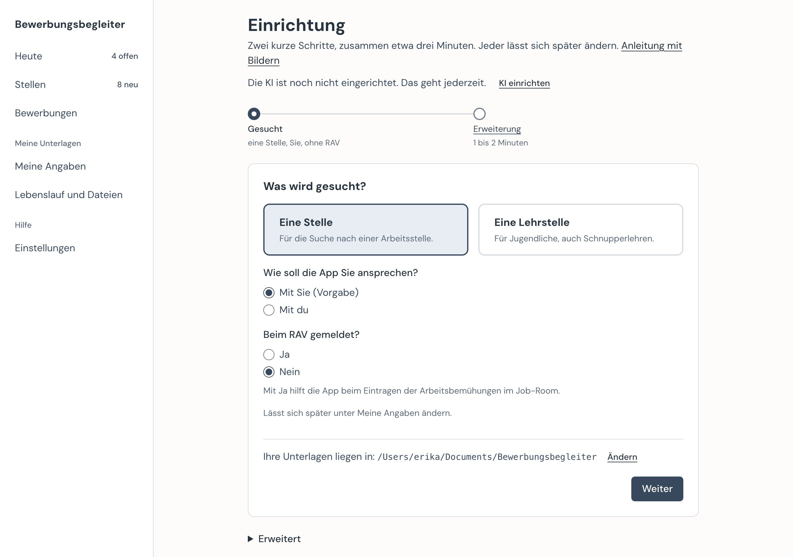
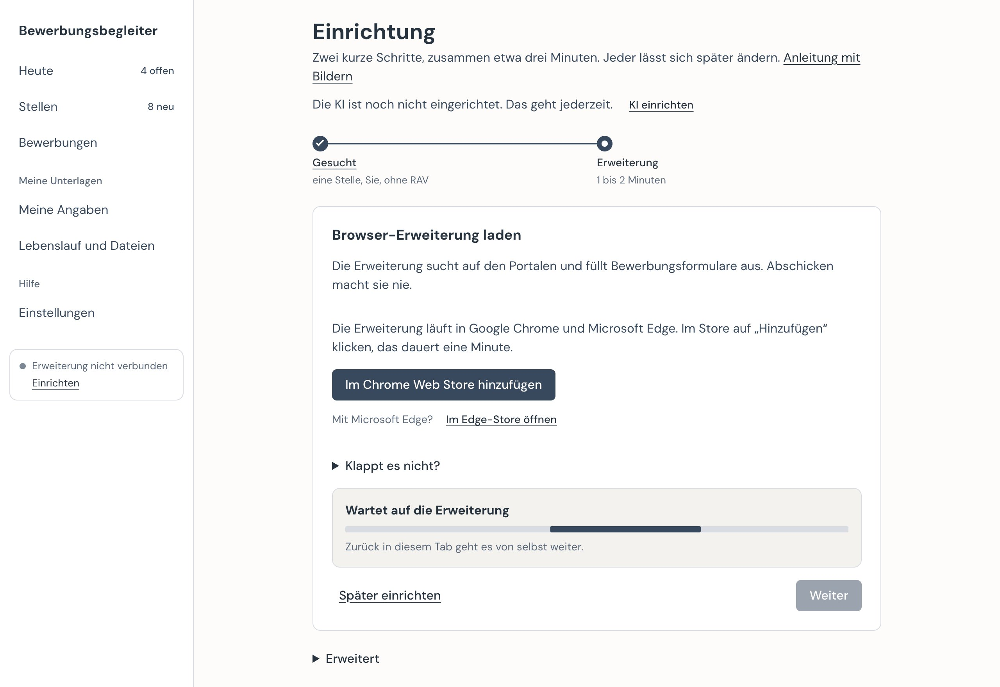
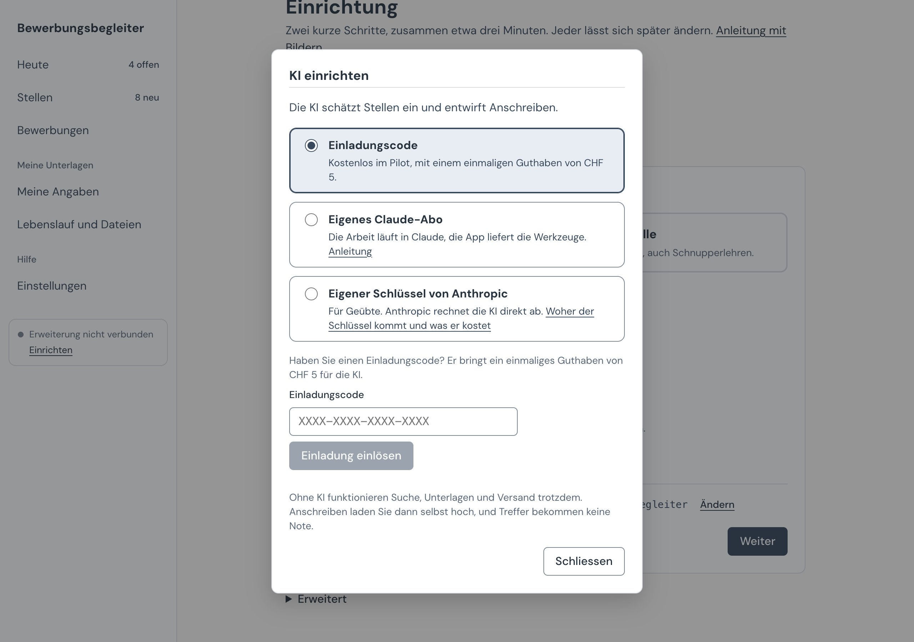
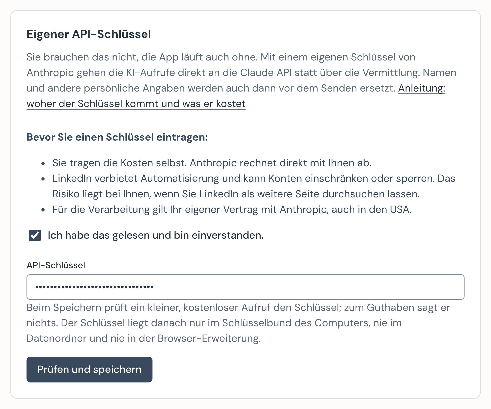

# Anleitung

Der Bewerbungsbegleiter ist eine App für Ihren Computer. Die App sucht auf Schweizer Stellenportalen nach Stellen, die zu Ihnen passen, und schätzt jede ein. Für die Stellen, die Sie wählen, bereitet sie Lebenslauf und Anschreiben als Entwurf vor und füllt das Bewerbungsformular der Firma aus. Bei jeder Bewerbung zeigt sie den nächsten Schritt, und sie hilft beim Nachweis fürs RAV.

Was zählt, bleibt bei Ihnen: Sie wählen die Stellen, passen das Anschreiben an die Firma an, geben es frei und schicken die Bewerbung selbst ab. Die Zeit, die Sie bei Suche und Formatierung sparen, gehört Ihrer Bewerbung.

Ihre Unterlagen liegen auf Ihrem Computer, nicht auf einem fremden Server.

Du suchst eine Lehrstelle? Eingerichtet wird die App für dich von einer erwachsenen Person, die Elternteil oder gesetzliche Vertretung ist. Was bei dir anders ist, steht unter [Für Lehrstellen](#für-lehrstellen).

**Springen zu**

- [Schnellstart für Bewerbungen](#schnellstart-für-bewerbungen)
- [Einmal einrichten](#einmal-einrichten)
  - [Was Sie brauchen](#was-sie-brauchen)
  - [App installieren](#app-installieren)
  - [App einrichten](#app-einrichten)
  - [Browser-Erweiterung hinzufügen](#browser-erweiterung-hinzufügen)
  - [Am Ende der Einrichtung](#am-ende-der-einrichtung)
- [Mit der App arbeiten](#mit-der-app-arbeiten)
  - [Angaben erfassen](#angaben-erfassen)
  - [Stellen suchen und bewerben](#stellen-suchen-und-bewerben)
  - [Lebenslauf für eine Stelle erstellen](#lebenslauf-für-eine-stelle-erstellen)
  - [Suchbegriffe prüfen](#suchbegriffe-prüfen)
  - [Ein Wort aus verworfenen Stellen ausschliessen](#ein-wort-aus-verworfenen-stellen-ausschliessen)
  - [Firmen und kununu](#firmen-und-kununu)
  - [Fertige Dateien verwenden](#fertige-dateien-verwenden)
  - [Für Lehrstellen](#für-lehrstellen)
- [Bei Bedarf](#bei-bedarf)
  - [Updates](#updates)
  - [Mehrere Personen](#mehrere-personen)
  - [Datenordner](#datenordner)
  - [Unter Linux](#unter-linux)
  - [Für Geübte](#für-geübte)
  - [Häufige Fehler](#häufige-fehler)
  - [Hilfe](#hilfe)

## Schnellstart für Bewerbungen

So kommen Sie von der Installation zur ersten Bewerbung. Jeder Schritt verweist auf die Einzelheiten weiter unten.

1. **App installieren und einrichten.** Laden Sie die App auf der Seite [App laden](laden.html) und starten Sie sie. Die Seite **Einrichtung** fragt, was Sie suchen und ob Sie beim RAV gemeldet sind. Die KI ist kein Schritt der Einrichtung: Mit **KI einrichten** lösen Sie, falls Sie einen haben, Ihren Einladungscode für die KI ein, ein einmaliges Probeguthaben von CHF 5. Das geht auch später, wann Sie sie brauchen. Mehr unter [App installieren](#app-installieren) und [App einrichten](#app-einrichten).

   

2. **Browser-Erweiterung hinzufügen.** Klicken Sie in der Einrichtung auf den Knopf für den Store Ihres Browsers und dort auf **Hinzufügen** oder **Abrufen**. Danach geht es in der App von selbst weiter. Mehr unter [Browser-Erweiterung hinzufügen](#browser-erweiterung-hinzufügen).

   

3. **Angaben erfassen.** Laden Sie unter **Meine Angaben** Ihren bisherigen Lebenslauf hoch und klicken Sie auf **Vorbefüllen**: Die KI füllt die nächsten Schritte aus, und Sie prüfen alles. Wo fast alle dasselbe antworten, steht schon eine Vorgabe. Zum Schluss klicken Sie auf **Angaben übernehmen**. Mehr unter [Angaben erfassen](#angaben-erfassen).

   

4. **Stellen suchen und eine wählen.** Klicken Sie auf **Stellen** und dann auf **Jetzt suchen**. Die Erweiterung sucht auf den Portalen, die KI schätzt jeden Treffer ein. Bei einer Stelle, die Ihnen gefällt, klicken Sie auf **Bewerbung vorbereiten**; die Bewerbung öffnet sich. Mehr unter [Stellen suchen und bewerben](#stellen-suchen-und-bewerben).

   

5. **Unterlagen erstellen und abschicken.** Mit **Lebenslauf erstellen** stellen Sie in der Bewerbung einen Lebenslauf für diese Stelle zusammen; das ist freiwillig. Klicken Sie dann auf **Unterlagen erstellen**; die KI entwirft dabei das Anschreiben. Lesen Sie es, passen Sie es mit **Ändern** an die Firma an und klicken Sie auf **Freigeben**. Mit **Formular öffnen** füllt die Erweiterung das Formular der Firma aus. Sie prüfen es und schicken die Bewerbung selbst ab. Wie der Lebenslauf für eine Stelle entsteht, steht unter [Lebenslauf für eine Stelle erstellen](#lebenslauf-für-eine-stelle-erstellen). Mehr unter [Stellen suchen und bewerben](#stellen-suchen-und-bewerben) und [Fertige Dateien verwenden](#fertige-dateien-verwenden).

   

## Einmal einrichten

Diese Kapitel brauchen Sie nur einmal. Sie gelten auch, wenn Sie die App für Ihr Kind einrichten, das eine Lehrstelle sucht.

### Was Sie brauchen

- einen Computer mit Windows, macOS oder Linux,
- den Browser Chrome oder Edge,
- für die KI-Unterstützung einen Einladungscode. Er ist ein kostenloses, einmaliges Probeguthaben von CHF 5 und erneuert sich nicht. Den Code fordern Sie per E-Mail an, solange es Codes gibt; die Adresse steht auf der Seite [Hilfe](https://bewerbungsbegleiter.ch/hilfe.html#kontakt). Ist das Guthaben aufgebraucht, fordern Sie dort einen neuen Code an. Ohne Code funktionieren Suche, Unterlagen und Versand trotzdem. Haben Sie ein eigenes Claude-Abo oder einen eigenen API-Schlüssel, geht es auch ohne Code (siehe [Für Geübte](#für-geübte)).

### App installieren

Die App laden Sie auf der Seite [App laden](laden.html), für Windows, macOS oder Linux. Unter Linux geht es etwas anders, siehe [Unter Linux](#unter-linux).

Unter macOS trägt die App eine eigene Signatur des Projekts, nicht von Apple. Darum öffnet macOS sie beim ersten Mal erst, wenn Sie es in den Systemeinstellungen bestätigen. Updates nimmt die App nur an, wenn sie genau diese Signatur tragen. Unter Windows ist die App nicht signiert, darum warnt Windows (SmartScreen) beim ersten Start. Beide Warnungen sind zu erwarten, und Sie bestätigen sie nur einmal. Öffnen Sie unten den Teil für Ihren Computer.

Für Computer mit Windows

1. Die Setup-Datei für Windows herunterladen und öffnen. Warnt der Browser beim Herunterladen, behalten Sie die Datei.
2. Erscheint „Der Computer wurde durch Windows geschützt“: auf **Weitere Informationen** klicken, dann auf **Trotzdem ausführen**. Die App ist unter Windows nicht signiert, darum diese Warnung von SmartScreen.
3. Die Installation durchlaufen. Administratorrechte braucht es nicht. Die App steht danach im Startmenü.

Die App öffnet sich in Ihrem Browser mit der Seite „Einrichtung“.

Für Mac-Computer mit macOS

1. Die ZIP-Datei für macOS herunterladen und im Finder öffnen.
2. **Die App in den Ordner „Programme“ ziehen.** Sonst funktionieren spätere Updates nicht.
3. Die App dort öffnen. macOS warnt und öffnet sie nicht, weil ihre Signatur nicht von Apple stammt.
4. **Systemeinstellungen → Datenschutz & Sicherheit** öffnen, nach unten scrollen und bei der App auf **Dennoch öffnen** klicken.

Das braucht es nur beim ersten Öffnen. Updates tragen dieselbe Signatur, darum fragt macOS danach nicht mehr.

Die App öffnet sich in Ihrem Browser mit der Seite „Einrichtung“.

### App einrichten

Die App läuft in Ihrem Browser, aber nur auf Ihrem Computer. Links steht die Seitenleiste mit **Heute**, **Stellen** und **Bewerbungen**, darunter unter **Meine Unterlagen** die Seiten **Meine Angaben** und **Lebenslauf und Dateien** und ganz unten **Einstellungen**. Sie beenden die App unter **Einstellungen**, **Über die App**, mit **Beenden**. Schliessen Sie den letzten Tab der App, beendet sie sich nach einer Minute von selbst. Läuft gerade eine Suche oder eine Aufgabe der KI, wartet sie, bis diese fertig ist.

Die Einrichtung hat zwei kurze Schritte und dauert zusammen etwa drei Minuten. Schritt 1 steht hier, Schritt 2 unter [Browser-Erweiterung hinzufügen](#browser-erweiterung-hinzufügen). Die KI ist kein Schritt: Sie richten sie mit **KI einrichten** ein, wann Sie wollen (siehe [KI einrichten](#ki-einrichten)). Jeden Schritt können Sie später ändern; Sie finden die Seite unter **Einstellungen**, **Daten und Sicherung**, mit dem Link **Einrichtung: Datenordner, Erweiterung und KI**.

#### Schritt 1: Was wird gesucht?

Wählen Sie **Eine Stelle** oder **Eine Lehrstelle**, wie die App Sie ansprechen soll und ob Sie beim RAV gemeldet sind. Vorgewählt ist **Nein**; mit **Ja** hilft die App beim Eintragen der Arbeitsbemühungen im Job-Room.

Unten steht, wo Ihre Unterlagen liegen: der Datenordner mit Ihrem Lebenslauf, Ihren Anschreiben und Ihren Bewerbungen. Der Vorschlag unter „Dokumente“ passt meistens. Einen anderen Ordner wählen Sie mit **Ändern** und **Ordner wählen …**. Klicken Sie dann auf **Weiter**; die App legt den Ordner an.

Bei Lehrstellen: Wählen Sie **Eine Lehrstelle**, auch wenn Sie die App für Ihr Kind einrichten.

#### Angaben aus einer Datei

Liegt im Ordner Downloads eine Datei aus der Einstiegsvorlage oder aus Claude, deren Name mit „einstieg“ beginnt, zeigt die Einrichtung nach Schritt 1 den Schritt **Datei** mit dieser Datei. Klicken Sie auf **Importieren**, oder auf **Überspringen**, wenn Sie Ihre Angaben lieber unter **Meine Angaben** erfassen. Liegt die Datei anderswo, finden Sie den Import unten auf der Seite unter **Erweitert**, **Datei übernehmen**; die Datei wählen Sie dort mit **Datei wählen …**.

Liegen Suchprofil, Stilprofil oder Bausteine schon im Datenordner, fragt die App pro Datei, ob sie bleibt. Das geht wie unter [Angaben erfassen](#angaben-erfassen) beschrieben, abschliessend mit **Mit dieser Wahl importieren**.

#### KI einrichten

Die KI richten Sie in einem Fenster über der Seite ein. Es öffnet sich, wenn Sie oben in der Einrichtung auf **KI einrichten** klicken, wenn Sie eine KI-Funktion nutzen, bevor die KI eingerichtet ist, und wenn Sie einen Einladungslink öffnen.

Lesen Sie zuerst die Datenschutzerklärung und willigen Sie ein: Die App ist für Erwachsene, und ohne Einwilligung gehen keine Texte an die KI. Widerrufen können Sie jederzeit unter **Einstellungen**, **KI und Guthaben**.

Bei Lehrstellen: Eingerichtet wird die App von einer erwachsenen Person, die Elternteil oder gesetzliche Vertretung ist; sie bestätigt das in der Einwilligung.

Danach wählen Sie den Weg zur KI:

- **Einladungscode:** kostenlos, ein einmaliges Probeguthaben von CHF 5 (siehe [Was Sie brauchen](#was-sie-brauchen)). Den Code eintragen und auf **Einladung einlösen** klicken. Haben Sie einen Einladungslink erhalten, genügt ein Klick darauf; das Fenster öffnet sich, und der Code wird nach der Einwilligung eingelöst.
- **Eigenes Claude-Abo:** Die Schritte dafür stehen unter **Einstellungen**; das Fenster führt mit **In den Einstellungen einrichten** dorthin (siehe [Für Geübte](#für-geübte)).
- **Eigener Schlüssel von Anthropic:** Wer einen eigenen API-Schlüssel hat, bestätigt die Hinweise, fügt den Schlüssel ein und klickt auf **Prüfen und speichern** (siehe [Für Geübte](#für-geübte)).

Ist die KI eingerichtet, schliessen Sie das Fenster mit **Weiter**. Ohne Code schliessen Sie es mit **Schliessen**; Suche, Unterlagen und Versand funktionieren dann trotzdem. In beiden Fällen sind Sie wieder dort, wo Sie waren.

### Browser-Erweiterung hinzufügen

Das ist Schritt 2 der Einrichtung. Die Erweiterung sucht in Ihrem Browser nach Stellen und füllt Bewerbungsformulare aus; abschicken macht sie nie. Ausserdem liest sie auf Klick das Inserat ein, das Sie gerade offen haben, zum Beispiel auf LinkedIn oder der Karriereseite einer Firma: Inserat öffnen, auf ihr Symbol klicken, **Stelle speichern**.

In Microsoft Edge und Google Chrome kommt die Erweiterung aus dem Store. Die App erkennt Ihren Browser und zeigt den Knopf für seinen Store; den anderen Store finden Sie als Link darunter. Öffnen Sie unten den Teil für Ihren Browser. Danach geht es in der App von selbst weiter.

Für Microsoft Edge

1. In der App auf **Im Edge-Store hinzufügen** klicken (in einem anderen Browser: auf den Link **Im Edge-Store öffnen**). Der [Eintrag bei Edge Add-ons](https://microsoftedge.microsoft.com/addons/detail/mcbcijjbklfeffbollnemgkgnabnmfmp) geht auf.
2. Auf **Abrufen** klicken und bestätigen.

Fertig: In der App erscheint von selbst „Die Erweiterung ist bereit“.

Für Google Chrome

1. In der App auf **Im Chrome Web Store hinzufügen** klicken (in Edge: auf den Link **Im Chrome Web Store öffnen**). Der [Eintrag im Chrome Web Store](https://chromewebstore.google.com/detail/bewerbungsbegleiter/nopiegcdnjpkekgfakgglegkeifpmopo) geht auf.
2. Auf **Hinzufügen** klicken und bestätigen.

Fertig: In der App erscheint von selbst „Die Erweiterung ist bereit“.

Ohne Store laden: wenn es über den Store nicht klappt

In diesem Fall laden Sie die Erweiterung einmal von Hand, in Chrome oder Edge. Die Schritte stehen in der App unter **Klappt es nicht?**:

1. Auf **In Chrome öffnen** oder **In Edge öffnen** klicken. Die Erweiterungsseite und der Ordner der Erweiterung gehen auf.
2. Den **Entwicklermodus** einschalten: in Chrome oben rechts, in Edge links.
3. Den Ordner der Erweiterung, den die App geöffnet hat, auf die Erweiterungsseite ziehen. Geht das nicht: **Entpackte Erweiterung laden** wählen und den Ordner auswählen. Der Knopf **Kopieren** neben dem Pfad hilft dabei: Auf dem Mac fügen Sie den Pfad im Auswahlfenster mit Cmd+Shift+G ein, unter Windows oben in die Adresszeile, unter Linux mit Ctrl+L.

Die Erweiterung steht dann in der Liste, und in der App erscheint von selbst „Die Erweiterung ist bereit“.

### Am Ende der Einrichtung

Ist noch etwas offen, etwa die KI oder die Erweiterung, steht am Ende **Fast fertig** mit einer Zeile pro offenem Punkt und einem Knopf wie **KI einrichten** oder **Erweiterung laden**. Sie können das auch später nachholen. Ist alles bereit, steht dort **Alles eingerichtet**. Mit **Meine Angaben erfassen** geht es weiter.

## Mit der App arbeiten

Du suchst eine Lehrstelle? Was bei dir anders ist, steht unter [Für Lehrstellen](#für-lehrstellen).

### Angaben erfassen

Unter **Meine Angaben** erfassen Sie Lebenslauf und Suchprofil, in etwa 20 Minuten. Vorhandene Unterlagen als PDF oder Word können Sie hochladen. Die KI macht daraus Vorschläge, und Sie prüfen jeden davon. Wo fast alle dasselbe antworten, steht schon eine Vorgabe, die Sie ändern können: Wohnort und Ort im Datum wie Ihr Ort, Pensum 80–100 %, Start nach Vereinbarung, beim Anschreiben jeweils die erste Wahl. Im letzten Schritt, **Übernehmen**, klicken Sie auf **Angaben übernehmen**. Erst danach zählen Ihre Angaben für die Suche.

Ändern können Sie Ihre Angaben jederzeit an derselben Stelle. Die Seite zeigt dann Ihren bisherigen Lebenslauf. Was sie nicht anzeigt, zum Beispiel Ihr Foto, bleibt beim Übernehmen, wie es ist. So geht nichts verloren, was Sie schon verfeinert haben.

**Tags** bestimmen, wo ein Eintrag erscheint: Ohne Tags steht er in jedem Lebenslauf, mit Tags nur in den Varianten für Stellen mit einem dieser Tags. Tags können Sie Stellen, einzelnen Tätigkeiten, Kenntnissen, Projekten, Lehrtätigkeiten und Zertifikaten geben. Die Seite schlägt die Tags vor, die Sie schon verwenden; neue tippen Sie einfach ein. Tags sind freiwillig.

**Stufen** für Kenntnisse und Sprachen sind ebenfalls freiwillig und gelten nur fürs Dossier: Bei einer Kenntnis wählen Sie 1 bis 6, bei einer Sprache A1 bis C2, mit **ohne Stufe** entfernen Sie sie wieder. Hat ein Eintrag eines Bereichs eine Stufe, zeigt das Dossier dort eine Grafik, und Einträge ohne Stufe erscheinen darin neutral. Ganz ohne Stufen gibt es keine Grafik.

Für die Stellensuche gibt es ausserdem die Abschnitte **Projekte** sowie **Lehre und Training** und ein Feld für Ihre eigene Webseite. Bei Ausbildungen und Zertifikaten können Sie unter **Eigener Text** einen fertigen Satz schreiben; er steht im Lebenslauf anstelle der einzelnen Angaben.

Gibt es Suchprofil, Stilprofil oder Bausteine schon, fragt die App beim Übernehmen pro Datei, ob sie bleibt. Vorgewählt ist **Behalten**. Wählen Sie **Ersetzen**, zeigt die Seite zuerst die Unterschiede: Zeilen mit − fallen weg, Zeilen mit + kommen dazu. Abschliessend klicken Sie auf **Mit dieser Wahl übernehmen**. Der alte Stand bleibt als Entwurf erhalten, und der Lebenslauf nimmt Ihre Angaben in jedem Fall auf.

### Stellen suchen und bewerben

1. **Suchen**: Klicken Sie links auf **Stellen** und dann auf **Jetzt suchen**. Die Erweiterung sucht auf den Portalen, in Ihrem Browser und nur, wenn Sie die Suche starten. Ohne gewählte Kantone sucht sie in der ganzen Schweiz; Stellen nahe Ihrem Wohnort stehen dann zuerst. Lässt sich die Suche noch nicht starten, steht der Grund direkt unter dem Knopf, etwa **Zuerst Meine Angaben abschliessen.** Oben fasst eine Zeile die Einstellungen zusammen: Suchbegriffe, Region und Anzahl Portale. Mit **Ändern** oder **Suche einstellen** öffnen Sie die Seite **Suche einstellen** und wählen dort unter **Wo suchen Sie?** die Portale. Region, Pensum, was Sie nicht sehen wollen und den Titelfilter unter **Erweitert** ändern Sie dort ebenfalls: **Ändern** in der Karte öffnet die Felder, **Speichern** gilt ab der nächsten Suche, und der frühere Stand bleibt als Entwurf erhalten. Passen Ihre Begriffe nicht zur Informatik, ist ictjobs zu Beginn ausgeschaltet. Die Suche läuft alle Ihre Suchbegriffe und Orte ab, pro Portal in Etappen von höchstens 30 Suchen mit einer Minute Pause dazwischen, damit die Portale nicht alles auf einmal bekommen. Vor einer langen Suche steht unter **Jetzt suchen**, wie viele Suchen und Etappen es sind und wie lange es etwa dauert; während der Suche zeigt die Seite, auf welchem Portal sie mit welchem Suchbegriff und Ort sucht und bei welcher Suche und Etappe sie ist. Pro Portal holt ein Lauf höchstens 150 neue Inserate, der Rest kommt bei der nächsten Suche. Ihre Suchbegriffe stehen auf **Suche einstellen** unter **Welche Stellen passen zu Ihnen?**: Einen eigenen tragen Sie unter **Eigenen Suchbegriff aufnehmen** ein und klicken auf **Aufnehmen**. Haben Sie einen Begriff aus Versehen entfernt, holt **Rückgängig** in der Meldung ihn an seinen Platz zurück.
2. **Entscheiden**: Neue Treffer stehen unter **Neu**. Hat ein Treffer noch keine Note, lässt **Bewerten** die KI einschätzen, wie gut er zu Ihnen passt; **Alle prüfen** über der Liste tut das für alle, mit den geschätzten Kosten daneben. Während es läuft, steht im Kasten, welches Inserat die Erweiterung gerade holt und welche Stellen die KI gerade prüft. Beim gewählten Treffer klicken Sie auf **Bewerbung vorbereiten**: Die App legt die Bewerbung an und öffnet sie. **Merken** legt sie an, ohne sie zu öffnen; die Meldung **Gemerkt.** führt mit **Bewerbung öffnen** zu ihr. **Verwerfen** blendet den Treffer aus. Gemerkte Treffer stehen unter **Gemerkt**, verworfene unter **Verworfen**.
3. **Bewerben**: **Heute** zeigt, was als Nächstes zu tun ist, und die Seite **Bewerbungen** den nächsten Schritt jeder Bewerbung. Öffnen Sie eine Bewerbung. Unter **Lebenslauf** wählen Sie die Variante oder erstellen mit **Lebenslauf erstellen** einen Lebenslauf für diese Stelle (siehe [Lebenslauf für eine Stelle erstellen](#lebenslauf-für-eine-stelle-erstellen)). Dann klicken Sie auf **Unterlagen erstellen**. Fehlt noch ein Anschreiben, entwirft die KI dabei zuerst eines; das kann bis zu einer Minute dauern. Der Entwurf ist ein Ausgangspunkt: Lesen Sie ihn, passen Sie ihn mit **Ändern** an die Stelle und die Firma an, und klicken Sie dann auf **Freigeben**. Die App prüft die erstellten PDFs unter **Unterlagen prüfen**: wie voll die letzte Seite ist, ob eine Überschrift allein am Ende einer Seite steht und ob Text über den Rand oder über anderen Text läuft. Jeder Befund nennt das Dokument und die Seite und hat einen Knopf **So lassen**; das Formular öffnet sich erst, wenn Sie jeden Befund angesehen und bestätigt haben. Ist ein Dokument zu lang, steht im Befund auch, was sich kürzen liesse; gekürzt wird nur von Ihnen. Danach öffnet **Formular öffnen** das Formular der Firma, und die Erweiterung füllt es aus. Haben Sie schon einen fertigen Lebenslauf, entfällt das Erstellen (siehe [Fertige Dateien verwenden](#fertige-dateien-verwenden)).

Abgeschickt wird eine Bewerbung immer von Ihnen selbst.

### Lebenslauf für eine Stelle erstellen

Auf der Seite einer Bewerbung stellen Sie unter **Lebenslauf** mit **Lebenslauf erstellen** einen Lebenslauf eigens für diese Stelle zusammen. Die App baut ihn aus Ihren Angaben unter **Meine Angaben**; was drinsteht und wie er aussieht, wählen Sie getrennt. Das ist freiwillig: Ohne gilt der Lebenslauf, der unter **Lebenslauf-Variante** gewählt ist.

1. **Inhalt:** Die Stationen stehen nach Abschnitten geordnet, etwa Berufserfahrung, Bildung und Weiterbildung, Projekte und Zertifikate. Mit dem Häkchen bestimmen Sie, welche in diesen Lebenslauf kommen, mit den Pfeilen ihre Reihenfolge im Abschnitt. **Berufsbezeichnung** und **Kurzprofil** kommen aus Ihren Angaben; hier kürzen und stellen Sie sie für die Stelle um. Die Angaben selbst ändern Sie unter **Meine Angaben**.
2. **Aussehen:** **Zweispaltig** setzt Foto und Kontakt in den Kopf und den Inhalt in zwei Spalten, **Einspaltig** alles schlicht untereinander. Die Wahl gilt nur für diese Bewerbung. Ein Dossier hat sein eigenes Design, gewählt unter **Unterlagen prüfen**.
3. **Speichern:** Unter **Name der Fassung** schlägt die App Stelle und Firma vor. Klicken Sie auf **Lebenslauf übernehmen**. Der Lebenslauf ist dann eine eigene Fassung: Er gilt für diese Bewerbung, steht wie jede Variante unter **Lebenslauf-Variante** zur Wahl, und Ihre Angaben bleiben, wie sie sind. Öffnen Sie **Lebenslauf erstellen** später wieder, ersetzt **Lebenslauf übernehmen** diese Fassung. **Abbrechen** schliesst den Teil, ohne etwas zu speichern.

Das ist etwas anderes als **Aussehen wählen** auf der Seite **Lebenslauf und Dateien**: Dort wählen Sie das Design für alle neuen Lebensläufe, die die App aus Ihren Angaben baut, und neue Bewerbungen übernehmen es. Was Sie bei einer Bewerbung mit **Lebenslauf erstellen** wählen, gilt nur für diese eine Stelle. Schon erstellte Lebensläufe bleiben in beiden Fällen, wie sie sind.

### Suchbegriffe prüfen

Bringt ein Begriff aus dem Titelfilter viele Treffer, die nicht passen, zeigt **Stellen** über der Liste den Hinweis **Ein Begriff lässt viel Unpassendes durch**. Das zählt die App selbst, ohne KI: Sobald mindestens 30 Treffer eine Note haben, prüft sie, ob ein Begriff allein viele davon hereinbringt und die meisten eine Note unter 4 haben. Der Hinweis nennt den Begriff, die Zahlen und Beispiele. Mit **Ausblenden** kommt er für diesen Begriff nicht wieder.

**Suchbegriffe prüfen lassen**, im Hinweis oder unter **Suche einstellen**, bittet die KI um einen Vorschlag. Daneben steht, was das etwa kostet. Unter **Was geht an die KI?** zeigt **Text ansehen** genau den Text, der geschickt würde, ohne ihn zu senden. Die KI bekommt Ihr Suchprofil, Ihren Lebenslauf mit Platzhaltern für Name, Adresse und Kontakte sowie Titel und Note der eingeschätzten Treffer, keine Inseratstexte. Das gibt es vorerst nur bei der Stellensuche.

Die KI schlägt Änderungen vor: einen zu allgemeinen Begriff durch genauere ersetzen, einen fehlenden Suchbegriff aufnehmen oder ein Wort aus unpassenden Titeln ausschliessen. Jede Änderung steht als Karte mit Häkchen, Grund und Beleg; ein Link zeigt die Treffer, auf die sich der Beleg stützt. Darunter steht, wie die Suche danach aussieht. Geändert wird nur, was Sie angehakt haben und übernehmen; bis dahin bleibt das Suchprofil, wie es ist. Passt Ihnen der Vorschlag nicht, schreiben Sie unter **Neu vorschlagen**, was anders sein soll; Ihr Text geht mit dem Vorschlag an die KI.

Nach dem Übernehmen holt **Rückgängig machen** den Stand davor zurück, solange niemand sonst das Suchprofil geändert hat. Der Stand vor jeder Änderung bleibt ausserdem unter **Entwürfe und Versionen**; die Seite öffnen Sie auf **Lebenslauf und Dateien** mit **Frühere Fassungen ansehen**.

### Ein Wort aus verworfenen Stellen ausschliessen

Haben mindestens drei Stellen, die Sie verworfen haben, dasselbe Wort im Titel, schlägt **Suche einstellen** unter **Was Sie nicht sehen wollen** vor, es auszuschliessen, etwa: **Aus den Stellen, die Sie verworfen haben: 3 haben «Aussendienst» im Titel.** Darunter steht, wie viele Stellen, die Sie nicht verworfen haben, das Wort auch im Titel haben. Das zählt die App selbst, ohne KI und ohne Kosten. Wörter aus **Titel, die passen** schlägt sie nie vor. **«Aussendienst» nicht mehr zeigen** setzt das Wort unter **Im Titel**; das gilt ab der nächsten Suche, und der frühere Stand bleibt als Entwurf erhalten. **Die 3 Stellen ansehen** zeigt genau diese Stellen auf **Stellen**. **Nicht jetzt** legt den Vorschlag beiseite, bis weitere verworfene Stellen das Wort haben. Ohne einen dieser Klicks ändert sich nichts. Das gibt es nur bei der Stellensuche.

### Firmen und kununu

Auf **Stellen**, im Reiter **Firmen** neben **Neu**, **Gemerkt** und **Verworfen**, steht jede Firma aus Ihren Treffern und Bewerbungen, dazu, was kununu über sie sagt. Bei der Lehrstellensuche heisst der Reiter **Lehrbetriebe**.

Auf kununu bewerten heutige und frühere Mitarbeitende ihre Firma, bei Lehrbetrieben auch Lernende. 5 ist der beste Wert, 1 der schlechteste. Die Werte stammen von diesen Mitarbeitenden, nicht von der App. Unter 10 Bewertungen sagt ein Wert wenig, die App schreibt dann „wenig aussagekräftig“. Nach 90 Tagen gilt er als veraltet, und die App bietet **Neu prüfen** an. Die Note der App ist etwas anderes: Sie sagt, wie gut eine Stelle zu Ihren Angaben passt.

Die App fragt kununu nur, wenn Sie auf **Prüfen** klicken, nie von selbst. An kununu geht dabei nur der Firmenname; Ihre Angaben bleiben auf diesem Computer. Mit der Erweiterung liest die App Wert und Anzahl Bewertungen in einem Tab und trägt sie ein. Ohne Erweiterung öffnet **Prüfen** die Firma bei kununu in einem neuen Tab, und Sie lesen den Wert dort selbst.

In der Liste der Treffer steht der Wert als **kununu 3.8 von 5** nach dem Firmennamen, gestrichelt bei wenigen Bewertungen. Neben dem Treffer zeigt eine Zeile Wert, Bewertungen und Datum, dazu **Bei kununu ansehen** oder **Jetzt prüfen**. **Jetzt prüfen** tut dasselbe wie **Prüfen** im Reiter **Firmen**.

Lässt sich kein Wert lesen, zum Beispiel weil kununu eine Prüfseite zeigt, bleibt der Tab offen. Klicken Sie dann im Reiter **Firmen** auf **Von Hand eintragen**; den Knopf hat jede Firma ohne Wert und jede, deren Wert älter als 90 Tage ist. Geben Sie den Wert und die Anzahl Bewertungen so ein, wie sie bei kununu stehen, und klicken Sie auf **Eintragen**.

Welche kununu-Seite zu einer Firma gehört, entscheiden Sie selbst:

- Findet kununu mehrere Firmen, klicken Sie auf **Passende wählen**. Ort und Anzahl Bewertungen helfen beim Wählen. Wählen Sie die richtige und klicken Sie auf **Zuordnen**. Passt keine, wählen Sie **Keine davon passt**.
- Findet kununu die Firma nicht, suchen Sie mit **Bei kununu suchen** selbst. Öffnen Sie die Firma bei kununu und kopieren Sie den Link aus der Adresszeile. Klicken Sie in der App auf **Selbst zuordnen**, fügen Sie den Link ein und klicken Sie auf **Zuordnen**. Es gehen Links von kununu.com/ch, kununu.com/de und kununu.de. Danach liest **Prüfen** die Werte von dieser Seite.

Unter **Zu klären** zeigt der Reiter die Firmen, bei denen noch eine Wahl offen ist oder die Prüfung nicht ging.

### Fertige Dateien verwenden

Haben Sie Lebenslauf, Zeugnisse oder ein Anschreiben schon als fertige Datei, verwendet die App sie so, wie sie sind. Öffnen Sie unten den Teil, der für Sie passt.

Lebenslauf und Zeugnisse: wenn Sie sie schon als PDF haben

Auf der Seite **Lebenslauf und Dateien** (links unter **Meine Unterlagen**) wählen Sie unter **Ihr Lebenslauf**, woher er kommt. Voreingestellt ist **Die App erstellt ihn**: aus Ihren Angaben, im Design, das Sie mit **Aussehen wählen** bestimmen. Haben Sie ein fertiges PDF, klicken Sie auf **Ich nehme mein eigenes PDF** und dann auf **PDF wählen**. Es wird so verwendet, wie es ist, und gilt für alle Bewerbungen, bei denen keine Variante gewählt ist.

Unter **Zeugnisse und Zertifikate** ziehen Sie Ihre Dateien hinein oder klicken auf **Dateien wählen**, als PDF, JPG oder PNG. Die App ordnet jede Datei nach ihrem Namen einer Art zu: **Zeugnis** (Arbeits- und Schulzeugnisse), **Diplom** oder **Zertifikat**. Stimmt die Art nicht, wählen Sie in der Zeile die richtige. Zeugnisse gehen beim Ausfüllen eines Formulars mit; welche Zertifikate und Diplome mitgehen, schlägt die App pro Bewerbung vor, und Sie wählen. Mit **Entfernen** nehmen Sie eine Datei heraus; sie bleibt unter **Frühere Fassungen**. Die Dateien gehen nicht an die KI.

Damit das Formular auch Name, Adresse und Kontakt einfüllt, braucht es trotzdem die Angaben unter **Meine Angaben**. Ohne sie bleiben diese Felder leer, und Sie tragen sie selbst ein.

Eigenes Anschreiben: wenn Sie es selbst geschrieben haben

Ein eigenes Anschreiben laden Sie als PDF auf der Seite der Bewerbung hoch, unter **Eigenes Anschreiben**. Es gilt nur für diese Bewerbung und anstelle eines Entwurfs. Solange es gilt, entwirft und prüft die KI dort kein Anschreiben; den Inhalt vergleichen Sie selbst mit dem Inserat. Entfernen Sie die Datei, gilt wieder der Entwurf.

Wenn im Formular ein Upload-Feld offen bleibt

Hat ein Formular nur ein Feld für eine Datei, baut die App daraus ein gemeinsames PDF. Haben Sie für die Bewerbung ein Dossier gewählt, ist es das Dossier, mit den Nachweisen dahinter; Formulare mit eigenen Feldern für Lebenslauf und Anschreiben bekommen weiterhin die einzelnen Dateien. Bleibt ein Upload-Feld trotzdem offen, klicken Sie im Balken oder auf der Seite der Bewerbung auf **Dateien im Ordner zeigen**. Die App legt dann alle Dateien der Bewerbung in einen Ordner, öffnet ihn und nennt den Pfad. Von dort ziehen Sie die Datei ins Formular. Oder Sie fügen den Pfad im Datei-Dialog ein: auf dem Mac mit ⇧⌘G, unter Windows im Feld „Dateiname“. Direkt in diesen Ordner kann die App den Datei-Dialog nicht lenken, das lässt der Browser nicht zu.

Ersetzen Sie eine Datei, während ein Formular offen ist, behält das Formular die frühere Fassung. Laden Sie das Formular neu, damit es die aktuelle bekommt. Tauschen Sie die Datei dort nicht von Hand aus: Bei „Abgeschickt? Ja“ hält die App fest, was das Formular von ihr bekommen hat.

### Für Lehrstellen

Eingerichtet wird die App von einer erwachsenen Person, die Elternteil oder gesetzliche Vertretung ist. Sie installiert alles genau wie oben beschrieben, wählt in der Einrichtung **Eine Lehrstelle** und bestätigt das in der Einwilligung zur KI. Mach ruhig mit, vor allem bei den Warnungen des Computers.

Danach ist Folgendes anders:

1. Unter **Meine Angaben** wählst du die **Lehrstellensuche**. Die Fragen führen dich durch alles, was es braucht.
2. Die Seite mit deinen Treffern heisst **Lehrstellen**. Weisst du noch nicht, welcher Beruf passt? Auf **Lehrstellen** öffnest du **Suche einstellen**; dort kann dir die KI unter **Berufe von der KI vorschlagen lassen** Berufe vorschlagen. Fehlt noch die Einwilligung, steht dort **Die KI ist noch aus.** Ein Klick auf **KI einschalten** zeigt den Text dazu. Was du geschrieben hast, bleibt stehen, und nach **Einwilligen** kommen die Vorschläge. Du entscheidest, welche du in deine Suche aufnimmst. Einen Beruf, den du schon kennst, trägst du unter **Eigenen Beruf aufnehmen** selbst ein, mit EFZ oder EBA. Hast du einen Beruf aus Versehen entfernt, holt **Rückgängig** ihn zurück.
3. Unter **Suche einstellen** wählst du auch, ob du Lehrstellen, Schnupperlehren oder beides suchst. Die Erweiterung sucht dann auf LENA (berufsberatung.ch) und yousty. Unter **Wo suchst du?** kannst du eines davon ausschalten. Wohnort, Umkreis und Kantone änderst du dort unter **Region und Pensum** mit **Ändern**.

Deine Bewerbung schickst immer du selbst ab.

## Bei Bedarf

### Updates

**App:** Gibt es eine neue Version, fragt die App beim Start in einem Fenster nach. Klicken Sie auf **Installieren**, oder auf **Später** und arbeiten Sie weiter. Dann steht oben ein Hinweis mit **Jetzt aktualisieren**, und beim nächsten Start fragt die App wieder. Beim **Beenden** installiert sich die neue Version von selbst im Hintergrund, beim nächsten Start läuft sie. Ihre Daten und Einstellungen bleiben erhalten. Unter Linux aktualisieren Sie von Hand, siehe [Unter Linux](#unter-linux).

**Vorabversionen:** Neue Versionen gibt es manchmal zuerst zum Ausprobieren. Wer sie testen möchte, schaltet unter **Einstellungen**, **Erweitert**, **Vorabversionen** den Schalter **Vorabversionen als Update anbieten** ein. Vorabversionen können noch Fehler haben. Voreingestellt bekommen Sie nur veröffentlichte Versionen.

**Erweiterung:** Aus dem Store hält der Browser die Erweiterung selbst aktuell. Haben Sie sie von Hand geladen, bringt die App die neue Version mit, und die Erweiterung lädt sich von selbst neu, sobald die App läuft und keine Suche oder kein Formular offen ist. Sie müssen nichts tun. Der Entwicklermodus muss dafür eingeschaltet bleiben. Zeigt die Seite „Einrichtung“ trotzdem eine andere Version, öffnen Sie `chrome://extensions` oder `edge://extensions` und klicken bei der Erweiterung auf **Neu laden**. Das ist auch beim Wechsel auf die erste Version mit dieser Funktion einmal nötig.

Wechsel von Version 0.2.10 oder älter: wenn die App bei Ihnen noch Bewerbungsassistent heisst

Bis Version 0.2.10 hiess die App technisch „Bewerbungsassistent“. Von dort aktualisiert sie sich nicht von selbst: Sie zeigt nur den Link zum Herunterladen. Laden Sie die neue Version einmal von Hand und installieren Sie sie wie unter [App installieren](#app-installieren). Danach geht es wieder von selbst.

Beim ersten Start übernimmt die neue Version Ihre Einstellungen, den Datenordner und den Zugang zur KI. Der Mac fragt dabei unter Umständen einmal nach Ihrem Passwort für den Schlüsselbund. Lehnen Sie ab, lösen Sie Ihre Einladung neu ein. Eine noch offene alte App wird dabei beendet.

Von Hand bleibt:

- **Mac:** Die alte App „Bewerbungsassistent“ aus „Programme“ löschen. Windows entfernt die alte Version selbst.
- **Erweiterung:** Die alte Erweiterung auf der Erweiterungsseite des Browsers entfernen und die neue hinzufügen, wie unter [Browser-Erweiterung hinzufügen](#browser-erweiterung-hinzufügen) beschrieben.
- **Eigenes Claude-Abo:** Die drei Skills in der App neu herunterladen und in Claude ersetzen, und Claude Desktop einmal neu starten. Haben Sie die App in Claude Code eingetragen: `claude mcp remove bewerbungsassistent` und den Befehl aus den Einstellungen neu ausführen.

Einladungslinks, die mit `bewerbungsassistent://` beginnen, öffnen die App nicht mehr. Geben Sie den Code in diesem Fall in der App ein.

### Mehrere Personen

Mehrere Personen können die App auf demselben Computer nutzen. Jede Person hat einen eigenen Datenordner mit Lebenslauf, Anschreiben und Bewerbungen.

Am einfachsten hat jede Person ein eigenes Benutzerkonto auf dem Computer und richtet die App dort ein. Dann hat sie auch ihren eigenen Zugang zur KI.

Teilen Sie sich ein Benutzerkonto, wechseln Sie so zwischen den Personen:

1. Unter **Einstellungen**, **Daten und Sicherung**, auf **Einrichtung: Datenordner, Erweiterung und KI** klicken.
2. Im Schritt **Gesucht** neben dem Datenordner auf **Ändern** klicken.
3. Mit **Ordner wählen …** den Ordner der anderen Person wählen. Die App meldet dann „Der Ordner enthält schon Bewerbungsdaten; sie werden weiter verwendet.“ Für eine neue Person wählen Sie einen neuen, leeren Ordner.
4. Auf **Weiter** klicken. Die Unterlagen in einem Ordner, den es schon gibt, bleiben, wie sie sind.

Die App arbeitet jetzt mit den Unterlagen dieser Person. Eine neue Person erfasst danach ihre Angaben unter **Meine Angaben**. Die Einwilligung gehört zum Datenordner: Vor der ersten KI-Nutzung gibt jede Person ihre eigene.

Bringen Sie vor dem Wechsel zu Ende, was noch offen ist: eine laufende Suche, Tabs mit Bewerbungsformularen und angefangene Einträge im Job-Room. Sonst kann, was dabei herauskommt, bei der falschen Person landen.

Der Zugang zur KI gehört zum Benutzerkonto des Computers, nicht zum Datenordner. Auf demselben Konto nutzen beide Personen also denselben Zugang und dasselbe Guthaben. Das gilt auch für einen eigenen API-Schlüssel.

### Datenordner

Alles, was Sie in der App erfassen, liegt als gewöhnliche Datei in Ihrem Datenordner. Sie können die Dateien mit jedem Texteditor öffnen, die PDFs verschicken oder alles in ein anderes Programm mitnehmen. Welcher Ordner das ist, sehen Sie in der Einrichtung im Schritt **Gesucht**; Sie erreichen sie unter **Einstellungen**, **Daten und Sicherung**.

**Bevor Sie eine Datei von Hand ändern:** Erstellen Sie zuerst unter **Einstellungen**, **Daten und Sicherung**, mit **Sicherung erstellen** eine Kopie des ganzen Ordners. Eine Datei mit einem Fehler kann die App nicht mehr lesen. Sicherer ist es, Texte in der App unter **Einstellungen**, **Daten und Sicherung**, **Für Geübte: Inhalte als Text bearbeiten** zu ändern: Dort prüft die App jede Änderung, und der alte Stand bleibt als Entwurf erhalten.

Welche Dateien dort liegen und was sie enthalten, steht unter [Was im Datenordner liegt](#was-im-datenordner-liegt).

### Unter Linux

#### Installieren

Zugesagt ist das aktuelle Ubuntu LTS. Linux Mint baut darauf auf und wird mitgeprüft. Auf anderen Systemen wie Fedora, Debian oder Arch läuft die App meist auch, aber ohne Zusage.

1. Die AppImage-Datei herunterladen und in einen festen Ordner legen, zum Beispiel „Programme“ in Ihrem Benutzerordner. Dort soll die Datei bleiben: Die App meldet sich beim Start unter diesem Pfad an, für den Einladungslink und die Erweiterung.
2. Die Datei ausführbar machen: im Dateimanager unter **Eigenschaften** „Als Programm ausführen“ erlauben, oder im Terminal mit `chmod +x` und dem Namen der Datei.
3. Die Datei doppelt anklicken. Danach steht der Bewerbungsbegleiter auch im Anwendungsmenü.

Die App öffnet sich in Ihrem Browser mit der Seite „Einrichtung“. Für die Erweiterung braucht es Chrome oder Edge als Paket von der Seite des Herstellers, nicht als Snap oder Flatpak (mehr unter [Fehler, die nur unter Linux vorkommen](#fehler-die-nur-unter-linux-vorkommen)).

#### Aktualisieren

Unter Linux installiert sich die App nicht selbst: Auf **Neue Version herunterladen** klicken, die neue AppImage-Datei an die Stelle der alten legen und ausführbar machen. Ihre Daten und Einstellungen bleiben erhalten.

#### Fehler, die nur unter Linux vorkommen

| Meldung oder Problem | Was hilft |
|---|---|
| Das AppImage startet nicht, und es erscheint ein Hinweis auf FUSE | Unter Ubuntu und Mint `sudo apt install fuse3`, unter Arch `sudo pacman -S fuse3`, unter Fedora `sudo dnf install fuse3`. Danach die Datei erneut öffnen. |
| Die Erweiterung findet die App nicht | Chrome oder Edge laufen vermutlich als Snap oder Flatpak, etwa das Chromium von Ubuntu. Solche Browser dürfen keine Programme ausserhalb starten. Installieren Sie Chrome oder Edge als `.deb`-Paket von der Seite von Google oder Microsoft und starten Sie danach die App einmal neu. |
| „Der Zugang liess sich nicht im Schlüsselbund des Systems ablegen“ | Die App legt den Zugang zur KI nur verschlüsselt ab, im Schlüsselbund des Systems. Ubuntu und Mint haben ihn. Auf schlanken Desktops fehlt er manchmal: den GNOME-Schlüsselbund (`gnome-keyring`) oder KWallet installieren, neu anmelden und den Einladungslink nochmals öffnen. |
| „Für den Auswahldialog fehlt zenity oder kdialog“ | Den Pfad ins Feld darunter tippen, oder `zenity` installieren (`sudo apt install zenity`). |

### Für Geübte

Hier steht, was die meisten nie brauchen: zwei Wege zur KI ohne Einladungscode und die Dateien im Datenordner. Beide Wege sind freiwillig; mit dem Einladungscode allein läuft die App schon.

#### Eigenes Claude-Abo (freiwillig)

Wer ein Abo bei Anthropic hat, kann auch in Claude arbeiten und das Ergebnis in die App schreiben lassen, ohne Einladung. Die KI-Knöpfe der App laufen damit nicht. Mehr dazu in der Anleitung [Mit dem eigenen Claude-Abo arbeiten](eigenes-abo.md).

#### Eigener API-Schlüssel (freiwillig)

Ein eigener Schlüssel lohnt sich, wenn Sie mehr KI nutzen möchten, als das Guthaben Ihres Einladungscodes erlaubt, oder wenn die Suche zusätzliche Seiten lesen soll. Das geht nur mit eigenem Schlüssel.

Das ändert sich damit:

- Die KI-Aufrufe gehen direkt an die Claude API, nicht mehr über die Vermittlung. Namen und andere persönliche Angaben werden auch dann vor dem Senden ersetzt.
- Sie tragen die Kosten selbst. Anthropic rechnet direkt mit Ihnen ab.
- Für die Verarbeitung gilt Ihr eigener Vertrag mit Anthropic, auch in den USA.

Schlüssel bei Anthropic holen

Auch mit einem Abo von Claude brauchen Sie dafür ein Konto in der Console, denn die API rechnet Anthropic [getrennt vom Abo](https://support.claude.com/en/articles/9876003-i-have-a-paid-claude-subscription-pro-max-team-or-enterprise-plans-why-do-i-have-to-pay-separately-to-use-the-claude-api-and-console) ab.

1. In der [Claude Console](https://platform.claude.com/) ein Konto eröffnen oder sich anmelden.
2. Unter [Billing](https://platform.claude.com/settings/billing) Guthaben kaufen. Die API läuft [im Voraus bezahlt](https://support.claude.com/en/articles/8977456-how-do-i-pay-for-my-claude-api-usage): Ist das Guthaben aufgebraucht, hält sie an, bis Sie nachladen. Automatisches Nachladen müssen Sie nicht einschalten; ohne bleibt das Guthaben Ihre Obergrenze.
3. Unter [API keys](https://platform.claude.com/settings/keys) einen Schlüssel erstellen und kopieren.

Behandeln Sie den Schlüssel wie ein Passwort: Wer ihn hat, kann auf Ihre Kosten die KI nutzen. Geben Sie ihn nicht weiter und schicken Sie ihn nicht per E-Mail. Ist er doch einmal in fremde Hände geraten, löschen Sie ihn in der Console.

Schlüssel in der App eintragen

1. Unter **Einstellungen**, **KI und Guthaben**, bei **Zugang zur KI** den **Eigenen Schlüssel von Anthropic** wählen. Darunter erscheint der Abschnitt **Eigener API-Schlüssel**.
2. Die Hinweise lesen und das Häkchen setzen.
3. Den Schlüssel einfügen und auf **Prüfen und speichern** klicken.

Die App prüft den Schlüssel mit einem kleinen, kostenlosen Aufruf. Zum Guthaben sagt diese Prüfung nichts: Fehlt es, merken Sie das erst beim ersten Aufruf der KI. Der Schlüssel liegt danach nur im Schlüsselbund Ihres Computers, nie im Datenordner und nie in der Browser-Erweiterung.

Was die KI gekostet hat, steht auf derselben Seite unter **Guthaben**. Das ist die eigene Notiz der App. Massgebend ist die Abrechnung von Anthropic.

Weitere Seiten durchsuchen

Mit gespeichertem Schlüssel erscheint auf **Stellen**, **Suche einstellen**, in der Karte **Wo suchen Sie?** unter den Portalen dieser Abschnitt; der Link **Suche einstellen** beim Schlüssel führt dorthin. Hier tragen Sie Seiten ein, auf denen die Suche zusätzlich schauen soll, zum Beispiel die offenen Stellen einer Firma.

1. Unter **Adressen** höchstens fünf Adressen eintragen, eine pro Zeile. Kopieren Sie die Adresse einfach aus der Adresszeile des Browsers, etwa `https://www.beispiel.ch/stellen`.
2. Auf **Seiten speichern** klicken.
3. Auf **Zugriff in der Erweiterung erlauben** klicken. Die Erweiterung öffnet eine eigene Seite. Dort klicken Sie auf **Erlaubnis geben** und bestätigen die Frage des Browsers. Das ist einmal nötig.

Ab der nächsten Suche kommen die Seiten dazu. Hat eine Seite ein Suchfeld, sucht die App dort mit den Begriffen aus Ihrem Suchprofil. Sonst liest sie die Stellen, die auf der Seite stehen. Findet sie nichts, öffnen Sie im Browser die Seite mit den offenen Stellen und tragen deren Adresse ein.

Die Suche liest pro Seite und Lauf höchstens zehn Ergebnisseiten und dreissig Inserate, mit Pausen dazwischen. Verlangt eine Seite eine Anmeldung oder ein CAPTCHA, überspringt die Suche sie. Das erledigt die App nicht für Sie.

**LinkedIn** verbietet Automatisierung und kann Konten einschränken oder sperren. Tragen Sie LinkedIn als Seite ein, liegt dieses Risiko bei Ihnen. Auch andere Portale regeln in ihren Bedingungen, was automatisiert erlaubt ist. Prüfen Sie das, bevor Sie ein Portal eintragen.

Schlüssel entfernen

Klicken Sie unter **Einstellungen**, **KI und Guthaben**, **Eigener Schlüssel von Anthropic** auf **Schlüssel entfernen**. Danach läuft die App wieder über die Vermittlung, und die Erweiterung gibt den Zugriff auf alle Seiten ab. Die weiteren Seiten werden dann nicht mehr durchsucht.

Bei Anthropic bleibt der Schlüssel bestehen. Brauchen Sie ihn nicht mehr, löschen Sie ihn auch in der Console.

#### Was im Datenordner liegt

Alles, was Sie in der App erfassen, liegt als gewöhnliche Datei im [Datenordner](#datenordner). Öffnen Sie unten den Teil, der Sie interessiert.

Ihre Grundlagen

- `cv.yaml` – Ihr Lebenslauf mit allen Angaben: Person, Stellen, Ausbildungen, Kenntnisse, Sprachen. Die App ändert ihn unter **Meine Angaben**, den Bildausschnitt unter **Lebenslauf und Dateien**, **Foto**, **Ausschnitt anpassen**. Ausserhalb der App ist es eine Textdatei im Format YAML nach dem Schema von JSON Resume, das auch andere Programme für Lebensläufe kennen.
- Ihr Foto, zum Beispiel `foto.jpg` – die Datei, die in `cv.yaml` unter `basics.image` steht. Sie bleibt ein gewöhnliches Bild. Haben Sie am Anfang kein Foto gegeben, laden Sie es unter **Lebenslauf und Dateien** mit **Foto hinzufügen** hoch, als JPG oder PNG. Die App speichert es dann als `foto.jpg` oder `foto.png`, ohne die Angaben zu Kamera, Ort und Zeit, die ein Foto sonst mitträgt.
- `fotos/` und `fotos.yaml` – weitere Fotos, wenn Sie unter **Lebenslauf und Dateien** mehr als eines hochladen, und die Liste aller Fotos mit ihrem Ausschnitt. Unter **Ihre Fotos** wählen Sie mit **Verwenden**, welches Foto aktiv ist; neue Lebensläufe und Dossiers nutzen dieses. Was schon erstellt oder verschickt ist, behält sein Foto. Ein Foto, das nicht aktiv ist, entfernen Sie mit **Löschen**; es bleibt unter **Entwürfe und Versionen**.
- `logos/` – Ihr eigenes Logo fürs Dossier, wenn Sie unter **Unterlagen prüfen**, **Erweitert**, **Zeichen und Farbe** eines wählen. Die Wahl von Zeichen, Farbe und Logo steht in `cv.yaml` (`x-zeichen`, `x-akzent`, `x-logo`). Das Logo geht nie an die KI.
- `suchprofil.md` – was Sie suchen: Berufe und Suchbegriffe, Region, Portale, Ausschlüsse. Die App ändert es unter **Meine Angaben** und auf **Stellen** unter **Suche einstellen**. Ein Text im Format Markdown, lesbar in jedem Editor.
- `anschreiben/stil.md` – Ihr Stilprofil: wie Ihre Anschreiben klingen sollen. `anschreiben/bausteine.md` – Ihre Bausteine: Sätze und Beispiele, die die KI in Anschreiben verwenden darf. Beide entstehen unter **Meine Angaben** und lassen sich unter **Inhalte als Text** ändern.
- `jobs/<name>.yaml` und `varianten.yaml` – Varianten des Lebenslaufs für bestimmte Stellen und ihre Tags. Sie entstehen mit **Lebenslauf erstellen** bei einer Bewerbung (siehe [Lebenslauf für eine Stelle erstellen](#lebenslauf-für-eine-stelle-erstellen)) oder mit Claude; ändern lassen sie sich unter **Inhalte als Text**.
- `einrichtung.yaml` – Ihre Wahl aus dem ersten Schritt der Einrichtung: Stelle oder Lehrstelle, Sie oder du, RAV.
- `aussehen.yaml` – das Design Ihres Lebenslaufs, gewählt auf der Seite **Lebenslauf und Dateien** mit **Aussehen wählen**: Zweispaltig (Vorgabe) oder Einspaltig. Neue Lebensläufe entstehen in diesem Design; was schon erstellt oder verschickt ist, bleibt, wie es ist. Ein Dossier hat sein eigenes Design, gewählt bei der Bewerbung.
- `unterlagen.yaml` – ob Ihr Lebenslauf drei statt zwei Seiten haben darf, wenn Sie unter **Einstellungen**, **Erweitert** **Drei Seiten für den Lebenslauf erlauben** einschalten, und ob er Ihr Foto zeigt, wenn Sie unter **Lebenslauf und Dateien** beim Foto **Im Lebenslauf zeigen** ausschalten. Ausgeschaltet entstehen neue Lebensläufe und Dossiers ohne Foto; was schon erstellt oder verschickt ist, behält sein Foto.
- `einwilligung.json` – wann Sie der Nutzung der KI zugestimmt haben und welcher Fassung des Textes.
- `uebersetzungen.yaml` – welche Übersetzungen im Lebenslauf schon geprüft sind, nur als Prüfsummen, ohne Text. Sie schreibt der Skill `bewerbung` von Claude.

Ihre Bewerbungen

- `bewerbungen.yaml` – das Register aller Bewerbungen: Firma, Stelle, Status, Daten, Notizen. Die App ändert es auf der Seite **Bewerbungen**, auf der Seite jeder Bewerbung und beim **Merken** einer Stelle. Ausserhalb der App ist es eine Liste in YAML, die sich in eine Tabelle übertragen lässt.
- `bewerbungen/<id>/` – ein Ordner pro Bewerbung:
  - `bewerbungen/<id>/stelle.md` – der Text des Inserats, gespeichert beim **Merken** oder beim Speichern des Inserats mit der Erweiterung.
  - `bewerbungen/<id>/anschreiben.yaml` – Ihr Anschreiben, entworfen und geändert auf der Seite der Bewerbung.
  - `bewerbungen/<id>/lebenslauf.pdf` und `bewerbungen/<id>/anschreiben.pdf` – die Unterlagen, die **Unterlagen erstellen** baut. Diese PDFs können Sie direkt verschicken, etwa per E-Mail.
  - `bewerbungen/<id>/dossier.pdf` – das Dossier mit Deckblatt, Anschreiben und Lebenslauf, wenn Sie unter **Unterlagen prüfen** **Dossier** gewählt haben. Als Design wählen Sie Siegel, Raster oder Register, unter **Erweitert** auch eines pro Seite. Anschreiben und Lebenslauf liegen im Design ihrer Seite auch einzeln daneben. Unter dem Design steht, welches Zeichen und welche Akzentfarbe das Dossier zeigt. Beides ändern Sie unter **Erweitert**, **Zeichen und Farbe**: Ring, Block, Verschränkt (nur mit zwei Buchstaben), Linie oder Punkt mit Ihren Initialen, oder mit **Logo wählen** ein eigenes Logo als PNG, JPG oder SVG bis 5 MB. Als Farbe gibt es **Passend zum Design**, sieben Farben, **Aus dem Logo** und eine eigene Farbe; eine zu helle schlägt die App mit **Vorschlag übernehmen** dunkler vor. Jede Wahl gilt sofort für alle Dossiers, die Sie danach erstellen; **Zurück zur Voreinstellung** stellt beides wieder auf das Design.
  - `bewerbungen/<id>/dossier.yaml` – falls vorhanden, die weiteren Seiten des Dossiers wie Begrüssung, Dank und Kennzahlen. Begrüssung und Dank entwirft die KI unter **Unterlagen prüfen** mit **Von der KI entwerfen**; Sie passen sie dort an und speichern sie mit **Texte speichern**. Ohne Text entfällt die Seite dazu.
  - `bewerbungen/<id>/zertifikate.zip` – die für diese Bewerbung gewählten Zertifikate.
  - `bewerbungen/<id>/eigenes-anschreiben.pdf` – ein Anschreiben, das Sie unter **Eigenes Anschreiben** selbst hochgeladen haben.
  - `bewerbungen/<id>/freigabe.yaml` – dass Sie das Anschreiben mit **Freigeben** freigegeben haben. Jede Änderung am Anschreiben hebt die Freigabe auf.
  - `bewerbungen/<id>/pruefung-ki.json` – das Ergebnis der letzten Prüfung durch die KI (**Inhalt prüfen**).
  - `bewerbungen/<id>/pruefung-bestaetigt.yaml` – welche Meldungen der Prüfung zum Satz der PDFs Sie unter **Unterlagen prüfen** mit **So lassen** bestätigt haben, etwa eine fast leere letzte Seite. Nur als Prüfsummen, ohne Text. Ein neu erstelltes PDF braucht eine neue Bestätigung, und erst danach öffnet sich ein Formular.
  - `bewerbungen/<id>/an-formular/` – was ein offenes Bewerbungsformular von der App bekommen hat, darunter `unterlagen.pdf` und `nachweise.pdf`, wenn die App Dateien zu einem PDF zusammenfasst. Der Ordner verschwindet beim Versand.
  - `bewerbungen/<id>/zum-hochladen/` – alle Dateien der Bewerbung zum Hochladen von Hand, angelegt mit **Dateien im Ordner zeigen**. Auch er verschwindet beim Versand.
- `versendet/` – jede Fassung, die Sie verschickt haben, genau einmal. Die App legt sie bei **Versand erfassen** oder **Abgeschickt? Ja** ab. Hier finden Sie später, was eine Firma bekommen hat.

Ihre Dateien und Unterlagen

- `dokumente/` – Ihre Originale, unverändert:
  - `dokumente/lebenslauf.pdf` – Ihr fertiger Lebenslauf, hochgeladen unter **Lebenslauf und Dateien** mit **Ich nehme mein eigenes PDF**.
  - `dokumente/zeugnisse/` und `dokumente/zertifikate/` – Zeugnisse und Zertifikate aus **Meine Angaben** und **Lebenslauf und Dateien**. Diplome liegen bei den Zertifikaten.
  - `dokumente/arten.yaml` – welche Dateien bei den Zertifikaten Diplome sind, wie Sie es auf **Lebenslauf und Dateien** eingestellt haben.
  - `dokumente/lebenslauf-bisher/` und `dokumente/anschreiben-bisher/` – frühere Lebensläufe und Anschreiben, die Sie unter **Meine Angaben** hochgeladen haben. Die KI liest daraus Vorschläge.
  - `dokumente/angaben-stand.json` – Ihr Zwischenstand unter **Meine Angaben**, bis Sie die Angaben übernehmen.
  - `dokumente/einstieg.json` und `dokumente/neu.yaml` – eine eingelesene Datei mit Angaben (Einrichtung, Schritt **Datei** oder **Erweitert**) und die Liste der Unterlagen daraus, die noch nicht übernommen sind.

Suche, Verlauf und Technisches

- `suche/` – die Stellensuche unter **Stellen**: `suche/treffer.yaml` mit den Treffern und ihren Bewertungen, `suche/texte/` mit den Texten der Inserate, `suche/letzte-suche.yaml` mit dem letzten Lauf pro Portal und `suche/einstellungen.yaml` mit den Einstellungen der Seite. Wer die Treffer in eine Tabelle übertragen will, findet sie hier.
- `firmen.yaml` – was die App über die Firmen aus Treffern und Bewerbungen bei kununu weiss: die zugeordnete kununu-Seite, Wert, Anzahl Bewertungen und wann geprüft wurde. Sie entsteht auf **Stellen** im Reiter **Firmen**.
- `firmen-ausgeschlossen.yaml` – die Firmen, deren Inserate die Suche nicht mehr zeigt, ein Name pro Zeile. Sie entsteht mit **Diese Firma nicht mehr zeigen** bei einem Treffer, einer Bewerbung oder im Reiter **Firmen**, und **Diese Firma wieder zeigen** nimmt eine Firma dort wieder heraus; Sie ändern sie unter **Suche einstellen**, **Was Sie nicht sehen wollen**.
- `.entwuerfe/` – jeder frühere Stand Ihrer Dateien, mit `.entwuerfe/index.yaml` als Verzeichnis. Die App zeigt sie unter **Entwürfe und Versionen**, erreichbar auf **Lebenslauf und Dateien** mit **Frühere Fassungen ansehen**. Von hier holen Sie einen alten Stand zurück.
- `.ki/nutzung.jsonl` – was die KI wann gekostet hat, ohne Inhalte. Die App zeigt es unter **Einstellungen**, **KI und Guthaben**, nach Aufgaben aufgeteilt.
- `.sicherung.yaml` – wann Sie zuletzt eine Sicherung erstellt haben, für die Erinnerung.
- `.build/` – Zwischenstände beim Bauen der PDFs. Sie dürfen den Ordner löschen; die App legt ihn neu an.
- `.git/` und `.gitignore` – ist Git auf dem Computer installiert, hält die App jeden Versand zusätzlich als Version fest. Die `.gitignore` sagt Git, was nicht hineingehört, etwa `dokumente/` und `suche/`.

Ordner und Dateien mit einem Punkt am Anfang zeigen Finder und Explorer meist nicht an. Auf dem Mac blenden Sie sie mit ⇧⌘. ein, unter Windows im Explorer unter **Anzeigen**, **Einblenden**, **Ausgeblendete Elemente**.

### Häufige Fehler

#### Beim Start

| Meldung oder Problem | Was hilft |
|---|---|
| „Diese Seite öffnet sich nur über die App“ | Sie haben die Adresse von Hand geöffnet oder in einem anderen Browser. Öffnen Sie den Bewerbungsbegleiter über sein Programmsymbol, auch wenn er schon läuft. Andere Konten auf demselben Rechner kommen so nicht an Ihre Daten. |
| Windows blockiert die Datei, und **Trotzdem ausführen** fehlt | Vermutlich ist [Smart App Control](https://support.microsoft.com/de-de/windows/smart-app-control-frequently-asked-questions-285ea03d-fa88-4d56-882e-6698afdb7003) aktiv. Es blockiert nicht signierte Programme, und laut Microsoft gibt es keine Ausnahme für einzelne Programme. Die App läuft dann nur, wenn Sie es in der Windows-Sicherheit ausschalten. Das gilt für alle Programme; entscheiden Sie das bewusst, bei Jugendlichen als Elternteil oder gesetzliche Vertretung. |
| macOS öffnet die App beim ersten Mal nicht | Die App trägt die eigene Signatur des Projekts, nicht eine von Apple. Öffnen Sie **Systemeinstellungen → Datenschutz & Sicherheit** und klicken Sie bei der App auf **Dennoch öffnen**. Das braucht es nur einmal. |
| „Die Signatur der neuen Version stimmt nicht; Update abgebrochen.“ (macOS) | Das Update trägt nicht die Signatur des Projekts, darum installiert die App es nicht. Ihre Version läuft weiter wie bisher. Versuchen Sie es später nochmals; kommt die Meldung wieder, laden Sie die neue Version von der Seite [App laden](laden.html) und melden Sie es unter [Hilfe](#hilfe). |
| „Diese Version kennt die Signatur der App nicht; bitte die neue Version von Hand laden.“ (macOS) | Ihre Version ist älter als die erste mit der Signatur des Projekts. Laden Sie die neue Version einmal von der Seite [App laden](laden.html) und installieren Sie sie wie unter [App installieren](#app-installieren). Danach geht es wieder von selbst. |
| „Zuerst in den Ordner Programme verschieben“ (macOS) | Beenden Sie die App, ziehen Sie sie in den Ordner „Programme“ und starten Sie sie von dort. |
| „Der Datenordner … wurde nicht gefunden“ | Liegt er auf einem USB-Stick, stecken Sie ihn ein und laden die Seite neu. Oder wählen Sie einen anderen Ordner. |
| Die Seite der App reagiert nicht mehr | Starten Sie die App neu. Ihre Daten bleiben erhalten. |

#### Mit der KI

| Meldung oder Problem | Was hilft |
|---|---|
| „Keine Verbindung zur KI. Ist der Rechner mit dem Internet verbunden?“ | Prüfen Sie Ihre Internetverbindung und versuchen Sie es nochmals. |
| „Vor der ersten KI-Nutzung braucht es die Einwilligung“ | Die App öffnet das Fenster [KI einrichten](#ki-einrichten) mit dem Text der Einwilligung. Sie können auch unter **Einstellungen**, **KI und Guthaben**, Abschnitt **Einwilligung**, einwilligen: **KI einschalten** zeigt den Text dazu. |
| „Die KI ist noch aus.“ | Klicken Sie daneben auf **KI einschalten**: Die App zeigt den Text der Einwilligung, und nach **Einwilligen** ist die KI an. Das geht auf der Seite einer Bewerbung, bei den Vorschlägen auf **Suche einstellen** (Seite **Stellen** oder **Lehrstellen**) und unter **Einstellungen**, **KI und Guthaben**, Abschnitt **Einwilligung**; was Sie bei den Vorschlägen geschrieben haben, bleibt stehen. |
| „Die KI ist noch nicht eingerichtet.“ | Die App öffnet das Fenster [KI einrichten](#ki-einrichten). Lösen Sie dort den Einladungscode ein, oder wählen Sie das eigene Claude-Abo oder einen eigenen Schlüssel. |
| „Der Zugang zur KI gilt nicht mehr.“ | Ihr Einladungscode gilt nicht mehr. Fordern Sie einen neuen Einladungscode an, wie unter [Hilfe](#hilfe) beschrieben, und lösen Sie ihn unter **Einstellungen**, **KI und Guthaben**, **Einladungscode** ein. Mit eigenem Schlüssel prüfen Sie ihn in der [Console](https://platform.claude.com/settings/keys). |
| „Das Guthaben des Einladungscodes ist aufgebraucht.“ | Das Guthaben eines Codes gilt einmal und erneuert sich nicht. Fordern Sie einen neuen Einladungscode an, wie unter [Hilfe](#hilfe) beschrieben, und lösen Sie ihn unter **Einstellungen**, **KI und Guthaben**, **Einladungscode** ein. Alles andere funktioniert weiterhin. |
| „Das sieht nicht wie ein API-Schlüssel aus.“ | Fügen Sie den ganzen Schlüssel aus der Console ein, ohne etwas davor oder danach. |
| „Dieser Schlüssel gilt nicht.“ | Prüfen Sie in der [Console](https://platform.claude.com/settings/keys), ob es ihn noch gibt, oder erstellen Sie einen neuen. Gespeichert wurde nichts. |
| „Das Guthaben bei Anthropic reicht nicht mehr.“ | Laden Sie unter [Billing](https://platform.claude.com/settings/billing) nach, oder entfernen Sie den eigenen Schlüssel. |

#### Mit der Erweiterung

| Meldung oder Problem | Was hilft |
|---|---|
| „Für die Suche braucht es die Browser-Erweiterung.“ | Die Erweiterung ist nicht hinzugefügt oder ausgeschaltet. Gehen Sie zu [Browser-Erweiterung hinzufügen](#browser-erweiterung-hinzufügen), oder schalten Sie sie auf der Erweiterungsseite ein. |
| „Die Erweiterung antwortet nicht. Bitte die Seite neu laden.“ | Laden Sie die Seite der App neu. Das kommt vor, wenn die Erweiterung neu geladen oder aktualisiert wurde. Hilft das nicht, prüfen Sie auf der Erweiterungsseite, ob sie eingeschaltet ist. |
| „Die Erweiterung hat keine Suche am Laufen. Bitte nochmals „Jetzt suchen“ drücken, sonst die Seite neu laden.“ | Die Suche ist unterbrochen worden, und die Seite wartet nicht länger auf sie. Was schon in der App angekommen ist, bleibt. Klicken Sie nochmals auf **Jetzt suchen**; hilft das nicht, laden Sie die Seite neu. |

#### Beim Bewerben

| Meldung oder Problem | Was hilft |
|---|---|
| „Bitte zuerst unter «Unterlagen prüfen» ansehen und mit «So lassen» bestätigen.“ | Die Prüfung hat am Satz eines PDFs etwas gefunden; davor steht, was und auf welcher Seite. Öffnen Sie die Bewerbung und sehen Sie sich unter **Unterlagen prüfen** das genannte Dokument an. Passt es so, klicken Sie beim Befund auf **So lassen**. Sonst ändern Sie den Text und klicken nochmals auf **Unterlagen erstellen**; die neuen PDFs prüft die App wieder. |

### Hilfe

Was die App vor dem Senden an die KI ersetzt und warum ictjobs an oder aus ist, steht in den [häufigen Fragen](fragen.md).

Kommen Sie nicht weiter, schreiben Sie uns über die Seite [Hilfe und Kontakt](https://bewerbungsbegleiter.ch/hilfe.html#kontakt). Dort fordern Sie auch einen Einladungscode an: per E-Mail, solange es Codes gibt, und einen neuen, wenn das Guthaben von CHF 5 aufgebraucht ist.
